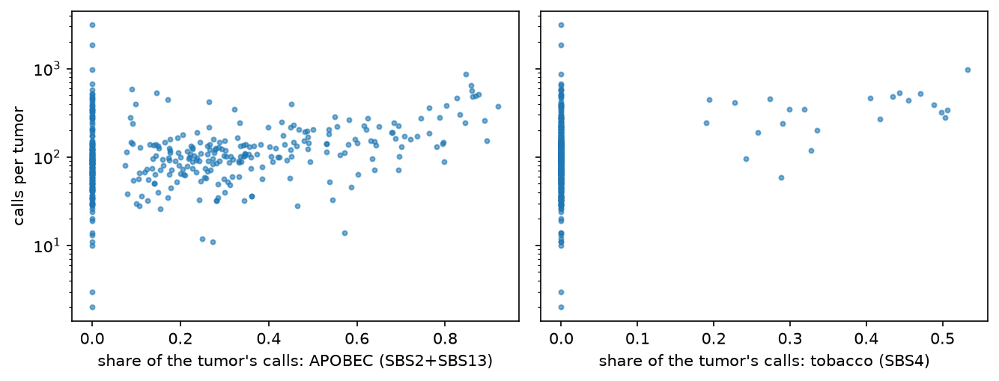
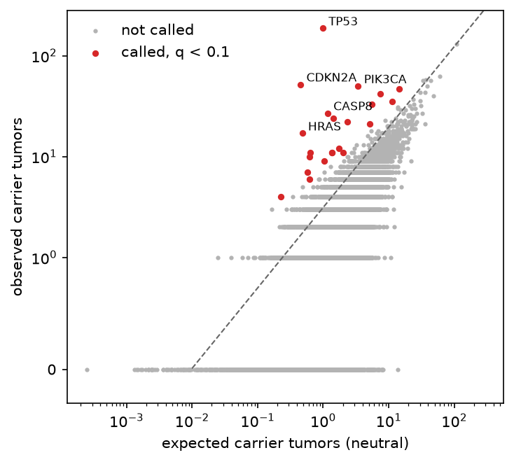

# Selection in head and neck cancer: a first-week tutorial

A mutation that is common in tumors is not necessarily one that
helps tumors grow. It may simply be a mutation that *happens* often:
some DNA sites mutate tens of times faster than others, because of
their sequence context, the mutational processes active in the
tumor (tobacco smoke, the APOBEC enzymes, ultraviolet light, ...)
and where the gene sits in the genome. **sigmutsel** separates the
two. For every tumor it estimates how often each site would mutate
with no selection (the **neutral mutation rate**, `mu`), and then
how many times more often a gene or a variant is found mutated than
that rate predicts (the **selection coefficient**, `gamma`):
`gamma = 1` is neutral, `gamma = 10` means the mutation is found in
tumors ten times as often as its rate alone would put it there.

In this tutorial you will:

1. download a public TCGA cohort (HNSC, head and neck squamous cell
   carcinoma, 410 tumors) and select the right files;
2. build a mutation dataset, with its quality control and the
   mutational-signature decomposition of each tumor;
3. fit the neutral rate model, with gene covariates from Zenodo;
4. read rates per tumor, per gene and per variant;
5. estimate selection for genes and variants, with intervals;
6. make the selection call for every gene (is it selected?) and
   estimate its strength (how strongly?);
7. work through two small research projects: **(a)** a frequent
   mutation that is mostly mutation rate against a rarer one that is
   strongly selected, and **(b)** comparing the strength of selection
   between two groups of tumors (smokers and never-smokers).

Each step says what it does in plain words, what to check, and the
mistakes people make. You need no prior experience with the
package; some Python and pandas, and the idea of a probability
distribution, are enough.

## Before you start

**Install** (Python 3.12, Linux or macOS; a fresh virtual
environment is strongly recommended):

```sh
python3.12 -m venv sigmutsel_env
source sigmutsel_env/bin/activate
pip install git+https://github.com/alfaromurillo/sigmutsel.git \
    git+https://github.com/alfaromurillo/sigmutselcovs.git
sigmutsel-setup        # reference data + the GRCh38 genome, once
sigmutsel-check-data   # every line should say "Found"
```

`sigmutsel-setup` downloads about 300 MB of reference files and
installs SigProfilerMatrixGenerator's GRCh38 genome (about 3 GB; on
our connection it took 18 minutes, most of it the genome). **Do not
skip the genome**: without it nothing fails, but every step that
reads the genome falls back to defaults and the rates come out
different (you would see a `RuntimeWarning: No installed GRCh38
genome`).

To run this file as a notebook, open it in Jupyter with `jupytext`
installed (`pip install jupytext notebook`) or in VS Code; or run it
as a plain script, `python selection_in_hnsc.py`.

**What it costs.** Measured on a desktop (16 cores, of which the fit
uses 4; 100 Mb/s connection). The outputs shown on this page come
from that run.

| step | time | peak memory | disk |
|---|---|---|---|
| download and select MAFs | 1 min | small | 180 MB |
| build the dataset (QC, signatures, opportunities) | 6 min | 12 GB | 1 GB |
| calibration steps (sample QC, spectra, site weights) | 16 min | 16-20 GB | |
| fit the rate model (NUTS, 4 chains) | 47 min (300 components) | under 10 GB | 0.6 GB |
| gammas (each) | 4-8 s | | |
| selection table, every gene | 5 min (4 processes) | | |

**Memory.** One step, the site weights, needs 16-20 GB whatever the
cohort (it holds every coding site of the exome at once; 16 GB in
the run shown here, 20 GB in a run as a script); the rest fits in
12 GB. On a 16 GB laptop set `SITE_WEIGHTS = False` in
step 3: everything runs, and the rates lose the correction for how
detection varies along each exon (fine for learning the package;
use a larger machine for results you report). The first sample QC
parses TCGA's copy-number file (3 minutes); later runs reuse it.


## Chains, cores and `XLA_FLAGS`

The slow step, the fit of the rate model (section 5), samples the
model's posterior with Hamiltonian Monte Carlo (NUTS) in **four
chains**: four independent runs from different starting points,
1,000 draws each, pooled into the 4,000 draws the selection
estimates use. Four rather than one is how convergence is checked:
if the chains agree, they found the same posterior (the R-hat
statistic of section 5 measures it); if they disagree, none of them
can be trusted.

The chains can run **at the same time**, one per CPU core, which
makes the fit several times faster. The sampler (NumPyro, on
JAX) does that only if JAX sees four *devices*. A device here is not
hardware: on a CPU, JAX shows one device unless it is told to split
the CPU into several, which the environment variable `XLA_FLAGS`
below does. It must be set **before anything imports JAX** (sigmutsel
imports it), so it is the first thing the tutorial runs.

- **A machine with 4 or more cores** (most laptops and desktops
  today): keep the setting; the chains run in parallel.
- **Fewer than 4 cores**: the four devices share the cores you have,
  so running them together gains little over one after another;
  the results are the same.
- **Without the setting** (or with fewer devices than chains), JAX
  shows one device, NumPyro warns "There are not enough devices to
  run parallel chains: expected 4 but got 1. Chains will be drawn
  sequentially." and runs the four chains one after another. **The
  posterior is the same**; the fit takes several times longer (in
  one measured case, a small cohort's fit, 639 s instead of 66 s).
  Do not ask for 2 devices: anything below 4 falls back to one at a
  time.

The cell below prints how many cores this Python may use and how
many devices JAX sees: the second number should be 4.

> **If you have an NVIDIA GPU (optional).** Only the fit of section 5
> gains from it; everything else stays on the CPU, and no call
> changes. Three things, before sigmutsel is imported:
>
> 1. install JAX's CUDA build at the version sigmutsel is tested
>    with: `pip install "jax[cuda12]==0.11.0"`;
> 2. run the four chains together on the one GPU: add
>    `os.environ["SIGMUTSEL_CHAIN_METHOD"] = "vectorized"` to the cell
>    below (left at its default, `"parallel"`, NumPyro warns that
>    there are not enough devices and runs the chains one after
>    another);
> 3. do not set `JAX_PLATFORMS=cpu`. `XLA_FLAGS` then does not matter:
>    it splits only the CPU.
>
> `jax.devices()` should then list a CUDA device (section 5's count
> shows 1, which is right here). The posterior is the same as on the
> CPU. On one A100 GPU against four CPU cores, the fit ran 5x faster
> for a cohort with half HNSC's mutation calls and 12x for one with
> twice as many; HNSC itself has not been timed.


```python
import os

# Four JAX devices, one per chain (see above): before JAX is imported.
os.environ.setdefault(
    "XLA_FLAGS", "--xla_force_host_platform_device_count=4"
)

import logging
from pathlib import Path

import matplotlib.pyplot as plt
import numpy as np
import pandas as pd

import sigmutsel
from sigmutsel import Model, MutationDataset

# The package logs every step at INFO; warnings are what to read.
logging.getLogger("sigmutsel").setLevel(logging.WARNING)

PROJECT = "HNSC"
# Everything the tutorial writes goes here (about 2 GB). A relative
# path like "hnsc" is relative to the directory you run from. For a
# fixed place, Path.home() / "sigmutsel_hnsc" works everywhere:
#   Linux    /home/<you>/sigmutsel_hnsc
#   macOS    /Users/<you>/sigmutsel_hnsc
#   Windows  C:\Users\<you>\sigmutsel_hnsc
# or name any directory, e.g. Path("/data/sigmutsel_hnsc"), or on
# Windows Path("D:/sigmutsel_hnsc") (forward slashes work there too).
# sigmutsel is tested on Linux and macOS; on Windows run it in WSL,
# where paths are Linux paths.
WORK = Path("hnsc")
WORK.mkdir(exist_ok=True)
print("sigmutsel", sigmutsel.__version__)

import jax

cores = (
    len(os.sched_getaffinity(0))  # Linux: the cores this process may use
    if hasattr(os, "sched_getaffinity")
    else os.cpu_count()  # macOS
)
print(f"CPU cores: {cores}; JAX devices: {jax.local_device_count()}")


def show(fig, name):
    """Save a figure as WORK/<name>.png and display it in a notebook.

    The signature step imports SigProfilerAssignment, which switches
    matplotlib to a non-interactive backend: after it, figures no longer
    appear by themselves in Jupyter, so show the saved image instead.
    """
    path = WORK / f"{name}.png"
    fig.savefig(path, dpi=150, bbox_inches="tight")
    plt.close(fig)
    try:
        from IPython import get_ipython
        from IPython.display import Image, display
    except ImportError:  # a plain script: the PNG is the figure
        return
    if get_ipython() is not None:
        display(Image(filename=path))
```

    sigmutsel 0.1.1.post234
    CPU cores: 16; JAX devices: 4


## 1. Download and select the mutation calls

The GDC (NCI's Genomic Data Commons) publishes TCGA's somatic
mutation calls as one MAF file (a tab-separated table of mutations)
per sequenced *aliquot*. `download_project_maf_files` finds a
project's open-access MAFs, downloads them over HTTPS and unpacks
them into one flat directory. It needs no account and no extra
program; a rerun only fetches what is missing.


```python
from sigmutsel.download_tcga_data import download_project_maf_files

raw_mafs = WORK / "all_maf_files_raw"
mafs = download_project_maf_files(PROJECT, raw_mafs)
print(len(mafs), "MAF files")
```

    511 MAF files


**Select the files before anything reads them.** One aliquot per
file means the directory also holds recurrent and metastatic
samples, several aliquots of the same patient and patients treated
before the sample was taken. Counted as separate tumors, a patient
with four aliquots makes each of their mutations look recurrent.
`select_tcga_maf_files` keeps primary tumors (TCGA sample types 01
and 03), the newest aliquot of each patient, and drops patients the
GDC records as treated before collection. **Its defaults keep every
aliquot**, so pass the options below.


```python
from sigmutsel.tcga_sample_selection import select_tcga_maf_files

selected = WORK / "all_maf_files"
if not selected.is_dir():
    chosen = select_tcga_maf_files(
        raw_mafs,
        duplicate_policy="newest",
        exclude_prior_treatment=True,
        project=PROJECT,
    )
    selected.mkdir()
    for f in chosen:  # links, so the downloads stay where they are
        (selected / f.name).symlink_to(f.resolve())
print(len(list(selected.glob("*.maf"))), "files selected")
```

    Skipping a2277b1c-8f52-4ba1-aa1c-0b4957f43519.wxs.aliquot_ensemble_masked.maf: no data rows or no Tumor_Sample_Barcode column (likely zero somatic mutations called for this aliquot).


    410 files selected


## 2. Build the dataset

A `MutationDataset` turns the MAFs into everything the model needs.
Four things happen here, and they take about six minutes:

- **Call quality control** (`qc_mode=True`): calls in repeat regions
  (where reads map badly), duplicated calls, and multi-base events
  (doublets, kept aside because the model is about single-base
  substitutions) are removed, and calls on common germline alleles
  (gnomAD frequency above `1.5e-4`) are masked, because the GDC's
  own filter already removes most calls there.
- **Mutational signatures**: each tumor's mutations are decomposed
  into COSMIC signatures (SBS4 tobacco, SBS2/SBS13 APOBEC, SBS1/SBS5
  clock-like, ...). The decomposition runs twice: first unrestricted,
  to find sequencing-artifact mutations and treatment-exposed
  tumors; then restricted to the signatures known in this cancer
  type (`exclude_signature_subgroups=PROJECT`).
- **The channel universe**: each call is placed on its gene's
  transcript and classified as synonymous, missense, nonsense or
  splice, and each gene's **opportunity** (how many sites could
  mutate to each consequence, in each trinucleotide context) is
  counted.
- **The gene universe** (`gene_universe="wes_target"`): every gene
  of the exome capture, mutated in this cohort or not. The default,
  `"own_cohort"`, keeps only mutated genes and inflates the rates of
  a small cohort; always pass `"wes_target"`.

The built dataset is saved, so a rerun of this cell loads it in
seconds.


```python
from sigmutsel.qc import load_repeat_intervals
from sigmutsel.setup import download_repeatmasker_bed

dataset_dir = WORK / f"{PROJECT}_dataset"
if dataset_dir.is_dir():
    dataset = MutationDataset.load_dataset(dataset_dir)
else:
    dataset = MutationDataset(selected, signature_class="SBS")
    dataset.generate_mutation_db(
        qc_mode=True,
        qc_kwargs={
            "repeat_intervals": load_repeat_intervals(
                download_repeatmasker_bed("hg38")
            )
        },
        germline_mask_af=1.5e-4,
    )
    dataset.run_two_pass_signature_decomposition(
        exclude_signature_subgroups=PROJECT,
        treatment_naive=True,
        genome_build="GRCh38",
        exome=True,
        cosmic_version=3.6,
        artifact_threshold=0.5,
        treatment_load_threshold=0.2,
        prevalence_override_min_fraction=0.15,
        min_burden_for_diagnostics=100,
    )
    dataset.build_full_dataset(
        gene_universe="wes_target", regenerate_mutation_db=False
    )
    dataset.save_dataset(dataset_dir)

print(
    dataset.n_samples,
    "tumors,",
    len(dataset.model_db),
    "modelled calls",
)
```

    Dropping:
         Hugo_Symbol  Entrez_Gene_Id Center NCBI_Build Chromosome  Start_Position  \
    3412     Unknown               0     BI     GRCh38      chr21        16071297   
    
          End_Position Strand Variant_Classification Variant_Type  ...  \
    3412      16071297      +                    IGR          SNP  ...   
    
                                       case_id GDC_FILTER COSMIC hotspot  \
    3412  46e51eb2-0c5e-457b-af1a-8bac1b8a8bea        NaN    NaN       N   
    
          RNA_Support RNA_depth RNA_ref_count  RNA_alt_count  \
    3412      Unknown       NaN           NaN            NaN   
    
                        callers  multi_base  
    3412  muse;mutect2;varscan2         NaN  
    
    [1 rows x 141 columns]
    because of gene='Unknown' and/or missing Ensembl gene ID.


    


    ======================================================================
    Two-pass signature decomposition: pass A (unrestricted diagnostic fit)
    ======================================================================
    =======================
    Signature decomposition
    =======================


    Assigning COSMIC sigs or Signature Database ...... 


    [Parallel(n_jobs=16)]: Using backend LokyBackend with 16 concurrent workers.


    [Parallel(n_jobs=16)]: Done  40 tasks      | elapsed:    7.3s


    [Parallel(n_jobs=16)]: Done 130 tasks      | elapsed:   11.7s


    [Parallel(n_jobs=16)]: Done 256 tasks      | elapsed:   17.6s


    [Parallel(n_jobs=16)]: Done 410 out of 410 | elapsed:   24.4s finished


    Probabilities per mutation are only calculated if input_type is "vcf".
    
    
     
    Your Job Is Successfully Completed! Thank You For Using SigProfilerAssignment.
     
    
    
    
    
    


    ====================================================
    Two-pass signature decomposition: pass B (final fit)
    ====================================================
    Assigning COSMIC sigs or Signature Database ...... 


    [Parallel(n_jobs=16)]: Using backend LokyBackend with 16 concurrent workers.


    [Parallel(n_jobs=16)]: Done  40 tasks      | elapsed:    1.0s


    [Parallel(n_jobs=16)]: Done 130 tasks      | elapsed:    2.7s


    [Parallel(n_jobs=16)]: Done 256 tasks      | elapsed:    5.3s


    [Parallel(n_jobs=16)]: Done 392 out of 392 | elapsed:    7.9s finished


    Probabilities per mutation are only calculated if input_type is "vcf".
    
    
     
    Your Job Is Successfully Completed! Thank You For Using SigProfilerAssignment.
     
    
    
    ==================================================
    Mutation data: building compact mutation database.
    ==================================================
    
    ==================================
    Gene presence: computing matrices.
    ==================================


    


    
    
    ==========================================
    Contexts by gene: computing opportunities.
    ==========================================


    
    ==================================================
    Variant data: generating annotations and presence.
    ==================================================


    


    


    
    


    392 tumors, 59453 modelled calls


**What to check.** The number of tumors is a little below the number
of files: tumors whose every call was removed by the QC, or that the
signature step flagged as treatment-exposed, are gone.
`dataset.model_db` is the table of calls the model counts (one row
per call, with its gene, consequence and context); `mutation_db`
also holds the calls outside coding territory, which the model does
not use. Always take calls from `model_db`.


```python
calls = dataset.model_db
calls[
    [
        "Tumor_Sample_Barcode",
        "gene",
        "variant",
        "Variant_Classification",
    ]
].head()
```


<div>
<table border="1" class="dataframe">
  <thead>
    <tr style="text-align: right;">
      <th></th>
      <th>Tumor_Sample_Barcode</th>
      <th>gene</th>
      <th>variant</th>
      <th>Variant_Classification</th>
    </tr>
  </thead>
  <tbody>
    <tr>
      <th>0</th>
      <td>TCGA-F7-A50I-01A-11D-A28R-08</td>
      <td>DISP3</td>
      <td>DISP3 p.V814L</td>
      <td>Missense_Mutation</td>
    </tr>
    <tr>
      <th>1</th>
      <td>TCGA-F7-A50I-01A-11D-A28R-08</td>
      <td>CSMD2</td>
      <td>CSMD2 p.I900T</td>
      <td>Missense_Mutation</td>
    </tr>
    <tr>
      <th>2</th>
      <td>TCGA-F7-A50I-01A-11D-A28R-08</td>
      <td>DNALI1</td>
      <td>DNALI1 p.K32=</td>
      <td>Silent</td>
    </tr>
    <tr>
      <th>3</th>
      <td>TCGA-F7-A50I-01A-11D-A28R-08</td>
      <td>HIVEP3</td>
      <td>HIVEP3 p.P1225L</td>
      <td>Missense_Mutation</td>
    </tr>
    <tr>
      <th>4</th>
      <td>TCGA-F7-A50I-01A-11D-A28R-08</td>
      <td>ADGRL4</td>
      <td>ADGRL4 p.H498Y</td>
      <td>Missense_Mutation</td>
    </tr>
  </tbody>
</table>
</div>


## 3. Calibration steps (once per cohort)

Five more steps finish the dataset. They are separate because each
needs data or choices of its own; all are saved with the dataset.

**Sample QC.** A tumor sample with little tumor in it (low purity),
or whose variant allele fractions do not look like a tumor's, gives
too few calls and would look like a low-rate tumor. Such tumors are
flagged, from TCGA's ABSOLUTE purity and copy-number calls (public,
downloaded once), and left out of every fit below through
`excluded_samples`. This step is TCGA-specific: for other data, use
your own purity estimates or skip it.


```python
from sigmutsel.sample_qc import (
    combine_sample_flags,
    flag_low_purity_samples,
    flag_vaf_shape_samples,
    load_copy_number_segments_from_file,
)
from sigmutsel.setup import (
    download_tcga_absolute_purity,
    download_tcga_absolute_segments,
)

purity = pd.read_csv(download_tcga_absolute_purity(), sep="\t")
segments = load_copy_number_segments_from_file(
    download_tcga_absolute_segments()
)
tumors = dataset.mutation_db["Tumor_Sample_Barcode"].unique()
# The purity table uses shorter barcodes than the MAFs.
short = pd.Series(tumors, index=tumors).str.slice(
    0, len(purity["array"].iloc[0])
)
low_purity = (
    short.map(flag_low_purity_samples(purity))
    .fillna(False)
    .astype(bool)
    .rename("low_purity")
)
vaf_shape = flag_vaf_shape_samples(
    dataset.mutation_db, purity, segments
).reindex(tumors, fill_value=False)
dataset.sample_qc_flags = combine_sample_flags(low_purity, vaf_shape)
EXCLUDED = set(dataset.sample_qc_flags[dataset.sample_qc_flags].index)
print(f"{len(EXCLUDED)} of {len(tumors)} tumors flagged and left out")
```

    WARNING - 15.3% of samples flagged (60/392), above the 5% warn_threshold -- dropping this many samples may be discarding too much of the cohort; consider inverse-variance weighting instead.


    60 of 392 tumors flagged and left out


**The rest**, in one cell:

- repeat regions leave the *opportunity* too, not only the calls
  (a site where no call can be made must not count as a site that
  could mutate);
- each genomic position is assigned to one gene, where genes
  overlap;
- each tumor's mutational **spectrum** (the share of each of the 96
  trinucleotide substitution types) is estimated by shrinking its
  own counts toward the cohort's, by an amount chosen on held-out
  mutations (`select_kappas`); this matters most for tumors with few
  mutations;
- **site weights**: detection is lower near exon ends and differs
  by DNA strand, and the weights correct the opportunity for it,
  fitted on passenger genes;
- homozygous deletions and coding indels are recorded, so that a
  tumor that lost a gene, or hit it by an indel, is not counted as
  evidence that the gene is not selected.


```python
from sigmutsel.channel_universe import load_or_build_transcript_models
from sigmutsel.sample_qc import homozygously_deleted_genes
from sigmutsel.spectrum_shrinkage import (
    heldout_spectrum_scores,
    select_kappas,
)

if not (dataset.channel_universe or {}).get("exclude_repeats"):
    dataset.set_exclude_repeats(True)
if not (dataset.channel_universe or {}).get("exclude_overlaps"):
    dataset.set_exclude_overlaps(True)
if dataset.spectrum_shrinkage is None:
    signatures = dataset.signature_matrix
    if (
        "MutationType" in signatures.columns
    ):  # a freshly built dataset
        signatures = signatures.set_index("MutationType")
    scores = heldout_spectrum_scores(dataset.mutation_db, signatures)
    kept = scores.drop(index=scores.index.intersection(EXCLUDED))
    kept.attrs.update(scores.attrs)
    dataset.set_spectrum_shrinkage(select_kappas(kept))
SITE_WEIGHTS = True  # False on a 16 GB machine (see "Memory" above)
if SITE_WEIGHTS and dataset.site_weights is None:
    Model(
        dataset,
        None,
        cov_effects_per_sigma=False,
        prob_g_tau_tau_independent=False,
    ).estimate_site_weights(excluded_samples=EXCLUDED)
if dataset.homdel_db is None:
    dataset.homdel_db = homozygously_deleted_genes(
        segments, load_or_build_transcript_models(), tumors
    )
if dataset.indel_db is None:
    dataset.build_indel_db()
dataset.save_dataset(dataset_dir, overwrite=True)
print("spectrum shrinkage:", dataset.spectrum_shrinkage.label())
```

    


    


    


    


    


    


    


    


    


    


    


    


    


    


    


    


    Assigning COSMIC sigs or Signature Database ...... 


    [Parallel(n_jobs=16)]: Using backend LokyBackend with 16 concurrent workers.


    [Parallel(n_jobs=16)]: Done  40 tasks      | elapsed:    6.1s


    [Parallel(n_jobs=16)]: Done 130 tasks      | elapsed:    7.8s


    [Parallel(n_jobs=16)]: Done 256 tasks      | elapsed:   10.3s


    [Parallel(n_jobs=16)]: Done 392 out of 392 | elapsed:   12.9s finished


    
    
     
    Your Job Is Successfully Completed! Thank You For Using SigProfilerAssignment.
     


    Assigning COSMIC sigs or Signature Database ...... 


    [Parallel(n_jobs=16)]: Using backend LokyBackend with 16 concurrent workers.


    [Parallel(n_jobs=16)]: Done  40 tasks      | elapsed:    0.8s


    [Parallel(n_jobs=16)]: Done 130 tasks      | elapsed:    2.7s


    [Parallel(n_jobs=16)]: Done 256 tasks      | elapsed:    5.2s


    [Parallel(n_jobs=16)]: Done 392 out of 392 | elapsed:    7.6s finished


    
    
     
    Your Job Is Successfully Completed! Thank You For Using SigProfilerAssignment.
     


    Assigning COSMIC sigs or Signature Database ...... 


    [Parallel(n_jobs=16)]: Using backend LokyBackend with 16 concurrent workers.


    [Parallel(n_jobs=16)]: Done  40 tasks      | elapsed:    0.9s


    [Parallel(n_jobs=16)]: Done 130 tasks      | elapsed:    2.7s


    [Parallel(n_jobs=16)]: Done 256 tasks      | elapsed:    5.0s


    [Parallel(n_jobs=16)]: Done 392 out of 392 | elapsed:    7.4s finished


    
    
     
    Your Job Is Successfully Completed! Thank You For Using SigProfilerAssignment.
     


    Assigning COSMIC sigs or Signature Database ...... 


    [Parallel(n_jobs=16)]: Using backend LokyBackend with 16 concurrent workers.


    [Parallel(n_jobs=16)]: Done  40 tasks      | elapsed:    0.9s


    [Parallel(n_jobs=16)]: Done 130 tasks      | elapsed:    2.7s


    [Parallel(n_jobs=16)]: Done 256 tasks      | elapsed:    5.2s


    [Parallel(n_jobs=16)]: Done 392 out of 392 | elapsed:    7.8s finished


    
    
     
    Your Job Is Successfully Completed! Thank You For Using SigProfilerAssignment.
     


    Assigning COSMIC sigs or Signature Database ...... 


    [Parallel(n_jobs=16)]: Using backend LokyBackend with 16 concurrent workers.


    [Parallel(n_jobs=16)]: Done  40 tasks      | elapsed:    0.9s


    [Parallel(n_jobs=16)]: Done 130 tasks      | elapsed:    2.6s


    [Parallel(n_jobs=16)]: Done 256 tasks      | elapsed:    5.1s


    [Parallel(n_jobs=16)]: Done 392 out of 392 | elapsed:    7.6s finished


    
    
     
    Your Job Is Successfully Completed! Thank You For Using SigProfilerAssignment.
     


    spectrum shrinkage: kappa_1 100, kappa_2 1000


## 4. The tumors: burden and signatures

Before fitting anything, look at the data. Each tumor's number of
calls (its **mutation burden**) and the share of them its signature
decomposition gives to APOBEC (SBS2 + SBS13) and to tobacco (SBS4):


```python
burden = calls.groupby("Tumor_Sample_Barcode").size()
exposures = dataset.sig_assignments.reindex(burden.index).fillna(0)
share = exposures.div(exposures.sum(axis=1), axis=0)
apobec = share.filter(regex=r"^SBS(2|13)$").sum(axis=1)
tobacco = share.get("SBS4", pd.Series(0.0, index=share.index))

fig, axes = plt.subplots(1, 2, figsize=(9, 3.5), sharey=True)
for ax, s, label in (
    (axes[0], apobec, "APOBEC (SBS2+SBS13)"),
    (axes[1], tobacco, "tobacco (SBS4)"),
):
    ax.scatter(s, burden, s=8, alpha=0.6)
    ax.set_yscale("log")
    ax.set_xlabel(f"share of the tumor's calls: {label}")
axes[0].set_ylabel("calls per tumor")
fig.tight_layout()
show(fig, "burden_signatures")
```


    

    


**Reading this.** Each point is a tumor. Burdens span two orders of
magnitude (from a handful of calls to over a thousand), so a single
"cohort rate" would describe almost no tumor: the model gives each
tumor its own rate, from its own burden and spectrum. A group of
tumors gets most of its mutations from APOBEC (left, the points to
the right), another from tobacco (right). APOBEC prefers a C in a
TCW context (W = A or T), and two of the most common mutations of
this cancer, PIK3CA E545K and E542K, are C>T changes in exactly that
context. Keep that in mind for project (a).

## 5. Fit the neutral rate model

The rate of gene `g` in tumor `j` combines:

- the tumor's **spectrum and burden** (from the signatures);
- the gene's **opportunity** (its sites, by context and consequence,
  with the site weights);
- a **covariate** term `exp(c . x_g)`: genes that replicate late or
  sit in closed chromatin mutate faster, and `x_g` are those
  properties of the gene;
- a **channel factor**: non-synonymous sites get their own
  intercept;
- a per-gene **rate correction** `r_g`, learned from the gene's own
  synonymous (silent) mutations, which selection barely touches.

The covariates come ready-made from Zenodo through **sigmutselcovs**:
the principal components of about 5,000 per-gene measurements
(expression, histone marks, chromatin accessibility, replication
timing) for this tissue, plus 0/1 indicators for genes missing part
of them. The production model for HNSC uses the first 300
components (`fitted_n_components` in the record's manifest, chosen
by held-out cross-validation); a smaller number fits faster.


```python
import json

import sigmutselcovs

components = sigmutselcovs.fetch_covariate_matrix(PROJECT)
files = sigmutselcovs.fetch_covariate_artifacts(
    PROJECT, artifacts=("pca_indicators", "pca_manifest")
)
indicators = pd.read_parquet(files["pca_indicators"])
N_COMPONENTS = json.loads(Path(files["pca_manifest"]).read_text())[
    "fitted_n_components"
]
design = pd.concat(
    [components.iloc[:, :N_COMPONENTS], indicators], axis=1
)
genes = dataset.contexts_by_gene.index
print(
    f"{N_COMPONENTS} components; {genes.isin(design.index).sum()} of "
    f"{len(genes)} dataset genes have covariates"
)
```

    INFO - Already present, skipping: cov_matrix_pca.parquet


    INFO - Already present, skipping: pca_indicators.parquet


    INFO - Already present, skipping: pca_manifest.json


    300 components; 19147 of 19147 dataset genes have covariates


Now the model. `prob_g_tau_tau_independent=False` lets the share of
a tumor's mutations that falls in a gene depend on the tumor's
spectrum (the recommended setting; it has no default, and `True`
is an older, simpler model). `assign_cov_matrix` takes the design as given (no
second PCA). `estimate_channel_rg_cov_effects` fits the covariate
effects `c`, the channel intercept and the dispersion `theta` of
`r_g` by Hamiltonian Monte Carlo (NUTS, 4 chains, in parallel if
the first cell printed 4 JAX devices); `sample="full"` keeps the
posterior draws, which the selection estimates below need. This is
the slow step; the fitted model is saved. If it prints "There are
not enough devices to run parallel chains", the chains are running
one after another: the result is the same, only slower (see "Chains,
cores and `XLA_FLAGS`").


```python
model_dir = WORK / f"model_nc{N_COMPONENTS}"
if model_dir.is_dir():
    model = Model.load_model(model_dir)
    # A saved model loads its own copy of the dataset: hand it the
    # tables the selection estimates read.
    for table in ("multi_base_db", "homdel_db", "indel_db"):
        setattr(model.dataset, table, getattr(dataset, table))
    model.dataset.sample_qc_flags = dataset.sample_qc_flags
else:
    model = Model(
        dataset,
        None,
        cov_effects_per_sigma=False,
        prob_g_tau_tau_independent=False,
    )
    model.assign_cov_matrix(design)
    model.compute_channel_base_mus()
    model.estimate_channel_rg_cov_effects(
        excluded_samples=EXCLUDED, include_drivers=True, sample="full"
    )
    model.save_model(model_dir)
print(f"theta = {model.rg_theta:.2f}")
```

    INFO - Suppressed KeyError in PyTensorConfigParser.add for parameter 'cxx'!


    INFO - Suppressed KeyError in PyTensorConfigParser.add for parameter 'gcc_version_str'!


    INFO - Suppressed KeyError in PyTensorConfigParser.add for parameter 'compile__timeout'!


    INFO - Suppressed KeyError in PyTensorConfigParser.add for parameter 'DebugMode__check_c'!


    INFO - Suppressed KeyError in PyTensorConfigParser.add for parameter 'compiledir'!


    INFO - Suppressed KeyError in PyTensorConfigParser.add for parameter 'blas__ldflags'!


    INFO - Found 'auto' as default backend, checking available backends


    INFO - Matplotlib is available, defining as default backend


    INFO - arviz_base 1.2.0 available, exposing its functions as part of the `arviz` namespace


    INFO - arviz_stats 1.2.0 available, exposing its functions as part of the `arviz` namespace


    INFO - arviz_plots 1.2.0 available, exposing its functions as part of the `arviz` namespace


    INFO - Unable to initialize backend 'tpu': INTERNAL: Failed to open libtpu.so: libtpu.so: cannot open shared object file: No such file or directory


    theta = 8.54


**What to check.**

- **Convergence.** The posterior's R-hat: every parameter's should
  be below 1.01 (much above means the chains disagree; rerun with
  more draws, or check the data).
- **`theta`**, the inverse dispersion of `r_g`: large `theta` means
  the covariates leave little gene-to-gene variation unexplained.
- **Fit to held-out data.** The honest check of a rate model is how
  well it predicts mutation counts it has not seen. Here we compute
  the R² of passenger genes' non-silent counts using `r_g` from their
  silent counts only (`compute_r_g_for_evaluation`): the non-silent
  counts were not used to correct the gene's rate, so the model is
  predicting them, not fitting them.


```python
import arviz as az

posterior = model.cov_effects_posteriors
rhat = az.rhat(posterior)
print("max R-hat:", float(max(rhat[v].max() for v in rhat.data_vars)))
r2 = model.estimate_passenger_genes_r2(
    excluded_samples=EXCLUDED,
    target="non_silent_counts",
    gene_scaling=model.compute_r_g_for_evaluation(),
)
print(f"R² of passenger genes' non-silent counts: {r2:.3f}")
```

    max R-hat: 1.005053561897512


    R² of passenger genes' non-silent counts: 0.741


**Common mistakes at this step.**

- Using the *production* `r_g` (`compute_r_g_production`) to judge
  the fit: it is learned from both channels, so it partly predicts
  its own target and the R² looks better than it is.
- Reading R² as the measure of a rate model: a few heavily mutated
  genes carry most of its sum of squares. Compare models by held-out
  likelihood instead (the package's `cross_validation` module).
- Passing a different `excluded_samples` to later steps than to the
  fit: every per-gene sum is over the kept tumors.

## 6. Rates: per tumor, per gene, per variant

**Per gene.** `model.mu_gs` is a genes x tumors table: the expected
number of non-synonymous mutations of each gene in each tumor, from
the spectrum, opportunity, covariates and channel factor. It does
**not** include the gene's own correction `r_g`; multiply by it
yourself (`compute_r_g_for_evaluation` is the one learned from
silent mutations only, the one every selection estimate below uses).


```python
# A call's channel: syn (synonymous), esyn (synonymous at an exon end,
# which can act on splicing), mis (missense), non (nonsense), spl
# (essential splice). The non-silent channels are the last three.
NON_SILENT = ["mis", "non", "spl"]
r_g = model.compute_r_g_for_evaluation()
symbol = calls.drop_duplicates("ensembl_gene_id").set_index("gene")[
    "ensembl_gene_id"
]
kept = [t for t in model.mu_gs.columns if t not in EXCLUDED]
rows = []
for gene in ("TP53", "PIK3CA", "NOTCH1", "TTN", "MUC16"):
    gid = symbol[gene]
    rate = model.mu_gs.loc[gid, kept] * r_g.get(gid, 1.0)
    rows.append(
        {
            "gene": gene,
            "r_g": r_g.get(gid, np.nan),
            "median rate per tumor": rate.median(),
            "expected carriers": (1 - np.exp(-rate)).sum(),
            "observed carriers": calls.loc[
                (calls.gene == gene)
                & calls.channel.isin(NON_SILENT)
                & ~calls.Tumor_Sample_Barcode.isin(EXCLUDED),
                "Tumor_Sample_Barcode",
            ].nunique(),
        }
    )
pd.DataFrame(rows).set_index("gene").round(3)
```


<div>
<table border="1" class="dataframe">
  <thead>
    <tr style="text-align: right;">
      <th></th>
      <th>r_g</th>
      <th>median rate per tumor</th>
      <th>expected carriers</th>
      <th>observed carriers</th>
    </tr>
    <tr>
      <th>gene</th>
      <th></th>
      <th></th>
      <th></th>
      <th></th>
    </tr>
  </thead>
  <tbody>
    <tr>
      <th>TP53</th>
      <td>1.198</td>
      <td>0.003</td>
      <td>1.299</td>
      <td>187</td>
    </tr>
    <tr>
      <th>PIK3CA</th>
      <td>1.015</td>
      <td>0.009</td>
      <td>4.265</td>
      <td>50</td>
    </tr>
    <tr>
      <th>NOTCH1</th>
      <td>1.183</td>
      <td>0.022</td>
      <td>10.591</td>
      <td>42</td>
    </tr>
    <tr>
      <th>TTN</th>
      <td>1.053</td>
      <td>0.451</td>
      <td>136.181</td>
      <td>130</td>
    </tr>
    <tr>
      <th>MUC16</th>
      <td>0.716</td>
      <td>0.204</td>
      <td>78.974</td>
      <td>62</td>
    </tr>
  </tbody>
</table>
</div>


**Reading this.** "Expected carriers" is how many of the kept tumors
would carry at least one non-synonymous mutation in the gene if it
were neutral (a tumor with rate `mu` carries one with probability
`1 - exp(-mu)`). TTN and MUC16 are among the most mutated genes of
every cancer, and their observed counts are near what their length
and late replication predict: they are long, not (much) selected.
TP53 is mutated in about 190 of the 332 kept tumors where neutral
evolution would put a non-synonymous mutation in about one. This
comparison of observed with expected is the whole idea; `gamma`
makes it precise.

**Per variant.** `SiteRates` gives the rate of any single-nucleotide
variant, protein change or splice change in every tumor, whether it
was observed or not, without building a variants x tumors table. A
protein change's rate is the sum over every single-base route to it
(PIK3CA E545K has one; a change with two possible codons has two).
The *observable* rate is the one to compare with calls (a germline-
masked allele can mutate but cannot be called).


```python
from sigmutsel.site_rates import SiteRates

site_rates = SiteRates.from_model(model, r_g="evaluation")
VARIANTS = [
    "PIK3CA p.E545K",
    "PIK3CA p.E542K",
    "PIK3CA p.H1047R",
    "HRAS p.G12S",
    "TP53 p.R248Q",
    "TP53 p.R175H",
]
info, _, observable = site_rates.variant_rates(VARIANTS)
info[["channel", "n_routes", "routes"]]
```


<div>
<table border="1" class="dataframe">
  <thead>
    <tr style="text-align: right;">
      <th></th>
      <th>channel</th>
      <th>n_routes</th>
      <th>routes</th>
    </tr>
    <tr>
      <th>variant</th>
      <th></th>
      <th></th>
      <th></th>
    </tr>
  </thead>
  <tbody>
    <tr>
      <th>PIK3CA p.E545K</th>
      <td>mis</td>
      <td>1</td>
      <td>T[C&gt;T]A</td>
    </tr>
    <tr>
      <th>PIK3CA p.E542K</th>
      <td>mis</td>
      <td>1</td>
      <td>T[C&gt;T]A</td>
    </tr>
    <tr>
      <th>PIK3CA p.H1047R</th>
      <td>mis</td>
      <td>1</td>
      <td>A[T&gt;C]G</td>
    </tr>
    <tr>
      <th>HRAS p.G12S</th>
      <td>mis</td>
      <td>1</td>
      <td>C[C&gt;T]G</td>
    </tr>
    <tr>
      <th>TP53 p.R248Q</th>
      <td>mis</td>
      <td>1</td>
      <td>C[C&gt;T]G</td>
    </tr>
    <tr>
      <th>TP53 p.R175H</th>
      <td>mis</td>
      <td>1</td>
      <td>G[C&gt;T]G</td>
    </tr>
  </tbody>
</table>
</div>


`observable` is variants x tumors. Its sum over the kept tumors is
the number of tumors expected to carry the variant by mutation
alone; the ratio of observed to expected is a first, crude look at
selection.


```python
carriers = (
    calls[~calls.Tumor_Sample_Barcode.isin(EXCLUDED)]
    .groupby("variant")["Tumor_Sample_Barcode"]
    .nunique()
)
kept_obs = observable.loc[:, observable.columns.isin(kept)]
rates = pd.DataFrame(
    {
        "observed carriers": carriers.reindex(VARIANTS).fillna(0),
        "expected carriers": kept_obs.sum(axis=1).to_numpy(),
        "median rate per tumor": kept_obs.median(axis=1).to_numpy(),
    },
    index=VARIANTS,
)
rates["observed / expected"] = (
    rates["observed carriers"] / rates["expected carriers"]
)
rates.style.format("{:.3g}")
```


<style type="text/css">
</style>
<table id="T_65fe9">
  <thead>
    <tr>
      <th class="blank level0" >&nbsp;</th>
      <th id="T_65fe9_level0_col0" class="col_heading level0 col0" >observed carriers</th>
      <th id="T_65fe9_level0_col1" class="col_heading level0 col1" >expected carriers</th>
      <th id="T_65fe9_level0_col2" class="col_heading level0 col2" >median rate per tumor</th>
      <th id="T_65fe9_level0_col3" class="col_heading level0 col3" >observed / expected</th>
    </tr>
  </thead>
  <tbody>
    <tr>
      <th id="T_65fe9_level0_row0" class="row_heading level0 row0" >PIK3CA p.E545K</th>
      <td id="T_65fe9_row0_col0" class="data row0 col0" >12</td>
      <td id="T_65fe9_row0_col1" class="data row0 col1" >0.00278</td>
      <td id="T_65fe9_row0_col2" class="data row0 col2" >4.55e-06</td>
      <td id="T_65fe9_row0_col3" class="data row0 col3" >4.31e+03</td>
    </tr>
    <tr>
      <th id="T_65fe9_level0_row1" class="row_heading level0 row1" >PIK3CA p.E542K</th>
      <td id="T_65fe9_row1_col0" class="data row1 col0" >13</td>
      <td id="T_65fe9_row1_col1" class="data row1 col1" >0.00288</td>
      <td id="T_65fe9_row1_col2" class="data row1 col2" >4.7e-06</td>
      <td id="T_65fe9_row1_col3" class="data row1 col3" >4.52e+03</td>
    </tr>
    <tr>
      <th id="T_65fe9_level0_row2" class="row_heading level0 row2" >PIK3CA p.H1047R</th>
      <td id="T_65fe9_row2_col0" class="data row2 col0" >6</td>
      <td id="T_65fe9_row2_col1" class="data row2 col1" >0.000667</td>
      <td id="T_65fe9_row2_col2" class="data row2 col2" >1.29e-06</td>
      <td id="T_65fe9_row2_col3" class="data row2 col3" >9e+03</td>
    </tr>
    <tr>
      <th id="T_65fe9_level0_row3" class="row_heading level0 row3" >HRAS p.G12S</th>
      <td id="T_65fe9_row3_col0" class="data row3 col0" >3</td>
      <td id="T_65fe9_row3_col1" class="data row3 col1" >0.00223</td>
      <td id="T_65fe9_row3_col2" class="data row3 col2" >5.12e-06</td>
      <td id="T_65fe9_row3_col3" class="data row3 col3" >1.35e+03</td>
    </tr>
    <tr>
      <th id="T_65fe9_level0_row4" class="row_heading level0 row4" >TP53 p.R248Q</th>
      <td id="T_65fe9_row4_col0" class="data row4 col0" >4</td>
      <td id="T_65fe9_row4_col1" class="data row4 col1" >0.00208</td>
      <td id="T_65fe9_row4_col2" class="data row4 col2" >4.8e-06</td>
      <td id="T_65fe9_row4_col3" class="data row4 col3" >1.92e+03</td>
    </tr>
    <tr>
      <th id="T_65fe9_level0_row5" class="row_heading level0 row5" >TP53 p.R175H</th>
      <td id="T_65fe9_row5_col0" class="data row5 col0" >6</td>
      <td id="T_65fe9_row5_col1" class="data row5 col1" >0.00237</td>
      <td id="T_65fe9_row5_col2" class="data row5 col2" >5.83e-06</td>
      <td id="T_65fe9_row5_col3" class="data row5 col3" >2.53e+03</td>
    </tr>
  </tbody>
</table>


**Reading this.** A variant's rate is tiny (a few in a million per
tumor), so even the most frequent variants are expected in a small
fraction of one tumor across the whole cohort (0.003 tumors for
E545K). The ratio is thousands: these are among the most strongly
selected mutations in this cancer. The rates of variants of the
same gene differ: E545K and E542K are C>T changes in a TCA context,
APOBEC's favourite, and mutate about four times faster than H1047R
(an A>G change). Project (a) is about exactly that.

## 7. Selection coefficients for genes and variants

`estimate_gamma` estimates `gamma` for a gene (all its
non-synonymous sites together), a variant, or one consequence
channel of a gene. It compares, tumor by tumor, the probability
that a tumor carries the mutation given its rate and `gamma`, with
whether it does.

**The package's defaults are not the recommended settings** (they
are kept for reproducibility of older analyses). Pass these:


```python
model.estimate_gene_tumor_dispersion(excluded_samples=EXCLUDED)

GAMMA_SETTINGS = dict(
    excluded_samples=EXCLUDED,  # the QC-flagged tumors stay out
    use_mu_posterior=True,  # carry the rate model's uncertainty...
    mu_uncertainty="draws",  # ...exactly, over its posterior draws
    r_g_variant="evaluation",  # r_g from silent mutations only
    gene_tumor_dispersion="fitted",  # tumors differ beyond their rate
)
```

What each setting does:

- `use_mu_posterior=True, mu_uncertainty="draws"`: the rates are
  estimates, not known numbers. With these, gamma's interval
  averages over the rate model's posterior draws (the *cut*), so it
  is wide when the rates are uncertain. Without them the interval
  is too narrow.
- `r_g_variant="evaluation"`: the gene's rate correction from its
  silent mutations. The other one (`"production"`) has seen the
  non-silent mutations, so it would absorb part of the selection it
  is meant to measure.
- `gene_tumor_dispersion="fitted"`: mutations of a gene cluster in
  some tumors more than their rates predict. The dispersion `phi`
  is fitted on passenger genes (`estimate_gene_tumor_dispersion`,
  run above) and switched off where it does not improve held-out
  fit.

Tumors with a homozygous deletion of the gene, a coding indel in
it, or a doublet there are held out automatically (they met the
gene's pressure by an event the rates do not describe). For a
variant, tumors with *another* non-silent mutation in the same gene
are held out too.


```python
from sigmutsel.estimate_gammas import summarize_gamma


def gamma_row(item, **kwargs):
    """One gamma, summarized: posterior mean, 89% interval, carriers."""
    result = model.estimate_gamma(item, **GAMMA_SETTINGS, **kwargs)
    attrs = result.posterior.attrs
    return {
        "item": item
        + (f" ({kwargs['channel']})" if "channel" in kwargs else ""),
        **summarize_gamma(result),
        "carriers": attrs["n_tumors_with"],
        "tumors informative": attrs["n_tumors_informative"],
    }


GENES = [
    "TP53",
    "PIK3CA",
    "CDKN2A",
    "NOTCH1",
    "FAT1",
    "CASP8",
    "HRAS",
    "NSD1",
    "TTN",
    "MUC16",
]
gene_gammas = pd.DataFrame(
    [gamma_row(g, level="gene") for g in GENES]
).set_index("item")
gene_gammas.round(2)
```

    Gamma posterior summary:
          mean   sd eti89_lb eti89_ub  ess_bulk  ess_tail r_hat mcse_mean mcse_sd
    gamma  632  225      350     1000      3941      3884  1.00       3.5     3.8


    Gamma posterior summary:
          mean   sd eti89_lb eti89_ub  ess_bulk  ess_tail r_hat mcse_mean mcse_sd
    gamma   19  7.8       10       33      4115      3973  1.00      0.12    0.16


    Gamma posterior summary:
          mean   sd eti89_lb eti89_ub  ess_bulk  ess_tail r_hat mcse_mean mcse_sd
    gamma  218  110       98      420      3861      3863  1.00       1.8     2.6


    Gamma posterior summary:
           mean    sd eti89_lb eti89_ub  ess_bulk  ess_tail r_hat mcse_mean mcse_sd
    gamma  7.17  2.59        4       12      4130      3639  1.00     0.041   0.045


    Gamma posterior summary:
           mean    sd eti89_lb eti89_ub  ess_bulk  ess_tail r_hat mcse_mean mcse_sd
    gamma  4.27  1.41      2.5      6.8      3417      3728  1.00     0.023   0.028


    Gamma posterior summary:
           mean    sd eti89_lb eti89_ub  ess_bulk  ess_tail r_hat mcse_mean mcse_sd
    gamma  31.3  14.8       15       56      4139      4067  1.00      0.23    0.48


    Gamma posterior summary:
           mean    sd eti89_lb eti89_ub  ess_bulk  ess_tail r_hat mcse_mean mcse_sd
    gamma  44.4  20.6       21       81      3800      3840  1.00      0.34    0.44


    Gamma posterior summary:
          mean   sd eti89_lb eti89_ub  ess_bulk  ess_tail r_hat mcse_mean mcse_sd
    gamma  8.4  3.7        4       15      3817      3825  1.00      0.06   0.088


    Gamma posterior summary:
           mean     sd eti89_lb eti89_ub  ess_bulk  ess_tail r_hat mcse_mean mcse_sd
    gamma  1.46  0.266      1.1      1.9      4083      4076  1.00    0.0042  0.0033


    Gamma posterior summary:
            mean     sd eti89_lb eti89_ub  ess_bulk  ess_tail r_hat mcse_mean mcse_sd
    gamma  1.134  0.292     0.74      1.6      4164      3843  1.00    0.0046  0.0037


<div>
<table border="1" class="dataframe">
  <thead>
    <tr style="text-align: right;">
      <th></th>
      <th>mean</th>
      <th>lower</th>
      <th>upper</th>
      <th>upper_bound_only</th>
      <th>carriers</th>
      <th>tumors informative</th>
    </tr>
    <tr>
      <th>item</th>
      <th></th>
      <th></th>
      <th></th>
      <th></th>
      <th></th>
      <th></th>
    </tr>
  </thead>
  <tbody>
    <tr>
      <th>TP53</th>
      <td>632.27</td>
      <td>347.43</td>
      <td>1041.48</td>
      <td>False</td>
      <td>187</td>
      <td>104</td>
    </tr>
    <tr>
      <th>PIK3CA</th>
      <td>18.98</td>
      <td>10.33</td>
      <td>32.88</td>
      <td>False</td>
      <td>50</td>
      <td>280</td>
    </tr>
    <tr>
      <th>CDKN2A</th>
      <td>218.19</td>
      <td>98.33</td>
      <td>423.40</td>
      <td>False</td>
      <td>52</td>
      <td>197</td>
    </tr>
    <tr>
      <th>NOTCH1</th>
      <td>7.17</td>
      <td>4.00</td>
      <td>11.76</td>
      <td>False</td>
      <td>42</td>
      <td>276</td>
    </tr>
    <tr>
      <th>FAT1</th>
      <td>4.27</td>
      <td>2.45</td>
      <td>6.75</td>
      <td>False</td>
      <td>47</td>
      <td>258</td>
    </tr>
    <tr>
      <th>CASP8</th>
      <td>31.32</td>
      <td>15.30</td>
      <td>56.49</td>
      <td>False</td>
      <td>27</td>
      <td>302</td>
    </tr>
    <tr>
      <th>HRAS</th>
      <td>44.40</td>
      <td>20.86</td>
      <td>80.71</td>
      <td>False</td>
      <td>17</td>
      <td>313</td>
    </tr>
    <tr>
      <th>NSD1</th>
      <td>8.36</td>
      <td>4.03</td>
      <td>14.91</td>
      <td>False</td>
      <td>33</td>
      <td>284</td>
    </tr>
    <tr>
      <th>TTN</th>
      <td>1.46</td>
      <td>1.08</td>
      <td>1.92</td>
      <td>False</td>
      <td>130</td>
      <td>198</td>
    </tr>
    <tr>
      <th>MUC16</th>
      <td>1.13</td>
      <td>0.74</td>
      <td>1.64</td>
      <td>False</td>
      <td>62</td>
      <td>268</td>
    </tr>
  </tbody>
</table>
</div>


**Reading this.** `mean`, `lower` and `upper` are the posterior mean
of gamma and its 89% interval; `tumors informative` are the tumors
without the mutation that entered the fit (the held-out ones are
not). TP53's gamma, about 600, says a TP53 non-silent mutation is
found in tumors about 600 times more often than its rate predicts:
it is the **strength of selection** on the gene (relative to neutral
evolution), comparable to other genes' gammas. MUC16 sits at 1; TTN
at about 1.5, with an interval just above 1. That is a modest
excess, and TTN is not called in section 8: among 19,000 genes
some intervals exclude 1 by chance, and TTN, the longest gene,
is always among the genes one looks at first.

Two cautions. A *gene* gamma averages over all the gene's
non-synonymous sites: for an oncogene, a few selected hotspots
among hundreds of neutral sites give a modest gene gamma (PIK3CA,
HRAS), and its variant gammas are the effect sizes to report. And
one interval above 1 is not a selection call: across 19,000 genes
many neutral genes have intervals above 1 by chance. The call is
section 8.

**Per channel.** For a tumor suppressor, the predicted
loss-of-function channel (`"plof"`: nonsense and essential splice)
carries the selection; the synonymous channel (`"syn"`) is a
control, expected near 1.


```python
channel_gammas = pd.DataFrame(
    [
        gamma_row(g, level="gene", channel=ch)
        for g in ("TP53", "NOTCH1", "PIK3CA")
        for ch in ("mis", "plof", "syn")
    ]
).set_index("item")
channel_gammas.round(2)
```

    Gamma posterior summary:
          mean   sd eti89_lb eti89_ub  ess_bulk  ess_tail r_hat mcse_mean mcse_sd
    gamma  370  131      210      610      3340      3839  1.00       2.1     2.4


    Gamma posterior summary:
            mean     sd eti89_lb eti89_ub  ess_bulk  ess_tail r_hat mcse_mean mcse_sd
    gamma  9e+02  3e+02      530     1600      3638      3835  1.00       5.7     6.5


    Gamma posterior summary:
           mean   sd eti89_lb eti89_ub  ess_bulk  ess_tail r_hat mcse_mean mcse_sd
    gamma  10.7  7.2      2.4       24      3909      3922  1.00      0.11    0.14


    Gamma posterior summary:
           mean    sd eti89_lb eti89_ub  ess_bulk  ess_tail r_hat mcse_mean mcse_sd
    gamma  6.14  2.22      3.4       10      4028      4128  1.00     0.035   0.042


    Gamma posterior summary:
           mean    sd eti89_lb eti89_ub  ess_bulk  ess_tail r_hat mcse_mean mcse_sd
    gamma  22.4  11.4      9.7       42      4061      3761  1.00      0.18    0.34


    Gamma posterior summary:
           mean   sd eti89_lb eti89_ub  ess_bulk  ess_tail r_hat mcse_mean mcse_sd
    gamma  2.04  1.1     0.74        4      3978      3919  1.00     0.017   0.023


    Gamma posterior summary:
           mean   sd eti89_lb eti89_ub  ess_bulk  ess_tail r_hat mcse_mean mcse_sd
    gamma  21.4  8.1       12       36      4345      4084  1.00      0.12    0.13


    Gamma posterior summary:
          mean   sd eti89_lb eti89_ub  ess_bulk  ess_tail r_hat mcse_mean mcse_sd
    gamma  2.8  3.1     0.14      8.6      4118      3796  1.00     0.049   0.097


    Gamma posterior summary:
           mean   sd eti89_lb eti89_ub  ess_bulk  ess_tail r_hat mcse_mean mcse_sd
    gamma  2.74  2.3     0.41      6.8      3883      3606  1.00     0.039   0.067


<div>
<table border="1" class="dataframe">
  <thead>
    <tr style="text-align: right;">
      <th></th>
      <th>mean</th>
      <th>lower</th>
      <th>upper</th>
      <th>upper_bound_only</th>
      <th>carriers</th>
      <th>tumors informative</th>
    </tr>
    <tr>
      <th>item</th>
      <th></th>
      <th></th>
      <th></th>
      <th></th>
      <th></th>
      <th></th>
    </tr>
  </thead>
  <tbody>
    <tr>
      <th>TP53 (mis)</th>
      <td>370.09</td>
      <td>207.40</td>
      <td>608.63</td>
      <td>False</td>
      <td>143</td>
      <td>147</td>
    </tr>
    <tr>
      <th>TP53 (plof)</th>
      <td>939.47</td>
      <td>527.91</td>
      <td>1566.97</td>
      <td>False</td>
      <td>55</td>
      <td>229</td>
    </tr>
    <tr>
      <th>TP53 (syn)</th>
      <td>10.67</td>
      <td>2.43</td>
      <td>24.14</td>
      <td>False</td>
      <td>2</td>
      <td>330</td>
    </tr>
    <tr>
      <th>NOTCH1 (mis)</th>
      <td>6.14</td>
      <td>3.39</td>
      <td>10.02</td>
      <td>False</td>
      <td>34</td>
      <td>284</td>
    </tr>
    <tr>
      <th>NOTCH1 (plof)</th>
      <td>22.45</td>
      <td>9.73</td>
      <td>42.45</td>
      <td>False</td>
      <td>8</td>
      <td>308</td>
    </tr>
    <tr>
      <th>NOTCH1 (syn)</th>
      <td>2.04</td>
      <td>0.74</td>
      <td>4.03</td>
      <td>False</td>
      <td>5</td>
      <td>327</td>
    </tr>
    <tr>
      <th>PIK3CA (mis)</th>
      <td>21.43</td>
      <td>11.66</td>
      <td>36.39</td>
      <td>False</td>
      <td>50</td>
      <td>280</td>
    </tr>
    <tr>
      <th>PIK3CA (plof)</th>
      <td>NaN</td>
      <td>NaN</td>
      <td>8.56</td>
      <td>True</td>
      <td>0</td>
      <td>330</td>
    </tr>
    <tr>
      <th>PIK3CA (syn)</th>
      <td>2.74</td>
      <td>0.41</td>
      <td>6.83</td>
      <td>False</td>
      <td>1</td>
      <td>331</td>
    </tr>
  </tbody>
</table>
</div>


**Reading this.** TP53 is selected on both channels (its hotspot
missense mutations and its truncations). NOTCH1, a tumor suppressor
in this cancer, is selected mostly on `plof` (about 22, against 6 on
missense). PIK3CA, an oncogene, is selected on missense, and its
`plof` channel has no carrier: it is reported as an **upper bound
only** (`mean` and `lower` are NaN), how large gamma can be, not
where it is. The synonymous channel is the control: neutral by
design, so its gamma should cover 1. NOTCH1's and PIK3CA's do. TP53's
does not (about 11, on two carriers): with two calls the interval is
wide, and the usual suspects are synonymous changes that act on
splicing, or chance; it is a flag to look at the two calls, not a
verdict on the rates. A synonymous
gamma well above 1 in *many* genes would mean the rates are off.

**Variants.**


```python
variant_gammas = pd.DataFrame(
    [gamma_row(v, level="variant") for v in VARIANTS]
).set_index("item")
variant_gammas.round(0)
```

    Gamma posterior summary:
            mean     sd eti89_lb eti89_ub  ess_bulk  ess_tail r_hat mcse_mean mcse_sd
    gamma  7e+03  3e+03     3100    12000      4051      4047  1.00        49      59


    Gamma posterior summary:
            mean     sd eti89_lb eti89_ub  ess_bulk  ess_tail r_hat mcse_mean mcse_sd
    gamma  7e+03  4e+03     3300    14000      4144      3962  1.00        58      84


    Gamma posterior summary:
            mean     sd eti89_lb eti89_ub  ess_bulk  ess_tail r_hat mcse_mean mcse_sd
    gamma  1e+04  8e+03     5300    27000      4042      3915  1.00       120     170


    Gamma posterior summary:
            mean     sd eti89_lb eti89_ub  ess_bulk  ess_tail r_hat mcse_mean mcse_sd
    gamma  2e+03  1e+03      600     4900      3903      3889  1.00        23      30


    Gamma posterior summary:
            mean     sd eti89_lb eti89_ub  ess_bulk  ess_tail r_hat mcse_mean mcse_sd
    gamma  9e+03  6e+03     3200    20000      3944      4145  1.00        88     110


    Gamma posterior summary:
            mean     sd eti89_lb eti89_ub  ess_bulk  ess_tail r_hat mcse_mean mcse_sd
    gamma  1e+04  7e+03     4900    25000      4154      3672  1.00       110     140


<div>
<table border="1" class="dataframe">
  <thead>
    <tr style="text-align: right;">
      <th></th>
      <th>mean</th>
      <th>lower</th>
      <th>upper</th>
      <th>upper_bound_only</th>
      <th>carriers</th>
      <th>tumors informative</th>
    </tr>
    <tr>
      <th>item</th>
      <th></th>
      <th></th>
      <th></th>
      <th></th>
      <th></th>
      <th></th>
    </tr>
  </thead>
  <tbody>
    <tr>
      <th>PIK3CA p.E545K</th>
      <td>6686.0</td>
      <td>3059.0</td>
      <td>12238.0</td>
      <td>False</td>
      <td>12</td>
      <td>280</td>
    </tr>
    <tr>
      <th>PIK3CA p.E542K</th>
      <td>7384.0</td>
      <td>3303.0</td>
      <td>13908.0</td>
      <td>False</td>
      <td>13</td>
      <td>280</td>
    </tr>
    <tr>
      <th>PIK3CA p.H1047R</th>
      <td>13864.0</td>
      <td>5298.0</td>
      <td>27326.0</td>
      <td>False</td>
      <td>6</td>
      <td>280</td>
    </tr>
    <tr>
      <th>HRAS p.G12S</th>
      <td>2205.0</td>
      <td>604.0</td>
      <td>4934.0</td>
      <td>False</td>
      <td>3</td>
      <td>313</td>
    </tr>
    <tr>
      <th>TP53 p.R248Q</th>
      <td>9443.0</td>
      <td>3181.0</td>
      <td>20114.0</td>
      <td>False</td>
      <td>4</td>
      <td>104</td>
    </tr>
    <tr>
      <th>TP53 p.R175H</th>
      <td>12625.0</td>
      <td>4866.0</td>
      <td>25083.0</td>
      <td>False</td>
      <td>6</td>
      <td>104</td>
    </tr>
  </tbody>
</table>
</div>


```python
fig, ax = plt.subplots(figsize=(6, 4.5))
table = pd.concat([gene_gammas, variant_gammas])
y = np.arange(len(table))[::-1]
ax.errorbar(
    table["mean"],
    y,
    xerr=[
        table["mean"] - table["lower"],
        table["upper"] - table["mean"],
    ],
    fmt="o",
    ms=4,
    capsize=2,
)
ax.axvline(1, color="0.6", lw=1, ls="--")
ax.set_xscale("log")
ax.set_yticks(y, table.index)
ax.set_xlabel("gamma (posterior mean, 89% interval)")
fig.tight_layout()
show(fig, "gammas")
```


    

    


**Reading this.** The horizontal axis is logarithmic: the dashed
line is neutral (gamma = 1). Genes sit between about 1 and several
hundred (TP53, CDKN2A); hotspot variants at thousands, because a
variant gamma measures selection on one site, not averaged over a
gene's hundreds of sites. Intervals are wide for variants with few
carriers (HRAS G12S has three).

## 8. Is a gene selected, and how strongly?

Two questions, two answers, in one table over every gene:

- **The call.** A test of the null hypothesis that the gene is
  neutral (`gamma = 1`): how surprising its number of carrier tumors
  is under its rates, integrating over the uncertainty of `r_g`
  (`p_mid`, the mid-p-value), then Benjamini-Hochberg over all genes
  (`q`). `called` is `q < 0.1`.
- **The strength.** Gamma's posterior under an **empirical-Bayes
  prior**: a spike near 1 (most genes are neutral) plus a slab for
  the selected ones, both fitted on this cohort's genes. This
  shrinks the gammas of genes with little information toward 1, so
  they can be compared across genes (`eb_median`, `eb_lower`,
  `eb_upper`); `eb_p_above` is the posterior probability that gamma
  exceeds 2. The flat-prior interval (`flat_*`) is kept beside it,
  as an estimate only, never as a call.

It takes a few minutes (it runs every gene; `n_jobs` processes).


```python
selection = model.gene_selection_table(
    excluded_samples=EXCLUDED, fdr=0.1, n_jobs=4
)
gene_of = calls.drop_duplicates("ensembl_gene_id").set_index(
    "ensembl_gene_id"
)["gene"]
selection.insert(0, "gene", gene_of.reindex(selection.index))
called = selection[selection.called].sort_values("q")
print(f"{len(called)} of {len(selection)} genes called at q < 0.1")
called[
    [
        "gene",
        "n_tumors_with",
        "expected_with",
        "q",
        "eb_median",
        "eb_lower",
        "eb_upper",
        "flat_median",
    ]
].head(20).round(3)
```

    22 of 19147 genes called at q < 0.1


<div>
<table border="1" class="dataframe">
  <thead>
    <tr style="text-align: right;">
      <th></th>
      <th>gene</th>
      <th>n_tumors_with</th>
      <th>expected_with</th>
      <th>q</th>
      <th>eb_median</th>
      <th>eb_lower</th>
      <th>eb_upper</th>
      <th>flat_median</th>
    </tr>
    <tr>
      <th>gene_id</th>
      <th></th>
      <th></th>
      <th></th>
      <th></th>
      <th></th>
      <th></th>
      <th></th>
      <th></th>
    </tr>
  </thead>
  <tbody>
    <tr>
      <th>ENSG00000064012</th>
      <td>CASP8</td>
      <td>27</td>
      <td>1.170</td>
      <td>0.000</td>
      <td>25.826</td>
      <td>13.901</td>
      <td>51.761</td>
      <td>27.939</td>
    </tr>
    <tr>
      <th>ENSG00000121879</th>
      <td>PIK3CA</td>
      <td>50</td>
      <td>3.419</td>
      <td>0.000</td>
      <td>17.106</td>
      <td>9.807</td>
      <td>31.187</td>
      <td>17.843</td>
    </tr>
    <tr>
      <th>ENSG00000141510</th>
      <td>TP53</td>
      <td>187</td>
      <td>0.987</td>
      <td>0.000</td>
      <td>581.074</td>
      <td>344.410</td>
      <td>1011.634</td>
      <td>587.164</td>
    </tr>
    <tr>
      <th>ENSG00000147889</th>
      <td>CDKN2A</td>
      <td>52</td>
      <td>0.453</td>
      <td>0.000</td>
      <td>183.965</td>
      <td>95.587</td>
      <td>417.449</td>
      <td>189.566</td>
    </tr>
    <tr>
      <th>ENSG00000174775</th>
      <td>HRAS</td>
      <td>17</td>
      <td>0.480</td>
      <td>0.000</td>
      <td>35.483</td>
      <td>17.882</td>
      <td>74.162</td>
      <td>40.074</td>
    </tr>
    <tr>
      <th>ENSG00000116044</th>
      <td>NFE2L2</td>
      <td>24</td>
      <td>1.435</td>
      <td>0.000</td>
      <td>17.842</td>
      <td>9.560</td>
      <td>36.329</td>
      <td>19.417</td>
    </tr>
    <tr>
      <th>ENSG00000148400</th>
      <td>NOTCH1</td>
      <td>42</td>
      <td>7.365</td>
      <td>0.000</td>
      <td>6.432</td>
      <td>3.981</td>
      <td>11.389</td>
      <td>6.665</td>
    </tr>
    <tr>
      <th>ENSG00000109670</th>
      <td>FBXW7</td>
      <td>22</td>
      <td>2.339</td>
      <td>0.000</td>
      <td>9.901</td>
      <td>5.516</td>
      <td>18.872</td>
      <td>10.727</td>
    </tr>
    <tr>
      <th>ENSG00000234745</th>
      <td>HLA-B</td>
      <td>11</td>
      <td>0.633</td>
      <td>0.000</td>
      <td>17.593</td>
      <td>8.121</td>
      <td>38.999</td>
      <td>21.103</td>
    </tr>
    <tr>
      <th>ENSG00000165671</th>
      <td>NSD1</td>
      <td>33</td>
      <td>5.578</td>
      <td>0.000</td>
      <td>7.216</td>
      <td>4.014</td>
      <td>14.154</td>
      <td>7.569</td>
    </tr>
    <tr>
      <th>ENSG00000206503</th>
      <td>HLA-A</td>
      <td>10</td>
      <td>0.614</td>
      <td>0.000</td>
      <td>16.059</td>
      <td>7.333</td>
      <td>36.391</td>
      <td>19.571</td>
    </tr>
    <tr>
      <th>ENSG00000083857</th>
      <td>FAT1</td>
      <td>47</td>
      <td>14.327</td>
      <td>0.001</td>
      <td>3.929</td>
      <td>2.393</td>
      <td>6.780</td>
      <td>4.014</td>
    </tr>
    <tr>
      <th>ENSG00000129474</th>
      <td>AJUBA</td>
      <td>11</td>
      <td>1.367</td>
      <td>0.003</td>
      <td>8.051</td>
      <td>3.131</td>
      <td>17.309</td>
      <td>9.327</td>
    </tr>
    <tr>
      <th>ENSG00000163513</th>
      <td>TGFBR2</td>
      <td>11</td>
      <td>1.374</td>
      <td>0.003</td>
      <td>7.967</td>
      <td>3.399</td>
      <td>16.628</td>
      <td>9.224</td>
    </tr>
    <tr>
      <th>ENSG00000079999</th>
      <td>KEAP1</td>
      <td>12</td>
      <td>1.741</td>
      <td>0.005</td>
      <td>6.838</td>
      <td>1.061</td>
      <td>13.850</td>
      <td>7.766</td>
    </tr>
    <tr>
      <th>ENSG00000136238</th>
      <td>RAC1</td>
      <td>7</td>
      <td>0.569</td>
      <td>0.007</td>
      <td>10.845</td>
      <td>1.040</td>
      <td>25.553</td>
      <td>14.317</td>
    </tr>
    <tr>
      <th>ENSG00000172819</th>
      <td>RARG</td>
      <td>9</td>
      <td>1.033</td>
      <td>0.008</td>
      <td>8.332</td>
      <td>1.038</td>
      <td>18.579</td>
      <td>10.110</td>
    </tr>
    <tr>
      <th>ENSG00000100393</th>
      <td>EP300</td>
      <td>21</td>
      <td>5.194</td>
      <td>0.044</td>
      <td>4.354</td>
      <td>1.034</td>
      <td>8.547</td>
      <td>4.599</td>
    </tr>
    <tr>
      <th>ENSG00000167548</th>
      <td>KMT2D</td>
      <td>35</td>
      <td>11.233</td>
      <td>0.044</td>
      <td>3.648</td>
      <td>1.057</td>
      <td>6.540</td>
      <td>3.746</td>
    </tr>
    <tr>
      <th>ENSG00000130538</th>
      <td>OR11H1</td>
      <td>6</td>
      <td>0.622</td>
      <td>0.065</td>
      <td>6.653</td>
      <td>1.008</td>
      <td>19.449</td>
      <td>11.486</td>
    </tr>
  </tbody>
</table>
</div>


**Reading this table.** `n_tumors_with` are the carriers and
`expected_with` the carriers expected under neutrality. The genes at
the top are the known drivers of head and neck cancer (TP53, CDKN2A,
PIK3CA, CASP8, HRAS, NFE2L2, NOTCH1, FBXW7, NSD1, FAT1, HLA-A/B,
...). Compare
`eb_median` with `flat_median`: for a strongly selected gene with
many carriers they agree; for a gene with few carriers the EB
estimate is pulled toward 1. That is intended: across thousands of
genes, the flat estimates of genes with little data scatter widely
by chance, and the prior, learned from all genes, says how much.

**What to check.** Known passengers (TTN, MUC16) should not be
called, and are not. Near the bottom of the list there are genes
you will not find in a cancer gene list: OR11H1 (an olfactory
receptor), and past the 20 rows shown (`called.tail(3)`) NEK5 and
CGB8 (one of a cluster of near-identical copies). OR11H1 and CGB8
belong to multi-copy families, where reads map to the wrong copy
and calls pile up. A called gene you do not recognise is a gene to examine
(its calls, its rates, its paralogs), not yet a discovery.


```python
fig, ax = plt.subplots(figsize=(5, 4.5))
ax.scatter(
    selection.expected_with,
    selection.n_tumors_with,
    s=4,
    color="0.7",
    label="not called",
)
ax.scatter(
    called.expected_with,
    called.n_tumors_with,
    s=12,
    color="C3",
    label="called, q < 0.1",
)
# Label the five strongest calls; the rest are red dots.
for _, r in called.head(5).iterrows():
    ax.annotate(
        r.gene,
        (r.expected_with, r.n_tumors_with),
        fontsize=8,
        xytext=(4, 2),
        textcoords="offset points",
    )
top = max(selection.n_tumors_with.max(), 1) * 1.5
ax.plot([0.01, top], [0.01, top], color="0.4", lw=1, ls="--")
ax.set_xscale("log")
# symlog: logarithmic above 1, linear below, so 0 carriers can show.
ax.set_yscale("symlog", linthresh=1)
ax.set_ylim(-0.3, top)
ax.set_xlabel("expected carrier tumors (neutral)")
ax.set_ylabel("observed carrier tumors")
ax.legend(frameon=False, loc="upper left")
fig.tight_layout()
show(fig, "selection_called")
```


    

    


**Reading this.** One point per gene. The dashed line is "observed =
expected": a neutral gene scatters around it, more widely at small
counts. Called genes sit far above it. Long genes (to the right) can
have many carriers and still sit on the line.

## 9. Project (a): frequency is not selection

Suppose a published paper ranked the mutations of head and neck
cancer by how often they occur, and called the most frequent the
most important. PIK3CA has three classic hotspots: E545K and E542K
in the helical domain, H1047R in the kinase domain. Which is the
most frequent, which mutates fastest, and which is the most strongly
selected?


```python
pik3ca = ["PIK3CA p.E545K", "PIK3CA p.E542K", "PIK3CA p.H1047R"]
project_a = rates.loc[
    pik3ca, ["observed carriers", "expected carriers"]
]
project_a = project_a.join(
    variant_gammas.loc[pik3ca, ["mean", "lower", "upper"]]
)
project_a.columns = [
    "carriers",
    "expected (neutral)",
    "gamma",
    "gamma lower",
    "gamma upper",
]
project_a.style.format("{:.3g}")
```


<style type="text/css">
</style>
<table id="T_71de3">
  <thead>
    <tr>
      <th class="blank level0" >&nbsp;</th>
      <th id="T_71de3_level0_col0" class="col_heading level0 col0" >carriers</th>
      <th id="T_71de3_level0_col1" class="col_heading level0 col1" >expected (neutral)</th>
      <th id="T_71de3_level0_col2" class="col_heading level0 col2" >gamma</th>
      <th id="T_71de3_level0_col3" class="col_heading level0 col3" >gamma lower</th>
      <th id="T_71de3_level0_col4" class="col_heading level0 col4" >gamma upper</th>
    </tr>
  </thead>
  <tbody>
    <tr>
      <th id="T_71de3_level0_row0" class="row_heading level0 row0" >PIK3CA p.E545K</th>
      <td id="T_71de3_row0_col0" class="data row0 col0" >12</td>
      <td id="T_71de3_row0_col1" class="data row0 col1" >0.00278</td>
      <td id="T_71de3_row0_col2" class="data row0 col2" >6.69e+03</td>
      <td id="T_71de3_row0_col3" class="data row0 col3" >3.06e+03</td>
      <td id="T_71de3_row0_col4" class="data row0 col4" >1.22e+04</td>
    </tr>
    <tr>
      <th id="T_71de3_level0_row1" class="row_heading level0 row1" >PIK3CA p.E542K</th>
      <td id="T_71de3_row1_col0" class="data row1 col0" >13</td>
      <td id="T_71de3_row1_col1" class="data row1 col1" >0.00288</td>
      <td id="T_71de3_row1_col2" class="data row1 col2" >7.38e+03</td>
      <td id="T_71de3_row1_col3" class="data row1 col3" >3.3e+03</td>
      <td id="T_71de3_row1_col4" class="data row1 col4" >1.39e+04</td>
    </tr>
    <tr>
      <th id="T_71de3_level0_row2" class="row_heading level0 row2" >PIK3CA p.H1047R</th>
      <td id="T_71de3_row2_col0" class="data row2 col0" >6</td>
      <td id="T_71de3_row2_col1" class="data row2 col1" >0.000667</td>
      <td id="T_71de3_row2_col2" class="data row2 col2" >1.39e+04</td>
      <td id="T_71de3_row2_col3" class="data row2 col3" >5.3e+03</td>
      <td id="T_71de3_row2_col4" class="data row2 col4" >2.73e+04</td>
    </tr>
  </tbody>
</table>


```python
fig, axes = plt.subplots(1, 3, figsize=(9, 2.8), sharey=True)
y = np.arange(len(pik3ca))[::-1]
labels = [v.split()[1] for v in pik3ca]
axes[0].barh(y, project_a["carriers"])
axes[0].set_xlabel("carrier tumors")
axes[1].barh(y, project_a["expected (neutral)"])
axes[1].set_xlabel("expected by mutation alone")
axes[2].errorbar(
    project_a["gamma"],
    y,
    xerr=[
        project_a["gamma"] - project_a["gamma lower"],
        project_a["gamma upper"] - project_a["gamma"],
    ],
    fmt="o",
    capsize=2,
)
axes[2].set_xlabel("gamma (89% interval)")
axes[0].set_yticks(y, labels)
fig.tight_layout()
show(fig, "pik3ca_hotspots")
```


    

    


**Reading this.** The two helical-domain hotspots are the frequent
ones (12 and 13 carriers), and the kinase-domain H1047R has half as
many (6). But E545K and E542K mutate about four times faster: they
are C>T changes in APOBEC's TCA context, and APOBEC is active in
many of these tumors (section 4). Once each is divided by its own
neutral rate, H1047R comes out the *most* strongly selected, about
twice the helical ones. Its interval overlaps theirs, so how sure is
that? From the posterior draws:


```python
draws = {
    v: np.asarray(model.gammas[v].posterior["gamma"]).ravel()
    for v in pik3ca
}
rng = np.random.default_rng(0)
for other in ("PIK3CA p.E545K", "PIK3CA p.E542K"):
    ratio = draws["PIK3CA p.H1047R"] / rng.permutation(draws[other])
    lo, hi = np.percentile(ratio, [5.5, 94.5])
    print(
        f"H1047R / {other.split()[1]}: {np.median(ratio):.2f} "
        f"[{lo:.2f}, {hi:.2f}], P(H1047R stronger) = "
        f"{(ratio > 1).mean():.2f}"
    )
```

    H1047R / p.E545K: 1.98 [0.69, 5.77], P(H1047R stronger) = 0.85
    H1047R / p.E542K: 1.86 [0.61, 5.34], P(H1047R stronger) = 0.81


The posterior favours stronger selection on H1047R, but with six
carriers it does not settle it: a frequency ranking puts the three
in the opposite order to the selection ranking, and the honest
statement is "H1047R is at least as strongly selected as the
helical hotspots despite being half as frequent". (The draws of two
gammas are paired at random: they share the rate model's
uncertainty, which this ignores, so the interval is if anything too
wide.) That frequency and strength of selection part ways in head
and neck cancer, and that APOBEC deaminates the E545K and E542K
sites, was shown with cancereffectsizeR's method by Cannataro et al.
(2019, *Oncogene* 38:3475-3487, doi:10.1038/s41388-018-0657-6): read
it beside this project.

**How to turn this into a letter.** State the claim you test (the
paper's ranking by frequency), show frequency, neutral expectation
and gamma side by side as here, for the paper's own variants, and
report gamma with its interval. Check that your conclusion does not
depend on one setting: refit with fewer covariate components, and
with `gene_tumor_dispersion=None`; a robust difference survives
both. And say what gamma is not: it is selection relative to the
variant's own neutral rate, under this rate model; a variant gamma
is conditional on the site-level rate model (sites recur somewhat
more often than it predicts), so read a difference of less than
about a factor of two between two variants with care.

## 10. Project (b): selection in two groups of tumors

Does selection on a gene differ between smokers and never-smokers?
A paper that compares *mutation frequencies* between the groups
cannot tell: smokers' tumors carry more mutations everywhere, so a
gene is mutated more often in them even with the same selection.
Gamma removes that, because each tumor's rate includes its own
burden and spectrum (tobacco's SBS4 included).

**Step 1: the groups**, from the GDC's clinical data (public, no
account): `tobacco_smoking_status` of each patient.


```python
import requests

response = requests.post(
    "https://api.gdc.cancer.gov/cases",
    json={
        "filters": {
            "op": "in",
            "content": {
                "field": "project.project_id",
                "value": [f"TCGA-{PROJECT}"],
            },
        },
        "fields": "submitter_id,exposures.tobacco_smoking_status",
        "size": 2000,
    },
    timeout=60,
)
status = {
    case["submitter_id"]: (case.get("exposures") or [{}])[0].get(
        "tobacco_smoking_status"
    )
    for case in response.json()["data"]["hits"]
}
patient = pd.Series(kept, index=kept).str.slice(0, 12)
smoking = patient.map(status)
groups = {
    "never": set(smoking.index[smoking == "Lifelong Non-Smoker"]),
    "smoker": set(
        smoking.index[smoking.str.startswith("Current", na=False)]
    ),
}
print(
    {name: len(tumors) for name, tumors in groups.items()},
    "| status unknown:",
    int(
        (
            ~smoking.index.isin(groups["never"] | groups["smoker"])
        ).sum()
    ),
)
```

    {'never': 74, 'smoker': 250} | status unknown: 8


**Step 2: one rate model, two gammas.** The rate model above was
fitted on all tumors; it already gives every tumor its own rates.
A group's gamma is estimated on that group's tumors alone, by
excluding everyone else. **Do not fit a separate rate model per
group**: the covariate effects and `r_g` are properties of genes,
best estimated on all tumors, and a small group's own fit would
make its rates noisier, not more specific.


```python
def group_gamma(item, level, group, **kwargs):
    """Gamma of ``item`` on one group's tumors: its posterior draws."""
    others = set(kept) - groups[group]
    settings = {
        **GAMMA_SETTINGS,
        "excluded_samples": EXCLUDED | others,
    }
    result = model.estimate_gamma(
        item, level=level, store=False, **settings, **kwargs
    )
    return np.asarray(result.posterior["gamma"]).ravel(), result


rows = []
for item, level in [
    ("TP53", "gene"),
    ("CDKN2A", "gene"),
    ("PIK3CA", "gene"),
    ("NOTCH1", "gene"),
    ("PIK3CA p.E545K", "variant"),
]:
    draws, row = {}, {"item": item}
    for group in groups:
        draws[group], result = group_gamma(item, level, group)
        s = summarize_gamma(result)
        row[f"{group} gamma"] = s["mean"]
        row[f"{group} 89%"] = f"[{s['lower']:.1f}, {s['upper']:.1f}]"
        row[f"{group} carriers"] = result.posterior.attrs[
            "n_tumors_with"
        ]
    # The ratio of the two gammas, from independent draws of each.
    log_ratio = np.log(draws["smoker"]) - np.log(
        np.random.default_rng(0).permutation(draws["never"])
    )
    lo, hi = np.exp(np.percentile(log_ratio, [5.5, 94.5]))
    row["smoker / never"] = float(np.exp(np.median(log_ratio)))
    row["ratio 89%"] = f"[{lo:.2f}, {hi:.2f}]"
    row["P(smoker > never)"] = float((log_ratio > 0).mean())
    rows.append(row)
group_table = pd.DataFrame(rows).set_index("item")
group_table
```

    Gamma posterior summary:
          mean   sd eti89_lb eti89_ub  ess_bulk  ess_tail r_hat mcse_mean mcse_sd
    gamma  464  182      240      780      4215      4100  1.00       2.8     3.8


    Gamma posterior summary:
          mean     sd eti89_lb eti89_ub  ess_bulk  ess_tail r_hat mcse_mean mcse_sd
    gamma  656  2e+02      370     1100      3836      3753  1.00         4       5


    Gamma posterior summary:
          mean     sd eti89_lb eti89_ub  ess_bulk  ess_tail r_hat mcse_mean mcse_sd
    gamma  379  2e+02      130      790      3958      3973  1.00       3.6     5.5


    Gamma posterior summary:
          mean   sd eti89_lb eti89_ub  ess_bulk  ess_tail r_hat mcse_mean mcse_sd
    gamma  202  103       86      390      3959      4082  1.00       1.6       2


    Gamma posterior summary:
           mean   sd eti89_lb eti89_ub  ess_bulk  ess_tail r_hat mcse_mean mcse_sd
    gamma  14.6  7.8      6.1       29      4019      3424  1.00      0.12    0.17


    Gamma posterior summary:
           mean sd eti89_lb eti89_ub  ess_bulk  ess_tail r_hat mcse_mean mcse_sd
    gamma  20.7  9       11       36      4015      3789  1.00      0.14    0.27


    Gamma posterior summary:
          mean   sd eti89_lb eti89_ub  ess_bulk  ess_tail r_hat mcse_mean mcse_sd
    gamma  9.5  4.3      4.3       17      4159      3943  1.00     0.067   0.075


    Gamma posterior summary:
           mean    sd eti89_lb eti89_ub  ess_bulk  ess_tail r_hat mcse_mean mcse_sd
    gamma  6.73  2.48      3.6       11      4161      3921  1.00     0.039   0.039


    Gamma posterior summary:
            mean     sd eti89_lb eti89_ub  ess_bulk  ess_tail r_hat mcse_mean mcse_sd
    gamma  5e+03  4e+03     1200    11000      3808      3867  1.00        58      86


    Gamma posterior summary:
            mean     sd eti89_lb eti89_ub  ess_bulk  ess_tail r_hat mcse_mean mcse_sd
    gamma  8e+03  4e+03     3600    16000      4175      3923  1.00        69     110


<div>
<table border="1" class="dataframe">
  <thead>
    <tr style="text-align: right;">
      <th></th>
      <th>never gamma</th>
      <th>never 89%</th>
      <th>never carriers</th>
      <th>smoker gamma</th>
      <th>smoker 89%</th>
      <th>smoker carriers</th>
      <th>smoker / never</th>
      <th>ratio 89%</th>
      <th>P(smoker &gt; never)</th>
    </tr>
    <tr>
      <th>item</th>
      <th></th>
      <th></th>
      <th></th>
      <th></th>
      <th></th>
      <th></th>
      <th></th>
      <th></th>
      <th></th>
    </tr>
  </thead>
  <tbody>
    <tr>
      <th>TP53</th>
      <td>464.407817</td>
      <td>[244.3, 783.3]</td>
      <td>41</td>
      <td>656.202629</td>
      <td>[367.7, 1084.8]</td>
      <td>141</td>
      <td>1.427698</td>
      <td>[0.64, 3.16]</td>
      <td>0.7595</td>
    </tr>
    <tr>
      <th>CDKN2A</th>
      <td>378.886547</td>
      <td>[129.0, 791.4]</td>
      <td>14</td>
      <td>202.307724</td>
      <td>[85.6, 392.2]</td>
      <td>36</td>
      <td>0.549696</td>
      <td>[0.18, 1.83]</td>
      <td>0.2055</td>
    </tr>
    <tr>
      <th>PIK3CA</th>
      <td>14.632251</td>
      <td>[6.1, 29.4]</td>
      <td>8</td>
      <td>20.693411</td>
      <td>[10.6, 36.1]</td>
      <td>41</td>
      <td>1.466358</td>
      <td>[0.55, 4.18]</td>
      <td>0.7385</td>
    </tr>
    <tr>
      <th>NOTCH1</th>
      <td>9.469448</td>
      <td>[4.3, 17.1]</td>
      <td>11</td>
      <td>6.732207</td>
      <td>[3.6, 11.3]</td>
      <td>30</td>
      <td>0.727986</td>
      <td>[0.30, 1.77]</td>
      <td>0.2920</td>
    </tr>
    <tr>
      <th>PIK3CA p.E545K</th>
      <td>4900.502330</td>
      <td>[1200.9, 11099.1]</td>
      <td>2</td>
      <td>8361.761042</td>
      <td>[3570.7, 15859.4]</td>
      <td>10</td>
      <td>1.859273</td>
      <td>[0.52, 7.69]</td>
      <td>0.7780</td>
    </tr>
  </tbody>
</table>
</div>


**Reading this.** No ratio's interval excludes 1. TP53's gamma is
somewhat higher in smokers and CDKN2A's in never-smokers, but the
intervals run from about half to two or three times: with 74
never-smokers (and, for E545K, two carriers among them), this cohort
cannot tell these genes' selection apart between the groups. That
is a result worth reporting as it is ("no evidence of a difference,
and differences up to threefold cannot be excluded"), and it is
what a frequency comparison hides: TP53 is mutated in 56% of the
smokers' tumors and 55% of the never-smokers', and the gamma
comparison says that similar frequency is consistent with similar
selection, given each tumor's rates.

**How the uncertainty is computed, and what it leaves out.** The
ratio's interval comes from pairing independent draws of the two
groups' posteriors. Both gammas share the same rate model, and its
uncertainty (the covariate effects, `r_g`) moves both the same way;
pairing independent draws ignores that shared part, which makes
the ratio's interval somewhat *wider* than it should be. So a ratio
whose interval excludes 1 here is a conservative finding. A
`P(smoker > never)` near 0.5 means no evidence of a difference,
not evidence of no difference: check the interval's width before
writing "the same".

**Common mistakes in group comparisons.**

- Comparing frequencies (or the fraction of tumors mutated) between
  groups whose burdens differ.
- Comparing two groups' gammas from two separately fitted rate
  models: their difference then mixes selection with the two fits'
  differences.
- Forgetting confounders. In head and neck cancer, never-smokers
  are enriched for HPV-positive tumors, whose biology differs
  (HPV's E6 protein degrades p53, so TP53 mutations are rarely
  needed). A smoker/never-smoker difference in TP53 selection may be
  an HPV difference. Compare within HPV-negative tumors before
  attributing it to tobacco.
- Testing many genes and reporting the few with intervals excluding
  1: correct for the number of genes compared, or decide the genes
  before looking.

## 11. Reading the output correctly: a checklist

- **Gamma is the strength of selection**: how many times more
  often a mutation is found in tumors than its neutral rate
  predicts. It is not a probability of being a driver, not the
  mutation's fitness effect in absolute units, and not its
  "impact" on the patient.
- **Frequency is rate times selection.** A frequent mutation can be
  a fast-mutating site under modest selection; a rare one can be a
  slow site under strong selection. Always show the rate.
- **Compare genes with the EB estimates** (`eb_*`), not the flat
  ones; decide "selected or not" with `called` (`q`), not with an
  interval.
- **Gene gamma vs variant gamma.** For oncogenes, read variant (or
  missense-channel) gammas; for tumor suppressors, the `plof`
  channel.
- **A variant seen in one tumor** has a gamma set almost entirely
  by its rate (about 1/rate): ranking singletons by gamma ranks
  them by how slowly they mutate.
- **Near-neutral variant gammas are biased upward** by the
  same-gene hold-out (tumors with another hit in the gene leave the
  variant's absent set, and those are high-burden tumors): read a
  variant gamma of a few as possibly neutral.
- **mu_gs does not include r_g**; multiply by
  `compute_r_g_for_evaluation()` yourself.
- **QC consistency**: pass the same `excluded_samples` everywhere.

## 12. What next: project ideas

Each of these is a summer project with this tutorial's tools.

1. **A letter on a frequency-based claim.** Find a published paper
   that ranks or compares mutations by frequency (or calls the most
   frequent mutation the main driver) and redo its comparison with
   rates and gammas, as in project (a).
2. **Selection by group.** Smokers and never-smokers in lung
   adenocarcinoma (`LUAD`; a larger cohort: run it on a server),
   young and old patients (`diagnoses.age_at_diagnosis` in the same
   GDC query), sexes, HPV status in head and neck cancer, molecular
   subtypes. Which genes' gammas differ, and which differences
   survive a confounder?
3. **APOBEC hotspots across cancers.** PIK3CA E545K/E542K in
   bladder (`BLCA`), cervical (`CESC`), breast (`BRCA`) and head and
   neck cancer: does the helical/kinase difference hold everywhere?
4. **The synonymous control.** Estimate the `syn` channel gamma for
   the 50 most mutated genes of a cohort. Which are above 1, and
   why (splicing, mapping, a rate error)?
5. **A cohort outside TCGA.** Any GRCh38 MAF works; skip the
   TCGA-specific sample QC, and give covariates with sigmutselcovs
   (`project_genes` places your genes in a TCGA cohort's
   components).

## Troubleshooting

- `RuntimeWarning: No installed GRCh38 genome`: run
  `sigmutsel-setup` (or `python -c "from sigmutsel.setup import
  install_reference_genome; install_reference_genome()"`), then
  rebuild the dataset: one built without the genome has other
  opportunities.
- `FileNotFoundError: ... not found ... python -m sigmutsel setup`:
  reference data missing; `sigmutsel-check-data` lists what is.
- The fit warns "There are not enough devices to run parallel
  chains" (and the first cell printed `JAX devices: 1`): `XLA_FLAGS`
  was set after JAX was imported, which happens when cells run out
  of order. Restart the kernel and run the first cell first; or
  leave it, since the chains then run one after another with the
  same result, only slower.
- Killed / out of memory during the dataset build: the build peaks
  at about 12 GB for this cohort; use a smaller cohort, or a
  machine with more memory.
- A gamma raises `ValueError`: the item is not in the dataset (check
  the spelling, `"GENE p.X123Y"`, and that it has a call in a kept
  tumor) or the gene has no rate.
- `estimate_gamma` returns quickly with a huge gamma and
  `likelihood_saturated` in its attributes: the data cannot bound
  it from above (all carriers, almost no rate); report it as a lower
  bound.
