# Selection in head and neck cancer: a first-week tutorial

A mutation that is common in tumors is not necessarily one that
helps tumors grow. It may simply be a mutation that *happens* often:
some DNA sites mutate tens of times faster than others, because of
their sequence context, the mutational processes active in the
tumor (tobacco smoke, the APOBEC family of DNA-editing enzymes,
ultraviolet light, ...)
and where the gene sits in the genome. **sigmutsel** separates the
two. For every tumor it estimates how often each site would mutate
with no selection (the **neutral mutation rate**, `mu`), and then
how many times more often a gene or a variant is found mutated than
that rate predicts (the **selection coefficient**, `gamma`):
`gamma = 1` is neutral, `gamma = 10` means the mutation is found in
tumors ten times as often as its rate alone would put it there.

In this tutorial you will:

1. download a public cohort of The Cancer Genome Atlas (TCGA): HNSC,
   head and neck squamous cell carcinoma, 410 tumors; and choose the
   right files;
2. build a mutation dataset, with its quality control and the
   mutational-signature decomposition of each tumor;
3. fit the neutral rate model, with gene covariates from Zenodo;
4. read rates per tumor, per gene and per variant;
5. estimate selection for genes and variants, with intervals;
6. make the selection call for every gene (is it selected?) and
   estimate its strength (how strongly?);
7. work through two small research projects: **(a)** a frequent
   mutation that is mostly mutation rate against a rarer one that is
   strongly selected, and **(b)** comparing the strength of selection
   between two groups of tumors (HPV-positive and HPV-negative).

Each step says what it does in plain words, what to check, and the
mistakes people make. You need no prior experience with the
package; some Python and pandas, and the idea of a probability
distribution, are enough.

## Before you start

**Install** (Python 3.12, Linux or macOS; a fresh virtual
environment is strongly recommended):

```sh
python3.12 -m venv sigmutsel_env
source sigmutsel_env/bin/activate
pip install git+https://github.com/alfaromurillo/sigmutsel.git \
    git+https://github.com/alfaromurillo/sigmutselcovs.git
sigmutsel-setup        # reference data + the GRCh38 genome, once
sigmutsel-check-data   # every line should say "Found"
```

`sigmutsel-setup` downloads about 300 MB of reference files and
installs SigProfilerMatrixGenerator's GRCh38 genome (about 3 GB; on
our connection it took 18 minutes, most of it the genome). **Do not
skip the genome**: without it nothing fails, but every step that
reads the genome falls back to defaults and the rates come out
different (you would see a `RuntimeWarning: No installed GRCh38
genome`).

To run this file as a notebook, open it in Jupyter with `jupytext`
installed (`pip install jupytext notebook`) or in VS Code; or run it
as a plain script, `python selection_in_hnsc.py`.

**What it costs.** Measured on a desktop (16 cores, of which the fit
uses 4; 100 Mb/s connection). The outputs shown on this page come
from that run.

| step | time | peak memory | disk |
|---|---|---|---|
| download and choose the mutation files (MAFs) | 1 min | small | 180 MB |
| build the dataset (quality control, signatures, opportunities) | 6 min | 12 GB | 1 GB |
| calibration steps (sample quality control, spectra, site weights) | 16 min | 16-20 GB | |
| fit the rate model (Hamiltonian Monte Carlo, 4 chains) | 47 min (300 components; 4 min on a GPU) | under 10 GB | 0.6 GB |
| gammas (each) | 4-8 s | | |
| selection table, every gene | 5 min (4 processes) | | |

**Memory.** One step, the site weights, needs 16-20 GB whatever the
cohort (it holds every coding site of the exome at once; 16 GB in the
run shown here, 20 GB in a run as a script); the rest fits in 12 GB.
On a 16 GB laptop set `SITE_WEIGHTS = False` in step 3: everything
runs, and the rates lose the correction for how detection varies along
each exon (fine for learning the package; use a larger machine for
results you report). The first sample quality control (QC) parses
TCGA's copy-number file (3 minutes); later runs reuse it.

## 0. Set up the session

Three things before any analysis: the sampler's chains, the
libraries, and where the tutorial writes its files.

### Chains, cores and `XLA_FLAGS`

The slow step, the fit of the rate model (section 5), samples the
model's posterior with Hamiltonian Monte Carlo (NUTS, the No-U-Turn
Sampler) in **four chains**: four independent runs from different
starting points, 1,000 draws each, pooled into the 4,000 draws the
selection estimates use. Four rather than one is how convergence is
checked: if the chains agree, they found the same posterior (the R-hat
statistic of section 5, which compares the spread between chains with
the spread within them, measures it); if they disagree, none of them
can be trusted.

The chains can run **at the same time**, one per processor (CPU) core,
which makes the fit several times faster. The sampler (NumPyro, built
on JAX, a library for numerical computing) does that only if JAX sees
four *devices*. A device here is not hardware: on a CPU, JAX shows one
device unless it is told to split the CPU into several, which the
environment variable `XLA_FLAGS` below does (XLA is the compiler JAX
runs on). It must be set **before anything imports JAX** (sigmutsel
imports it), so it is the first thing the tutorial runs.

- **A machine with 4 or more cores** (most laptops and desktops
  today): keep the setting; the chains run in parallel.
- **Fewer than 4 cores**: the four devices share the cores you have,
  so running them together gains little over one after another;
  the results are the same.
- **Without the setting** (or with fewer devices than chains), JAX
  shows one device, NumPyro warns "There are not enough devices to
  run parallel chains: expected 4 but got 1. Chains will be drawn
  sequentially." and runs the four chains one after another. **The
  posterior is the same**; the fit takes several times longer (in
  one measured case, a small cohort's fit, 639 s instead of 66 s).
  Do not ask for 2 devices: anything below 4 falls back to one at a
  time.

The cell below sets it and prints how many cores this Python may
use; section 5 checks, just before the fit, that JAX sees the four
devices. (JAX is not imported here: imported this early, it warns
when the signature step starts worker processes.)

> **If you have an NVIDIA GPU (graphics processor; optional).** Only
> the fit of section 5 gains from it; everything else stays on the
> CPU, and no call changes. Three things, before sigmutsel is
> imported:
>
> 1. install JAX's build for CUDA (NVIDIA's GPU software) at the
>    version sigmutsel is tested with: `pip install
>    "jax[cuda12]==0.11.0"`;
> 2. run the four chains together on the one GPU: add
>    `os.environ["SIGMUTSEL_CHAIN_METHOD"] = "vectorized"` to the cell
>    below (left at its default, `"parallel"`, NumPyro warns that
>    there are not enough devices and runs the chains one after
>    another);
> 3. do not set `JAX_PLATFORMS=cpu`. `XLA_FLAGS` then does not matter:
>    it splits only the CPU.
>
> `jax.devices()` should then list a CUDA device (section 5's count
> shows 1, which is right here). For this cohort, on one NVIDIA A100,
> the sampling took 4 minutes instead of 47 on four CPU cores (11x),
> with the same posterior; the per-variant rates computed at the end
> of the step stay on the CPU.


```python
import os

# Four JAX devices, one per chain: before anything imports JAX.
os.environ.setdefault(
    "XLA_FLAGS", "--xla_force_host_platform_device_count=4"
)

# The cores this Python may use (Linux; elsewhere, all the machine's).
cores = (
    len(os.sched_getaffinity(0))
    if hasattr(os, "sched_getaffinity")
    else os.cpu_count()
)
print(f"CPU cores: {cores}")
```

    CPU cores: 8


### Import the libraries

sigmutsel prints only warnings, the messages worth reading. To
follow the long steps as they run, add
`logging.basicConfig(level=logging.INFO)` (after `import logging`)
to this cell: every step then reports what it is doing.


```python
from pathlib import Path  # file paths that work on every system

import matplotlib.pyplot as plt  # figures
import numpy as np  # arrays and numerical functions
import pandas as pd  # tables (DataFrames): every result is one

import sigmutsel
import sigmutsel.constants  # package-wide settings, the seed below
from sigmutsel import Model, MutationDataset  # the two main objects

# A fixed seed makes the sampling reproducible: the rate model's fit
# and the draws behind every gamma give the same numbers on every run.
# Left at None (the default), each run differs slightly, by the Monte
# Carlo error.
sigmutsel.constants.random_seed = 0

print("sigmutsel", sigmutsel.__version__)
```

    sigmutsel 0.1.1.post234


### Where the tutorial writes its files

Everything the tutorial downloads and computes goes in one
directory, about 2 GB: the MAF files, the dataset, the fitted model.
A rerun finds them there and skips what is done.


```python
PROJECT = "HNSC"  # the TCGA cohort

# A relative path like "hnsc" is relative to the directory you run
# from. For a fixed place, Path.home() / "sigmutsel_hnsc" works
# everywhere:
#   Linux    /home/<you>/sigmutsel_hnsc
#   macOS    /Users/<you>/sigmutsel_hnsc
#   Windows  C:\Users\<you>\sigmutsel_hnsc
# or name any directory, e.g. Path("/data/sigmutsel_hnsc"), or on
# Windows Path("D:/sigmutsel_hnsc") (forward slashes work there too).
# sigmutsel is tested on Linux and macOS; on Windows run it in WSL,
# where paths are Linux paths.
WORK = Path("hnsc")
WORK.mkdir(exist_ok=True)
```

## 1. Download the mutation calls and choose the files

The GDC (Genomic Data Commons of the US National Cancer Institute)
publishes TCGA's somatic mutation calls as one MAF file (Mutation
Annotation Format: a tab-separated table of mutations)
per sequenced *aliquot*. `download_project_maf_files` finds a
project's open-access MAFs, downloads them over HTTPS and unpacks
them into one flat directory. It needs no account and no extra
program.


```python
from sigmutsel.download_tcga_data import download_project_maf_files

raw_maf_dir = WORK / "all_maf_files_raw"
mafs = download_project_maf_files(PROJECT, raw_maf_dir)
print(len(mafs), "MAF files")
```

    511 MAF files


**Rerunning is safe.** Running a cell again (a *rerun*: after a
lost connection, a restarted kernel, or the next day) does not
repeat the work: the files already in `raw_maf_dir`, checked against
the GDC's sizes, are skipped, and only what is missing is fetched.
Calling the download a second time shows it: it lists the GDC's
files again, finds them all on disk and returns in seconds. Most
steps below behave the same way: they look in `WORK` first.


```python
import time

start = time.time()
mafs = download_project_maf_files(PROJECT, raw_maf_dir)  # a rerun
print(f"{len(mafs)} MAF files in {time.time() - start:.0f} s")
```

    511 MAF files in 1 s


**Choose the files before anything reads them.** One aliquot per
file means the directory also holds recurrent and metastatic
samples, several aliquots of the same patient and patients treated
before the sample was taken. Counted as separate tumors, a patient
with four aliquots makes each of their mutations look recurrent.
`select_tcga_maf_files` keeps primary tumors (TCGA sample types 01
and 03), the newest aliquot of each patient, and drops patients the
GDC records as treated before collection. **Its defaults keep every
aliquot**, so pass the options below.


```python
from sigmutsel.tcga_sample_selection import select_tcga_maf_files

maf_dir = WORK / "all_maf_files"  # the MAFs the dataset reads
# The first time, this directory does not exist yet: the files are
# chosen and it is created. On a rerun it exists and is left as it is.
if not maf_dir.is_dir():
    chosen = select_tcga_maf_files(
        raw_maf_dir,
        duplicate_policy="newest",
        exclude_prior_treatment=True,
        project=PROJECT,
    )
    maf_dir.mkdir()
    for f in chosen:  # links, so the downloads stay where they are
        (maf_dir / f.name).symlink_to(f.resolve())
print(len(list(maf_dir.glob("*.maf"))), "files chosen")
```

    410 files chosen


## 2. Build the dataset

A `MutationDataset` turns the MAFs into everything the model needs.
Four things happen here, and they take about six minutes:

- **Call quality control** (`qc_mode=True`): calls in repeat regions
  (where reads map badly), duplicated calls, and multi-base events
  (doublets, kept aside because the model is about single-base
  substitutions) are removed, and calls on common germline alleles
  (frequency above `1.5e-4` in gnomAD, the Genome Aggregation
  Database) are masked, because the GDC's
  own filter already removes most calls there.
- **Mutational signatures**: each tumor's mutations are decomposed
  into the single-base substitution (SBS) signatures of COSMIC, the
  Catalogue Of Somatic Mutations In Cancer (SBS4 tobacco, SBS2 and
  SBS13 APOBEC, SBS1 and SBS5 clock-like, ...). The decomposition runs
  twice: first unrestricted, to find sequencing-artifact mutations and
  treatment-exposed tumors; then restricted to the signatures known in
  this cancer type (`exclude_signature_subgroups=PROJECT`).
- **The channel universe**: each call is placed on its gene's
  transcript and classified as synonymous, missense, nonsense or
  splice, and each gene's **opportunity** (how many sites could
  mutate to each consequence, in each trinucleotide context) is
  counted.
- **The gene universe** (`gene_universe="wes_target"`, the default,
  written out below so you see it): every gene of the exome
  capture, mutated in this cohort or not.

The built dataset is saved, so a rerun of this cell loads it in
seconds.


```python
from sigmutsel.qc import load_repeat_intervals
from sigmutsel.setup import download_repeatmasker_bed

dataset_dir = WORK / f"{PROJECT}_dataset"
if dataset_dir.is_dir():
    dataset = MutationDataset.load_dataset(dataset_dir)
else:
    dataset = MutationDataset(maf_dir, signature_class="SBS")
    dataset.generate_mutation_db(
        qc_mode=True,
        qc_kwargs={
            "repeat_intervals": load_repeat_intervals(
                download_repeatmasker_bed("hg38")
            )
        },
        germline_mask_af=1.5e-4,
    )
    dataset.run_two_pass_signature_decomposition(
        exclude_signature_subgroups=PROJECT,
        treatment_naive=True,
        genome_build="GRCh38",
        exome=True,
        cosmic_version=3.6,
        artifact_threshold=0.5,
        treatment_load_threshold=0.2,
        prevalence_override_min_fraction=0.15,
        min_burden_for_diagnostics=100,
    )
    # Keeps the calls the signature step cleaned (it rebuilds them
    # from the MAFs only if none are loaded).
    dataset.build_full_dataset(gene_universe="wes_target")
    dataset.save_dataset(dataset_dir)

print(
    dataset.n_samples,
    "tumors,",
    len(dataset.model_db),
    "modelled calls",
)
```

    392 tumors, 59453 modelled calls


**What to check.** The number of tumors is a little below the number
of files: tumors whose every call was removed by the QC, or that the
signature step flagged as treatment-exposed, are gone.
`dataset.model_db` is the table of calls the model counts (one row
per call, with its gene, consequence and context); `mutation_db`
also holds the calls outside coding territory, which the model does
not use. Always take calls from `model_db`.


```python
calls = dataset.model_db
calls[
    [
        "Tumor_Sample_Barcode",
        "gene",
        "variant",
        "Variant_Classification",
    ]
].head()
```


<div>
<table border="1" class="dataframe">
  <thead>
    <tr style="text-align: right;">
      <th></th>
      <th>Tumor_Sample_Barcode</th>
      <th>gene</th>
      <th>variant</th>
      <th>Variant_Classification</th>
    </tr>
  </thead>
  <tbody>
    <tr>
      <th>0</th>
      <td>TCGA-F7-A50I-01A-11D-A28R-08</td>
      <td>DISP3</td>
      <td>DISP3 p.V814L</td>
      <td>Missense_Mutation</td>
    </tr>
    <tr>
      <th>1</th>
      <td>TCGA-F7-A50I-01A-11D-A28R-08</td>
      <td>CSMD2</td>
      <td>CSMD2 p.I900T</td>
      <td>Missense_Mutation</td>
    </tr>
    <tr>
      <th>2</th>
      <td>TCGA-F7-A50I-01A-11D-A28R-08</td>
      <td>DNALI1</td>
      <td>DNALI1 p.K32=</td>
      <td>Silent</td>
    </tr>
    <tr>
      <th>3</th>
      <td>TCGA-F7-A50I-01A-11D-A28R-08</td>
      <td>HIVEP3</td>
      <td>HIVEP3 p.P1225L</td>
      <td>Missense_Mutation</td>
    </tr>
    <tr>
      <th>4</th>
      <td>TCGA-F7-A50I-01A-11D-A28R-08</td>
      <td>ADGRL4</td>
      <td>ADGRL4 p.H498Y</td>
      <td>Missense_Mutation</td>
    </tr>
  </tbody>
</table>
</div>


```python
# What each quality-control step removed, summed over the tumors (the
# dataset keeps a ledger of it: one row per tumor and step).
STEP_LABELS = {
    "not_snv": "not a single-base substitution (indels)",
    "invalid_chromosome": "invalid chromosome",
    "invalid_allele": "invalid allele",
    "invalid_context": "invalid context",
    "duplicate_record": "duplicate record",
    "germline_variant_site": "at a common germline site",
    "merged_into_dbs_variant": "part of a doublet (set aside)",
    "merged_with_nearby_variant": "merged with a nearby call",
    "repetitive_region": "in a repeat region",
    "compact_failed": "no gene",
    "treatment_signature_sample": "tumor exposed to treatment",
    "artifact_signature_mutation": "sequencing-artifact signature",
}
ledger = dataset.qc_ledger
removed = (
    ledger[
        (ledger["level"] == "calls") & (ledger["step"] != "maf_rows")
    ]
    .groupby(["order", "step"])["n"]
    .sum()
    .droplevel("order")  # sorted in the order the steps run
)
removed = removed[removed > 0]
total = ledger.loc[ledger["step"] == "maf_rows", "n"].sum()

fig, ax = plt.subplots(figsize=(8, 0.35 * len(removed) + 1))
labels = [
    STEP_LABELS.get(step, step.replace("_", " "))
    for step in removed.index
]
ax.barh(labels, removed.to_numpy(), color="C0")
ax.invert_yaxis()  # the first step on top
ax.set_xscale("log")
ax.set_xlabel("calls removed or set aside, all tumors")
fig.tight_layout()
plt.show()
print(f"{total:,} calls in the MAF files, {len(calls):,} modelled")
```


    
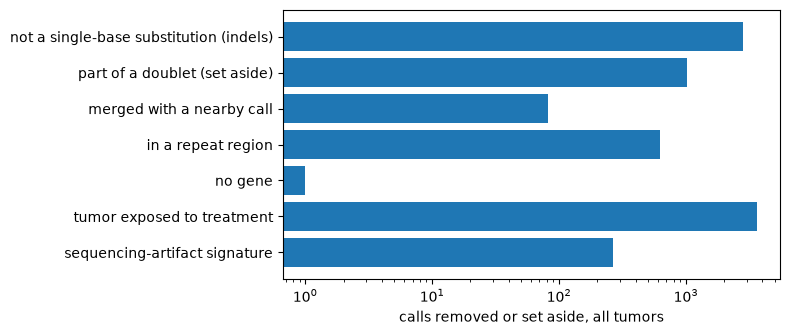
    


    69,489 calls in the MAF files, 59,453 modelled


**Reading the figure.** One bar per quality-control step, in the order
the steps run, on a logarithmic axis: what each removed from the MAF
files' calls, over all tumors. Calls that are not single-base
substitutions (insertions and deletions) are not modelled. Calls that
are part of a doublet are set aside, not discarded: the selection
estimates use them later. The last two bars come from the signature
step: every call of a tumor it found treatment-exposed, and the calls
it attributed to a sequencing-artifact signature. A step that removes
a large share in your own data is the first thing to look into.

## 3. Calibration steps (once per cohort)

Five more steps finish the dataset. They are separate because each
needs data or choices of its own; all are saved with the dataset.

**Sample QC.** A tumor sample with little tumor in it (low purity),
or whose variant allele fractions do not look like a tumor's, gives
too few calls and would look like a low-rate tumor. Such tumors are
flagged, from TCGA's purity and copy-number calls (made with the
ABSOLUTE method; public,
downloaded once), and left out of every fit below through
`excluded_samples`. This step is TCGA-specific: for other data, use
your own purity estimates or skip it.


```python
from sigmutsel.sample_qc import (
    combine_sample_flags,
    flag_low_purity_samples,
    flag_vaf_shape_samples,
    load_copy_number_segments_from_file,
)
from sigmutsel.setup import (
    download_tcga_absolute_purity,
    download_tcga_absolute_segments,
)

purity = pd.read_csv(download_tcga_absolute_purity(), sep="\t")
segments = load_copy_number_segments_from_file(
    download_tcga_absolute_segments()
)
tumors = dataset.mutation_db["Tumor_Sample_Barcode"].unique()
# The purity table uses shorter barcodes than the MAFs.
short = pd.Series(tumors, index=tumors).str.slice(
    0, len(purity["array"].iloc[0])
)
low_purity = (
    short.map(flag_low_purity_samples(purity))
    .fillna(False)
    .astype(bool)
    .rename("low_purity")
)
vaf_shape = flag_vaf_shape_samples(
    dataset.mutation_db, purity, segments
).reindex(tumors, fill_value=False)
dataset.sample_qc_flags = combine_sample_flags(low_purity, vaf_shape)
EXCLUDED = set(dataset.sample_qc_flags[dataset.sample_qc_flags].index)
print(f"{len(EXCLUDED)} of {len(tumors)} tumors flagged and left out")
```

    15.3% of samples flagged (60/392), above the 5% warn_threshold -- dropping this many samples may be discarding too much of the cohort; consider inverse-variance weighting instead.


    60 of 392 tumors flagged and left out


```python
# Purity against burden, one point per tumor, the flagged ones in red.
calls_per_tumor = dataset.mutation_db.groupby(
    "Tumor_Sample_Barcode"
).size()
tumor_purity = short.map(
    purity.drop_duplicates("array").set_index("array")["purity"]
)
flagged = dataset.sample_qc_flags.reindex(tumors, fill_value=False)
fig, ax = plt.subplots(figsize=(5.5, 4))
for keep, color, label in (
    (True, "C0", "kept"),
    (False, "C3", "flagged"),
):
    group = tumors[(~flagged.to_numpy()) == keep]
    ax.scatter(
        tumor_purity.reindex(group),
        calls_per_tumor.reindex(group),
        s=10 if keep else 16,
        alpha=0.6 if keep else 0.9,
        color=color,
        label=label,
    )
ax.axvline(0.30, color="0.6", lw=1, ls="--")  # the purity threshold
ax.set_yscale("log")
ax.set_xlabel("tumor purity (ABSOLUTE)")
ax.set_ylabel("calls per tumor")
ax.legend(frameon=False, loc="upper left", bbox_to_anchor=(1, 1))
fig.tight_layout()
plt.show()
```


    
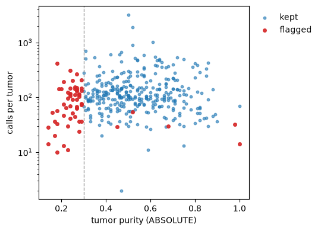
    


**Reading the figure.** Each point is a tumor (those without a purity
estimate are not shown). Left of the dashed line, purity below 0.30:
so little of the sample is tumor that many of its mutations fall
below the caller's detection, and the tumor would pass for a slowly
mutating one. Red points right of the line are flagged by the shape
of their allele fractions instead (their calls do not look like a
tumor's, given its purity and copy number). Both kinds stay out of
every fit through `EXCLUDED`.

**The rest**, in one cell:

- repeat regions leave the *opportunity* too, not only the calls
  (a site where no call can be made must not count as a site that
  could mutate);
- each genomic position is assigned to one gene, where genes
  overlap;
- each tumor's mutational **spectrum** (the share of each of the 96
  trinucleotide substitution types) is estimated by shrinking its
  own counts toward the cohort's, by an amount chosen on held-out
  mutations (`select_kappas`); this matters most for tumors with few
  mutations;
- **site weights**: detection is lower near exon ends and differs
  by DNA strand, and the weights correct the opportunity for it,
  fitted on passenger genes;
- homozygous deletions and coding indels are recorded, so that a
  tumor that lost a gene, or hit it by an indel, is not counted as
  evidence that the gene is not selected.


```python
from sigmutsel.channel_universe import load_or_build_transcript_models
from sigmutsel.sample_qc import homozygously_deleted_genes
from sigmutsel.spectrum_shrinkage import (
    heldout_spectrum_scores,
    select_kappas,
)

if not (dataset.channel_universe or {}).get("exclude_repeats"):
    dataset.set_exclude_repeats(True)
if not (dataset.channel_universe or {}).get("exclude_overlaps"):
    dataset.set_exclude_overlaps(True)
if dataset.spectrum_shrinkage is None:
    signatures = dataset.signature_matrix
    if (
        "MutationType" in signatures.columns
    ):  # a freshly built dataset
        signatures = signatures.set_index("MutationType")
    scores = heldout_spectrum_scores(dataset.mutation_db, signatures)
    kept = scores.drop(index=scores.index.intersection(EXCLUDED))
    kept.attrs.update(scores.attrs)
    dataset.set_spectrum_shrinkage(select_kappas(kept))
SITE_WEIGHTS = True  # False on a 16 GB machine (see "Memory" above)
if SITE_WEIGHTS and dataset.site_weights is None:
    # A model only for its tumors' type rates, which the weights are
    # fitted against; it is not kept.
    Model(dataset).estimate_site_weights(excluded_samples=EXCLUDED)
if dataset.homdel_db is None:
    dataset.homdel_db = homozygously_deleted_genes(
        segments, load_or_build_transcript_models(), tumors
    )
if dataset.indel_db is None:
    dataset.build_indel_db()
dataset.save_dataset(dataset_dir, overwrite=True)
print("spectrum shrinkage:", dataset.spectrum_shrinkage.label())
```

    spectrum shrinkage: kappa_1 100, kappa_2 1000


## 4. The tumors: burden and signatures

Before fitting anything, look at the data. Each tumor's number of
calls (its **mutation burden**) and the share of them its signature
decomposition gives to APOBEC (SBS2 + SBS13) and to tobacco (SBS4):


```python
burden = calls.groupby("Tumor_Sample_Barcode").size()
exposures = dataset.sig_assignments.reindex(burden.index).fillna(0)
share = exposures.div(exposures.sum(axis=1), axis=0)
apobec = share.filter(regex=r"^SBS(2|13)$").sum(axis=1)
tobacco = share.get("SBS4", pd.Series(0.0, index=share.index))

fig, axes = plt.subplots(1, 2, figsize=(9, 3.5), sharey=True)
for ax, s, label in (
    (axes[0], apobec, "APOBEC (SBS2+SBS13)"),
    (axes[1], tobacco, "tobacco (SBS4)"),
):
    ax.scatter(s, burden, s=8, alpha=0.6)
    ax.set_yscale("log")
    ax.set_xlabel(f"share of the tumor's calls: {label}")
axes[0].set_ylabel("calls per tumor")
fig.tight_layout()
plt.show()
```


    
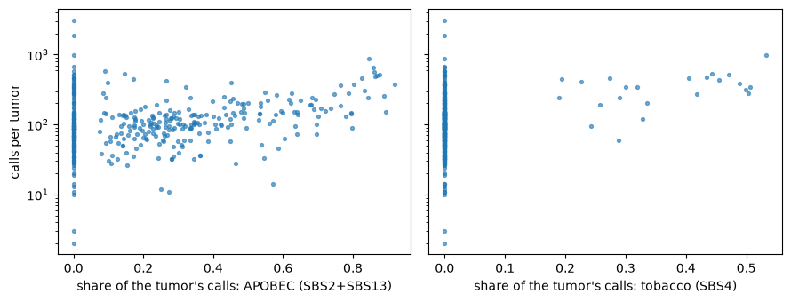
    


**Reading the figure.** Each point is a tumor. Burdens span two orders
of magnitude (from a handful of calls to over a thousand), so a single
"cohort rate" would describe almost no tumor: the model gives each
tumor its own rate, from its own burden and spectrum. A group of
tumors gets most of its mutations from APOBEC (left, the points to the
right), another from tobacco (right). APOBEC prefers a C in a TCW
context (a T, the C, then W = A or T), and two of the most common
mutations of this cancer, PIK3CA E545K and E542K, are C>T changes in
exactly that context. Keep that in mind for project (a).

The package draws every signature at once, tumor by tumor
(`figures.plot_sig_decomposition_with_burden`):


```python
from sigmutsel.figures import plot_sig_decomposition_with_burden

# The package draws at the size of a slide; a higher resolution
# makes it readable here.
with plt.rc_context({"figure.dpi": 200}):
    fig = plot_sig_decomposition_with_burden(
        burden, dataset.sig_assignments, show=True
    )
```


    
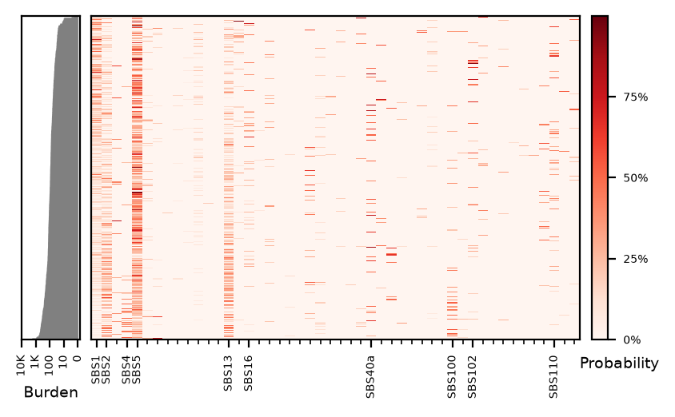
    


**Reading the figure.** One row per tumor, sorted by burden (left, on
a logarithmic axis; the lowest at the top). Each column of the
heatmap is a signature, labelled for the ten most active; the colour
is the share of the tumor's calls the decomposition gives it. Most
tumors are a mix of a few signatures: the clock-like SBS1 and SBS5
in most tumors, plus APOBEC or tobacco in some. Tumors with
few calls have noisy shares, the reason their rates lean on the
whole cohort's spectrum (the spectrum shrinkage of section 3).

## 5. Fit the neutral rate model

The rate of gene `g` in tumor `j` combines:

- the tumor's **spectrum and burden** (from the signatures);
- the gene's **opportunity** (its sites, by context and consequence,
  with the site weights);
- a **covariate** term `exp(c . x_g)`: genes that replicate late,
  sit in closed chromatin or are expressed less mutate faster. The
  vector `x_g` holds these properties of gene `g`, its
  **covariates** (below, summarized as principal components), and
  the vector `c`, the **coefficients**, says how much each one
  raises or lowers the rate; `c` is estimated in this step;
- a **channel factor**: non-synonymous sites get their own
  intercept;
- a per-gene **rate correction** `r_g`, learned from the gene's own
  synonymous (silent) mutations, which selection barely touches.

The covariates come ready-made from Zenodo through **sigmutselcovs**:
the principal components of about 5,000 per-gene measurements
(expression, histone marks, chromatin accessibility, replication
timing) for this tissue, plus 0/1 indicators for genes missing part
of them. The production model for HNSC uses the first 300
components (`fitted_n_components` in the record's manifest, chosen
by held-out cross-validation); a smaller number fits faster.


```python
import json

import sigmutselcovs

components = sigmutselcovs.fetch_covariate_matrix(PROJECT)
files = sigmutselcovs.fetch_covariate_artifacts(
    PROJECT, artifacts=("pca_indicators", "pca_manifest")
)
indicators = pd.read_parquet(files["pca_indicators"])
N_COMPONENTS = json.loads(Path(files["pca_manifest"]).read_text())[
    "fitted_n_components"
]
design = pd.concat(
    [components.iloc[:, :N_COMPONENTS], indicators], axis=1
)
genes = dataset.contexts_by_gene.index
print(
    f"{N_COMPONENTS} components; {genes.isin(design.index).sum()} of "
    f"{len(genes)} dataset genes have covariates"
)
```

    300 components; 19147 of 19147 dataset genes have covariates


Now the model. `assign_cov_matrix` takes the design as given (no
second principal component analysis). `compute_channel_base_mus`
computes each tumor's type rates and each gene's baseline rate on both
channels, the share of a tumor's mutations that falls in a gene
following the tumor's own spectrum. `estimate_channel_rg_cov_effects`
fits the covariate effects `c`, the channel intercept and the
dispersion `theta` of `r_g` by Hamiltonian Monte Carlo (NUTS, 4
chains, in parallel if JAX sees 4 devices, checked first);
`sample="full"` keeps the posterior draws, which the selection
estimates below need. This fit is the slow step; the fitted model is
saved. If it prints "There are not enough devices to run parallel
chains", the chains are running one after another: the result is the
same, only slower (see "Chains, cores and `XLA_FLAGS`").

The page you are reading was run on one GPU (the box in section 0),
so below it prints `JAX devices: 1`; on a CPU it should print 4.


```python
import jax  # the numerical library the sampler runs on

print(
    f"JAX devices: {jax.local_device_count()}"
)  # 4: chains in parallel

model_dir = WORK / f"model_nc{N_COMPONENTS}"
if model_dir.is_dir():
    model = Model.load_model(model_dir)
    # A saved model loads its own copy of the dataset: hand it the
    # tables the selection estimates read.
    for table in ("multi_base_db", "homdel_db", "indel_db"):
        setattr(model.dataset, table, getattr(dataset, table))
    model.dataset.sample_qc_flags = dataset.sample_qc_flags
else:
    model = Model(dataset)
    model.assign_cov_matrix(design)
    model.compute_channel_base_mus()
    model.estimate_channel_rg_cov_effects(
        excluded_samples=EXCLUDED, include_drivers=True, sample="full"
    )
    model.save_model(model_dir)
print(f"theta = {model.rg_theta:.2f}")
```

    JAX devices: 1


    theta = 8.53


**What to check.**

- **Convergence.** The posterior's R-hat: every parameter's should
  be below 1.01 (much above means the chains disagree; rerun with
  more draws, or check the data).
- **`theta`**, the inverse dispersion of `r_g`: large `theta` means
  the covariates leave little gene-to-gene variation unexplained.
- **Fit to held-out data.** The honest check of a rate model is how
  well it predicts mutation counts it has not seen. Here we compute
  the R² of passenger genes' non-silent counts using `r_g` from their
  silent counts only (`compute_r_g_for_evaluation`): the non-silent
  counts were not used to correct the gene's rate, so the model is
  predicting them, not fitting them.


```python
import arviz as az

posterior = model.cov_effects_posteriors
rhat = az.rhat(posterior)
print("max R-hat:", float(max(rhat[v].max() for v in rhat.data_vars)))
r2, per_gene = model.estimate_passenger_genes_r2(
    excluded_samples=EXCLUDED,
    target="non_silent_counts",
    gene_scaling=model.compute_r_g_for_evaluation(),
    return_per_gene=True,  # also the observed/expected pair per gene
)
print(f"R² of passenger genes' non-silent counts: {r2:.3f}")
```

    max R-hat: 1.0048759607240831


    R² of passenger genes' non-silent counts: 0.741


```python
fig, ax = plt.subplots(figsize=(5, 4.5))
ax.scatter(
    per_gene["expected"],
    per_gene["observed"],
    s=3,
    alpha=0.3,
    color="C0",
    linewidths=0,
)
top = (
    max(per_gene["observed"].max(), per_gene["expected"].max()) * 1.5
)
ax.plot([0.01, top], [0.01, top], color="0.4", lw=1, ls="--")
ax.set_xscale("log")
# symlog: logarithmic above 1, linear below, so 0 counts can show.
ax.set_yscale("symlog", linthresh=1)
ax.set_ylim(-0.3, top)
ax.set_xlabel("expected non-silent mutations (model)")
ax.set_ylabel("observed non-silent mutations")
fig.tight_layout()
plt.show()
```


    
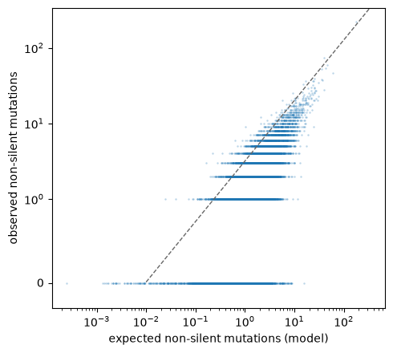
    


**Reading the figure.** One point per passenger gene, the pairs the
R² above is computed from: its non-silent mutations in the kept
tumors against the number the model expects, with `r_g` from the
gene's silent mutations only. The dashed line is "observed =
expected". A good rate model puts the cloud along it at every scale;
the spread around it shrinks, relative to the count, as the counts
grow, because small counts are noisy. A cloud tilted away from the
line, or bent at one end, means the rates are off for a whole class
of genes. The few genes at the top right weigh most in the R², which
is why it should not be read alone.


```python
from scipy import stats

r_g = model.compute_r_g_for_evaluation()
theta = model.rg_theta
fig, ax = plt.subplots(figsize=(5.5, 3.5))
ax.hist(
    r_g,
    bins=np.linspace(0, 4, 81),
    density=True,
    color="C0",
    alpha=0.6,
    label="genes' r_g",
)
grid = np.linspace(0.01, 4, 400)
ax.plot(
    grid,
    stats.gamma(a=theta, scale=1 / theta).pdf(grid),
    color="0.2",
    label=f"Gamma(theta, 1/theta), theta = {theta:.1f}",
)
ax.set_xlabel("r_g (gene's rate correction, from silent mutations)")
ax.set_ylabel("density")
ax.legend(frameon=False)
fig.tight_layout()
plt.show()
```


    
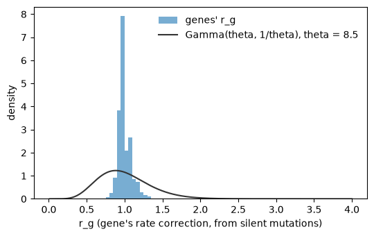
    


**Reading the figure.** The curve is the spread of `r_g` the model
allows before seeing a gene's silent mutations: centred at 1 (no
correction), and the narrower the larger `theta`. The bars are each
gene's estimate after seeing them. They gather more tightly at 1 than
the curve, because a gene with few silent mutations has little to
say and keeps a correction near 1; the genes far from 1 are those
whose many silent mutations show their rate really is higher or
lower than the covariates predict.

**Common mistakes at this step.**

- Using the *production* `r_g` (`compute_r_g_production`) to judge
  the fit: it is learned from both channels, so it partly predicts
  its own target and the R² looks better than it is.
- Reading R² as the measure of a rate model: a few heavily mutated
  genes carry most of its sum of squares. Compare models by held-out
  likelihood instead (the package's `cross_validation` module).
- Passing a different `excluded_samples` to later steps than to the
  fit: every per-gene sum is over the kept tumors.

## 6. Rates: per tumor, per gene, per variant

**Per gene.** `model.mu_gs` is a genes x tumors table: the expected
number of non-synonymous mutations of each gene in each tumor, from
the spectrum, opportunity, covariates and channel factor. It does
**not** include the gene's own correction `r_g`; multiply by it
yourself (`compute_r_g_for_evaluation` is the one learned from
silent mutations only, the one every selection estimate below uses).


```python
# A call's channel: syn (synonymous), esyn (synonymous at an exon end,
# which can act on splicing), mis (missense), non (nonsense), spl
# (essential splice). The non-silent channels are the last three.
NON_SILENT = ["mis", "non", "spl"]
r_g = model.compute_r_g_for_evaluation()
symbol = calls.drop_duplicates("ensembl_gene_id").set_index("gene")[
    "ensembl_gene_id"
]
kept = [t for t in model.mu_gs.columns if t not in EXCLUDED]
rows = []
for gene in ("TP53", "PIK3CA", "NOTCH1", "TTN", "MUC16"):
    gid = symbol[gene]
    rate = model.mu_gs.loc[gid, kept] * r_g.get(gid, 1.0)
    rows.append(
        {
            "gene": gene,
            "r_g": r_g.get(gid, np.nan),
            "median rate per tumor": rate.median(),
            "expected carriers": (1 - np.exp(-rate)).sum(),
            "observed carriers": calls.loc[
                (calls.gene == gene)
                & calls.channel.isin(NON_SILENT)
                & ~calls.Tumor_Sample_Barcode.isin(EXCLUDED),
                "Tumor_Sample_Barcode",
            ].nunique(),
        }
    )
pd.DataFrame(rows).set_index("gene").round(3)
```


<div>
<table border="1" class="dataframe">
  <thead>
    <tr style="text-align: right;">
      <th></th>
      <th>r_g</th>
      <th>median rate per tumor</th>
      <th>expected carriers</th>
      <th>observed carriers</th>
    </tr>
    <tr>
      <th>gene</th>
      <th></th>
      <th></th>
      <th></th>
      <th></th>
    </tr>
  </thead>
  <tbody>
    <tr>
      <th>TP53</th>
      <td>1.198</td>
      <td>0.003</td>
      <td>1.300</td>
      <td>187</td>
    </tr>
    <tr>
      <th>PIK3CA</th>
      <td>1.015</td>
      <td>0.009</td>
      <td>4.262</td>
      <td>50</td>
    </tr>
    <tr>
      <th>NOTCH1</th>
      <td>1.182</td>
      <td>0.022</td>
      <td>10.597</td>
      <td>42</td>
    </tr>
    <tr>
      <th>TTN</th>
      <td>1.049</td>
      <td>0.451</td>
      <td>136.229</td>
      <td>130</td>
    </tr>
    <tr>
      <th>MUC16</th>
      <td>0.717</td>
      <td>0.204</td>
      <td>78.960</td>
      <td>62</td>
    </tr>
  </tbody>
</table>
</div>


**Reading the table.** "Expected carriers" is how many of the kept
tumors would carry at least one non-synonymous mutation in the gene if
it were neutral (a tumor with rate `mu` carries one with probability
`1 - exp(-mu)`). TTN and MUC16 are among the most mutated genes of
every cancer, and their observed counts are near what their length and
late replication predict: they are long, not (much) selected. TP53 is
mutated in about 190 of the 332 kept tumors where neutral evolution
would put a non-synonymous mutation in about one. This comparison of
observed with expected is the whole idea; `gamma` makes it precise.

**Per variant.** `SiteRates` gives the rate of any single-nucleotide
variant, protein change or splice change in every tumor, whether it
was observed or not, without building a variants x tumors table
(here every possible single-nucleotide variant of the exome, about
105 million, by 392 tumors: some 330 GB of memory). A protein
change's rate is the sum over every single-base route to it
(PIK3CA E545K has one; a change with two possible codons has two).
The *observable* rate is the one to compare with calls (a germline-
masked allele can mutate but cannot be called).


```python
from sigmutsel.site_rates import SiteRates

site_rates = SiteRates.from_model(model, r_g="evaluation")
VARIANTS = [
    "PIK3CA p.E545K",
    "PIK3CA p.E542K",
    "PIK3CA p.H1047R",
    "HRAS p.G12S",
    "TP53 p.R248Q",
    "TP53 p.R175H",
]
info, _, observable = site_rates.variant_rates(VARIANTS)
info[["channel", "n_routes", "routes"]]
```


<div>
<table border="1" class="dataframe">
  <thead>
    <tr style="text-align: right;">
      <th></th>
      <th>channel</th>
      <th>n_routes</th>
      <th>routes</th>
    </tr>
    <tr>
      <th>variant</th>
      <th></th>
      <th></th>
      <th></th>
    </tr>
  </thead>
  <tbody>
    <tr>
      <th>PIK3CA p.E545K</th>
      <td>mis</td>
      <td>1</td>
      <td>T[C&gt;T]A</td>
    </tr>
    <tr>
      <th>PIK3CA p.E542K</th>
      <td>mis</td>
      <td>1</td>
      <td>T[C&gt;T]A</td>
    </tr>
    <tr>
      <th>PIK3CA p.H1047R</th>
      <td>mis</td>
      <td>1</td>
      <td>A[T&gt;C]G</td>
    </tr>
    <tr>
      <th>HRAS p.G12S</th>
      <td>mis</td>
      <td>1</td>
      <td>C[C&gt;T]G</td>
    </tr>
    <tr>
      <th>TP53 p.R248Q</th>
      <td>mis</td>
      <td>1</td>
      <td>C[C&gt;T]G</td>
    </tr>
    <tr>
      <th>TP53 p.R175H</th>
      <td>mis</td>
      <td>1</td>
      <td>G[C&gt;T]G</td>
    </tr>
  </tbody>
</table>
</div>


`observable` is variants x tumors. Its sum over the kept tumors is
the number of tumors expected to carry the variant by mutation
alone; the ratio of observed to expected is a first, crude look at
selection.


```python
carriers = (
    calls[~calls.Tumor_Sample_Barcode.isin(EXCLUDED)]
    .groupby("variant")["Tumor_Sample_Barcode"]
    .nunique()
)
kept_obs = observable.loc[:, observable.columns.isin(kept)]
rates = pd.DataFrame(
    {
        "observed carriers": carriers.reindex(VARIANTS).fillna(0),
        "expected carriers": kept_obs.sum(axis=1).to_numpy(),
        "median rate per tumor": kept_obs.median(axis=1).to_numpy(),
    },
    index=VARIANTS,
)
rates["observed / expected"] = (
    rates["observed carriers"] / rates["expected carriers"]
)
rates.style.format("{:.3g}")
```


<style type="text/css">
</style>
<table id="T_d8a52">
  <thead>
    <tr>
      <th class="blank level0" >&nbsp;</th>
      <th id="T_d8a52_level0_col0" class="col_heading level0 col0" >observed carriers</th>
      <th id="T_d8a52_level0_col1" class="col_heading level0 col1" >expected carriers</th>
      <th id="T_d8a52_level0_col2" class="col_heading level0 col2" >median rate per tumor</th>
      <th id="T_d8a52_level0_col3" class="col_heading level0 col3" >observed / expected</th>
    </tr>
  </thead>
  <tbody>
    <tr>
      <th id="T_d8a52_level0_row0" class="row_heading level0 row0" >PIK3CA p.E545K</th>
      <td id="T_d8a52_row0_col0" class="data row0 col0" >12</td>
      <td id="T_d8a52_row0_col1" class="data row0 col1" >0.00278</td>
      <td id="T_d8a52_row0_col2" class="data row0 col2" >4.54e-06</td>
      <td id="T_d8a52_row0_col3" class="data row0 col3" >4.32e+03</td>
    </tr>
    <tr>
      <th id="T_d8a52_level0_row1" class="row_heading level0 row1" >PIK3CA p.E542K</th>
      <td id="T_d8a52_row1_col0" class="data row1 col0" >13</td>
      <td id="T_d8a52_row1_col1" class="data row1 col1" >0.00288</td>
      <td id="T_d8a52_row1_col2" class="data row1 col2" >4.7e-06</td>
      <td id="T_d8a52_row1_col3" class="data row1 col3" >4.52e+03</td>
    </tr>
    <tr>
      <th id="T_d8a52_level0_row2" class="row_heading level0 row2" >PIK3CA p.H1047R</th>
      <td id="T_d8a52_row2_col0" class="data row2 col0" >6</td>
      <td id="T_d8a52_row2_col1" class="data row2 col1" >0.000666</td>
      <td id="T_d8a52_row2_col2" class="data row2 col2" >1.29e-06</td>
      <td id="T_d8a52_row2_col3" class="data row2 col3" >9e+03</td>
    </tr>
    <tr>
      <th id="T_d8a52_level0_row3" class="row_heading level0 row3" >HRAS p.G12S</th>
      <td id="T_d8a52_row3_col0" class="data row3 col0" >3</td>
      <td id="T_d8a52_row3_col1" class="data row3 col1" >0.00223</td>
      <td id="T_d8a52_row3_col2" class="data row3 col2" >5.13e-06</td>
      <td id="T_d8a52_row3_col3" class="data row3 col3" >1.35e+03</td>
    </tr>
    <tr>
      <th id="T_d8a52_level0_row4" class="row_heading level0 row4" >TP53 p.R248Q</th>
      <td id="T_d8a52_row4_col0" class="data row4 col0" >4</td>
      <td id="T_d8a52_row4_col1" class="data row4 col1" >0.00209</td>
      <td id="T_d8a52_row4_col2" class="data row4 col2" >4.8e-06</td>
      <td id="T_d8a52_row4_col3" class="data row4 col3" >1.92e+03</td>
    </tr>
    <tr>
      <th id="T_d8a52_level0_row5" class="row_heading level0 row5" >TP53 p.R175H</th>
      <td id="T_d8a52_row5_col0" class="data row5 col0" >6</td>
      <td id="T_d8a52_row5_col1" class="data row5 col1" >0.00237</td>
      <td id="T_d8a52_row5_col2" class="data row5 col2" >5.83e-06</td>
      <td id="T_d8a52_row5_col3" class="data row5 col3" >2.53e+03</td>
    </tr>
  </tbody>
</table>


**Reading the table.** A variant's rate is tiny (a few in a million
per tumor), so even the most frequent variants are expected in a small
fraction of one tumor across the whole cohort (0.003 tumors for
E545K). The ratio is thousands: these variants are among the most
strongly selected mutations in this cancer. The rates of variants of
the same gene differ: E545K and E542K are C>T changes in a TCA
context, APOBEC's favourite, and mutate about three and a half times
faster than H1047R (an A>G change). Project (a) is about exactly that
difference.


```python
# Each tumor's rate for two PIK3CA hotspots, coloured by APOBEC's share
# of its calls (section 4).
kept_tumors = [t for t in kept if t in observable.columns]
x = observable.loc["PIK3CA p.H1047R", kept_tumors]
y = observable.loc["PIK3CA p.E545K", kept_tumors]
fig, ax = plt.subplots(figsize=(5.5, 4.5))
points = ax.scatter(
    x,
    y,
    c=apobec.reindex(kept_tumors),
    cmap="viridis",
    vmin=0,
    vmax=1,
    s=10,
)
fig.colorbar(points, ax=ax, label="APOBEC share of the tumor's calls")
low = min(x[x > 0].min(), y[y > 0].min()) * 0.8
high = max(x.max(), y.max()) * 1.2
ax.plot([low, high], [low, high], color="0.4", lw=1, ls="--")
ax.set_xscale("log")
ax.set_yscale("log")
ax.set_xlabel("rate of PIK3CA H1047R in the tumor")
ax.set_ylabel("rate of PIK3CA E545K in the tumor")
fig.tight_layout()
plt.show()
```


    
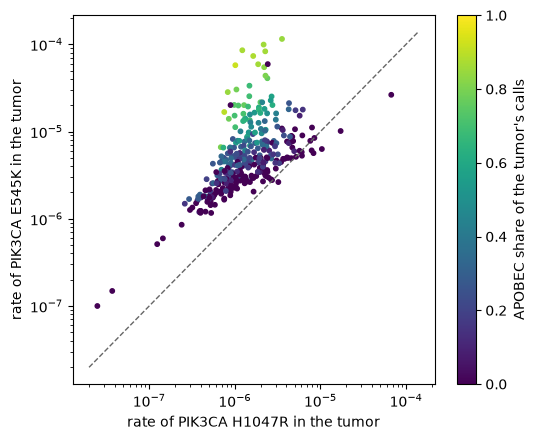
    


**Reading the figure.** One point per tumor; the dashed line is
"the same rate". The two hotspots are in the same gene, so the gene's
covariates and `r_g` are the same for both: the difference is the
tumor's spectrum alone. Rates span two orders of magnitude between
tumors, with the burden. Even tumors with little APOBEC (dark) sit
above the line, two to three times: C>T changes are common in every
tumor. APOBEC-rich ones (yellow) sit ten times above it or more,
because E545K is a C>T change in APOBEC's TCW context and H1047R an
A>G change it does not make. A cohort-wide rate would hide both
differences.

## 7. Selection coefficients for genes and variants

`estimate_gamma` estimates `gamma` for a gene (all its
non-synonymous sites together), a variant, or one consequence
channel of a gene. It compares, tumor by tumor, the probability
that a tumor carries the mutation given its rate and `gamma`, with
whether it does.

**The package's defaults are not the recommended settings** (they
are kept for reproducibility of older analyses). Pass these settings:


```python
model.estimate_gene_tumor_dispersion(excluded_samples=EXCLUDED)

GAMMA_SETTINGS = dict(
    excluded_samples=EXCLUDED,  # the QC-flagged tumors stay out
    use_mu_posterior=True,  # carry the rate model's uncertainty...
    mu_uncertainty="draws",  # ...exactly, over its posterior draws
    r_g_variant="evaluation",  # r_g from silent mutations only
    gene_tumor_dispersion="fitted",  # tumors differ beyond their rate
)
```

What each setting does:

- `use_mu_posterior=True, mu_uncertainty="draws"`: the rates are
  estimates, not known numbers. With these, gamma's interval
  averages over the rate model's posterior draws (the *cut*), so it
  is wide when the rates are uncertain. Without them the interval
  is too narrow.
- `r_g_variant="evaluation"`: the gene's rate correction from its
  silent mutations. The other one (`"production"`) has seen the
  non-silent mutations, so it would absorb part of the selection it
  is meant to measure.
- `gene_tumor_dispersion="fitted"`: mutations of a gene cluster in
  some tumors more than their rates predict. The dispersion `phi`
  is fitted on passenger genes (`estimate_gene_tumor_dispersion`,
  run above) and switched off where it does not improve held-out
  fit.

Tumors with a homozygous deletion of the gene, a coding indel in
it, or a doublet there are held out automatically (they met the
gene's pressure by an event the rates do not describe). For a
variant, tumors with *another* non-silent mutation in the same gene
are held out too.


```python
from sigmutsel.estimate_gammas import summarize_gamma


def gamma_row(item, **kwargs):
    """One gamma, summarized: posterior mean, 89% interval, carriers."""
    result = model.estimate_gamma(item, **GAMMA_SETTINGS, **kwargs)
    attrs = result.posterior.attrs
    return {
        "item": item
        + (f" ({kwargs['channel']})" if "channel" in kwargs else ""),
        **summarize_gamma(result),
        "carriers": attrs["n_tumors_with"],
        "tumors informative": attrs["n_tumors_informative"],
    }


GENES = [
    "TP53",
    "PIK3CA",
    "CDKN2A",
    "NOTCH1",
    "FAT1",
    "CASP8",
    "HRAS",
    "NSD1",
    "TTN",
    "MUC16",
]
gene_gammas = pd.DataFrame(
    [gamma_row(g, level="gene") for g in GENES]
).set_index("item")
gene_gammas.round(2)
```

    Gamma posterior summary:
          mean     sd eti89_lb eti89_ub  ess_bulk  ess_tail r_hat mcse_mean mcse_sd
    gamma  623  2e+02      350     1000      4165      3938  1.00       3.6     5.3


    Gamma posterior summary:
           mean   sd eti89_lb eti89_ub  ess_bulk  ess_tail r_hat mcse_mean mcse_sd
    gamma  18.7  7.3      9.9       32      4165      3938  1.00      0.11    0.13


    Gamma posterior summary:
          mean   sd eti89_lb eti89_ub  ess_bulk  ess_tail r_hat mcse_mean mcse_sd
    gamma  225  113      100      430      4165      3938  1.00       1.7     2.2


    Gamma posterior summary:
          mean    sd eti89_lb eti89_ub  ess_bulk  ess_tail r_hat mcse_mean mcse_sd
    gamma  7.1  2.53        4       12      4165      3938  1.00     0.038   0.047


    Gamma posterior summary:
           mean    sd eti89_lb eti89_ub  ess_bulk  ess_tail r_hat mcse_mean mcse_sd
    gamma  4.27  1.39      2.5      6.8      4165      3938  1.00     0.021   0.019


    Gamma posterior summary:
           mean    sd eti89_lb eti89_ub  ess_bulk  ess_tail r_hat mcse_mean mcse_sd
    gamma  30.6  13.3       15       54      4165      3938  1.00       0.2    0.25


    Gamma posterior summary:
           mean    sd eti89_lb eti89_ub  ess_bulk  ess_tail r_hat mcse_mean mcse_sd
    gamma  44.3  20.5       20       80      4165      3938  1.00      0.31    0.39


    Gamma posterior summary:
          mean   sd eti89_lb eti89_ub  ess_bulk  ess_tail r_hat mcse_mean mcse_sd
    gamma  8.3  3.6      4.2       15      4165      3938  1.00     0.054   0.071


    Gamma posterior summary:
            mean     sd eti89_lb eti89_ub  ess_bulk  ess_tail r_hat mcse_mean mcse_sd
    gamma  1.455  0.268      1.1      1.9      4165      3938  1.00    0.0041  0.0037


    Gamma posterior summary:
            mean     sd eti89_lb eti89_ub  ess_bulk  ess_tail r_hat mcse_mean mcse_sd
    gamma  1.137  0.311     0.72      1.7      4165      3938  1.00    0.0048  0.0044


<div>
<table border="1" class="dataframe">
  <thead>
    <tr style="text-align: right;">
      <th></th>
      <th>mean</th>
      <th>lower</th>
      <th>upper</th>
      <th>upper_bound_only</th>
      <th>carriers</th>
      <th>tumors informative</th>
    </tr>
    <tr>
      <th>item</th>
      <th></th>
      <th></th>
      <th></th>
      <th></th>
      <th></th>
      <th></th>
    </tr>
  </thead>
  <tbody>
    <tr>
      <th>TP53</th>
      <td>622.85</td>
      <td>347.16</td>
      <td>1033.45</td>
      <td>False</td>
      <td>187</td>
      <td>104</td>
    </tr>
    <tr>
      <th>PIK3CA</th>
      <td>18.66</td>
      <td>9.92</td>
      <td>31.56</td>
      <td>False</td>
      <td>50</td>
      <td>280</td>
    </tr>
    <tr>
      <th>CDKN2A</th>
      <td>225.03</td>
      <td>100.24</td>
      <td>427.58</td>
      <td>False</td>
      <td>52</td>
      <td>197</td>
    </tr>
    <tr>
      <th>NOTCH1</th>
      <td>7.10</td>
      <td>3.97</td>
      <td>11.54</td>
      <td>False</td>
      <td>42</td>
      <td>276</td>
    </tr>
    <tr>
      <th>FAT1</th>
      <td>4.27</td>
      <td>2.46</td>
      <td>6.78</td>
      <td>False</td>
      <td>47</td>
      <td>258</td>
    </tr>
    <tr>
      <th>CASP8</th>
      <td>30.65</td>
      <td>15.13</td>
      <td>54.46</td>
      <td>False</td>
      <td>27</td>
      <td>302</td>
    </tr>
    <tr>
      <th>HRAS</th>
      <td>44.31</td>
      <td>20.34</td>
      <td>80.42</td>
      <td>False</td>
      <td>17</td>
      <td>313</td>
    </tr>
    <tr>
      <th>NSD1</th>
      <td>8.30</td>
      <td>4.21</td>
      <td>14.77</td>
      <td>False</td>
      <td>33</td>
      <td>284</td>
    </tr>
    <tr>
      <th>TTN</th>
      <td>1.45</td>
      <td>1.07</td>
      <td>1.90</td>
      <td>False</td>
      <td>130</td>
      <td>198</td>
    </tr>
    <tr>
      <th>MUC16</th>
      <td>1.14</td>
      <td>0.72</td>
      <td>1.68</td>
      <td>False</td>
      <td>62</td>
      <td>268</td>
    </tr>
  </tbody>
</table>
</div>


**Reading the table.** `mean`, `lower` and `upper` are the posterior
mean of gamma and its 89% interval; `tumors informative` are the
tumors without the mutation that entered the fit (the held-out ones
are not). TP53's gamma, about 600, says a TP53 non-silent mutation is
found in tumors about 600 times more often than its rate predicts: it
is the **strength of selection** on the gene (relative to neutral
evolution), comparable to other genes' gammas. MUC16 sits at 1; TTN at
about 1.5, with an interval just above 1: a modest excess, and TTN is
not called in section 8: among 19,000 genes some intervals exclude 1
by chance, and TTN, the longest gene, is always among the genes one
looks at first.

Two cautions. A *gene* gamma averages over all the gene's
non-synonymous sites: for an oncogene, a few selected hotspots
among hundreds of neutral sites give a modest gene gamma (PIK3CA,
HRAS), and its variant gammas are the effect sizes to report. And
one interval above 1 is not a selection call: across 19,000 genes
many neutral genes have intervals above 1 by chance. The call is
section 8.

**Per channel.** For a tumor suppressor, the predicted
loss-of-function channel (`"plof"`: nonsense and essential splice)
carries the selection, for an oncogene the missense channel
(`"mis"`); the synonymous channel (`"syn"`) is a
control, expected near 1.


```python
channel_gammas = pd.DataFrame(
    [
        gamma_row(g, level="gene", channel=ch)
        for g in ("TP53", "NOTCH1", "PIK3CA")
        for ch in ("mis", "plof", "syn")
    ]
).set_index("item")
channel_gammas.round(2)
```

    Gamma posterior summary:
          mean   sd eti89_lb eti89_ub  ess_bulk  ess_tail r_hat mcse_mean mcse_sd
    gamma  378  140      210      620      4165      3938  1.00       2.1     2.7


    Gamma posterior summary:
            mean     sd eti89_lb eti89_ub  ess_bulk  ess_tail r_hat mcse_mean mcse_sd
    gamma  9e+02  4e+02      490     1600      4165      3938  1.00       5.7     7.2


    Gamma posterior summary:
           mean   sd eti89_lb eti89_ub  ess_bulk  ess_tail r_hat mcse_mean mcse_sd
    gamma  10.8  7.7      2.6       24      4165      3938  1.00      0.12    0.17


    Gamma posterior summary:
          mean    sd eti89_lb eti89_ub  ess_bulk  ess_tail r_hat mcse_mean mcse_sd
    gamma    6  2.19      3.3      9.9      4165      3938  1.00     0.033   0.038


    Gamma posterior summary:
           mean    sd eti89_lb eti89_ub  ess_bulk  ess_tail r_hat mcse_mean mcse_sd
    gamma  22.2  10.4      9.5       41      4165      3938  1.00      0.16    0.18


    Gamma posterior summary:
           mean    sd eti89_lb eti89_ub  ess_bulk  ess_tail r_hat mcse_mean mcse_sd
    gamma  1.99  1.08     0.73      3.9      4165      3938  1.00     0.016   0.022


    Gamma posterior summary:
           mean   sd eti89_lb eti89_ub  ess_bulk  ess_tail r_hat mcse_mean mcse_sd
    gamma  21.9  8.7       11       37      4165      3938  1.00      0.13    0.19


    Gamma posterior summary:
           mean sd eti89_lb eti89_ub  ess_bulk  ess_tail r_hat mcse_mean mcse_sd
    gamma  2.66  3     0.13        8      4165      3938  1.00     0.046   0.085


    Gamma posterior summary:
           mean   sd eti89_lb eti89_ub  ess_bulk  ess_tail r_hat mcse_mean mcse_sd
    gamma  2.67  2.2     0.42      6.7      4165      3938  1.00     0.034   0.052


<div>
<table border="1" class="dataframe">
  <thead>
    <tr style="text-align: right;">
      <th></th>
      <th>mean</th>
      <th>lower</th>
      <th>upper</th>
      <th>upper_bound_only</th>
      <th>carriers</th>
      <th>tumors informative</th>
    </tr>
    <tr>
      <th>item</th>
      <th></th>
      <th></th>
      <th></th>
      <th></th>
      <th></th>
      <th></th>
    </tr>
  </thead>
  <tbody>
    <tr>
      <th>TP53 (mis)</th>
      <td>378.00</td>
      <td>210.55</td>
      <td>615.04</td>
      <td>False</td>
      <td>143</td>
      <td>147</td>
    </tr>
    <tr>
      <th>TP53 (plof)</th>
      <td>943.66</td>
      <td>492.29</td>
      <td>1593.95</td>
      <td>False</td>
      <td>55</td>
      <td>229</td>
    </tr>
    <tr>
      <th>TP53 (syn)</th>
      <td>10.78</td>
      <td>2.57</td>
      <td>24.30</td>
      <td>False</td>
      <td>2</td>
      <td>330</td>
    </tr>
    <tr>
      <th>NOTCH1 (mis)</th>
      <td>6.00</td>
      <td>3.29</td>
      <td>9.87</td>
      <td>False</td>
      <td>34</td>
      <td>284</td>
    </tr>
    <tr>
      <th>NOTCH1 (plof)</th>
      <td>22.17</td>
      <td>9.48</td>
      <td>40.83</td>
      <td>False</td>
      <td>8</td>
      <td>308</td>
    </tr>
    <tr>
      <th>NOTCH1 (syn)</th>
      <td>1.99</td>
      <td>0.73</td>
      <td>3.89</td>
      <td>False</td>
      <td>5</td>
      <td>327</td>
    </tr>
    <tr>
      <th>PIK3CA (mis)</th>
      <td>21.94</td>
      <td>11.43</td>
      <td>36.64</td>
      <td>False</td>
      <td>50</td>
      <td>280</td>
    </tr>
    <tr>
      <th>PIK3CA (plof)</th>
      <td>NaN</td>
      <td>NaN</td>
      <td>8.00</td>
      <td>True</td>
      <td>0</td>
      <td>330</td>
    </tr>
    <tr>
      <th>PIK3CA (syn)</th>
      <td>2.67</td>
      <td>0.42</td>
      <td>6.68</td>
      <td>False</td>
      <td>1</td>
      <td>331</td>
    </tr>
  </tbody>
</table>
</div>


```python
CHANNEL_COLORS = {"mis": "C0", "plof": "C3", "syn": "0.5"}
fig, ax = plt.subplots(figsize=(6, 3.6))
y = np.arange(len(channel_gammas))[::-1]
x_min = 0.1  # the left edge of the axis
for yi, (item, r) in zip(y, channel_gammas.iterrows()):
    color = CHANNEL_COLORS[item.split("(")[1].rstrip(")")]
    if r["upper_bound_only"]:
        # No carrier: only an upper bound, drawn as a dotted line from
        # the axis edge to the bound.
        ax.plot([x_min, r["upper"]], [yi, yi], ls=":", color=color)
        ax.plot(r["upper"], yi, marker="|", ms=8, color=color)
    else:
        ax.plot([r["lower"], r["upper"]], [yi, yi], color=color)
        ax.plot(r["mean"], yi, "o", ms=4, color=color)
# A thin line between genes (three channels each).
for yi in y[2::3][:-1]:
    ax.axhline(yi - 0.5, color="0.9", lw=0.8)
ax.axvline(1, color="0.6", lw=1, ls="--")
ax.set_xscale("log")
ax.set_xlim(x_min, channel_gammas["upper"].max() * 2)
ax.set_yticks(y, channel_gammas.index)
ax.set_xlabel("gamma (posterior mean, 89% interval)")
fig.tight_layout()
plt.show()
```


    
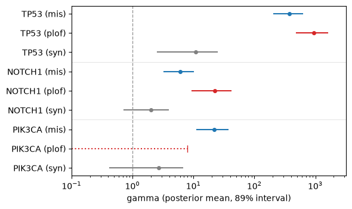
    


**Reading the figure.** The same table, on a logarithmic axis, with
the channels in colour (missense blue, pLoF red, synonymous grey).
The red pLoF points sit far right for the tumor suppressors (TP53,
NOTCH1); for the oncogene PIK3CA the blue missense point is the
selected one and the pLoF channel is only a dotted upper bound. The
grey synonymous controls should cross the dashed line at 1 (TP53's
does not: see the table's reading above).

**Reading the table.** TP53 is selected on both channels (its hotspot
missense mutations and its truncations). NOTCH1, a tumor suppressor
in this cancer, is selected mostly on `plof` (about 22, against 6 on
missense). PIK3CA, an oncogene, is selected on missense, and its
`plof` channel has no carrier: it is reported as an **upper bound
only** (`mean` and `lower` are NaN), how large gamma can be, not
where it is. The synonymous channel is the control: neutral by
design, so its gamma should cover 1. NOTCH1's and PIK3CA's do. TP53's
does not (about 11, on two carriers): with two calls the interval is
wide, and the usual suspects are synonymous changes that act on
splicing, or chance; it is a flag to look at the two calls, not a
verdict on the rates. A synonymous
gamma well above 1 in *many* genes would mean the rates are off.

**Variants.**


```python
variant_gammas = pd.DataFrame(
    [gamma_row(v, level="variant") for v in VARIANTS]
).set_index("item")
variant_gammas.round(0)
```

    Gamma posterior summary:
            mean     sd eti89_lb eti89_ub  ess_bulk  ess_tail r_hat mcse_mean mcse_sd
    gamma  7e+03  3e+03     2900    12000      4165      3938  1.00        48      71


    Gamma posterior summary:
            mean     sd eti89_lb eti89_ub  ess_bulk  ess_tail r_hat mcse_mean mcse_sd
    gamma  7e+03  4e+03     3200    14000      4165      3938  1.00        53      68


    Gamma posterior summary:
            mean     sd eti89_lb eti89_ub  ess_bulk  ess_tail r_hat mcse_mean mcse_sd
    gamma  1e+04  8e+03     5300    28000      4165      3938  1.00       120     170


    Gamma posterior summary:
            mean     sd eti89_lb eti89_ub  ess_bulk  ess_tail r_hat mcse_mean mcse_sd
    gamma  2e+03  1e+03      590     4700      4165      3938  1.00        22      34


    Gamma posterior summary:
            mean     sd eti89_lb eti89_ub  ess_bulk  ess_tail r_hat mcse_mean mcse_sd
    gamma  9e+03  6e+03     3100    19000      4165      3938  1.00        84     120


    Gamma posterior summary:
            mean     sd eti89_lb eti89_ub  ess_bulk  ess_tail r_hat mcse_mean mcse_sd
    gamma  1e+04  7e+03     4700    25000      4165      3938  1.00       100     140


<div>
<table border="1" class="dataframe">
  <thead>
    <tr style="text-align: right;">
      <th></th>
      <th>mean</th>
      <th>lower</th>
      <th>upper</th>
      <th>upper_bound_only</th>
      <th>carriers</th>
      <th>tumors informative</th>
    </tr>
    <tr>
      <th>item</th>
      <th></th>
      <th></th>
      <th></th>
      <th></th>
      <th></th>
      <th></th>
    </tr>
  </thead>
  <tbody>
    <tr>
      <th>PIK3CA p.E545K</th>
      <td>6586.0</td>
      <td>2915.0</td>
      <td>12073.0</td>
      <td>False</td>
      <td>12</td>
      <td>280</td>
    </tr>
    <tr>
      <th>PIK3CA p.E542K</th>
      <td>7240.0</td>
      <td>3218.0</td>
      <td>13562.0</td>
      <td>False</td>
      <td>13</td>
      <td>280</td>
    </tr>
    <tr>
      <th>PIK3CA p.H1047R</th>
      <td>14138.0</td>
      <td>5277.0</td>
      <td>28002.0</td>
      <td>False</td>
      <td>6</td>
      <td>280</td>
    </tr>
    <tr>
      <th>HRAS p.G12S</th>
      <td>2140.0</td>
      <td>587.0</td>
      <td>4715.0</td>
      <td>False</td>
      <td>3</td>
      <td>313</td>
    </tr>
    <tr>
      <th>TP53 p.R248Q</th>
      <td>9466.0</td>
      <td>3128.0</td>
      <td>19356.0</td>
      <td>False</td>
      <td>4</td>
      <td>104</td>
    </tr>
    <tr>
      <th>TP53 p.R175H</th>
      <td>12638.0</td>
      <td>4738.0</td>
      <td>24825.0</td>
      <td>False</td>
      <td>6</td>
      <td>104</td>
    </tr>
  </tbody>
</table>
</div>


```python
fig, ax = plt.subplots(figsize=(6, 4.5))
table = pd.concat([gene_gammas, variant_gammas])
y = np.arange(len(table))[::-1]
ax.errorbar(
    table["mean"],
    y,
    xerr=[
        table["mean"] - table["lower"],
        table["upper"] - table["mean"],
    ],
    fmt="o",
    ms=4,
    capsize=2,
)
ax.axvline(1, color="0.6", lw=1, ls="--")
ax.set_xscale("log")
ax.set_yticks(y, table.index)
ax.set_xlabel("gamma (posterior mean, 89% interval)")
fig.tight_layout()
plt.show()
```


    
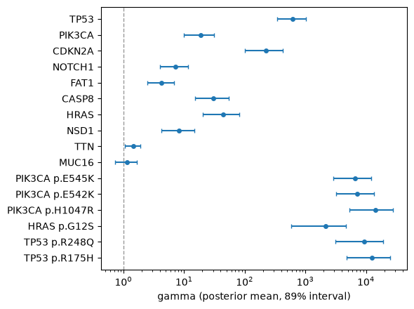
    


**Reading the figure.** The horizontal axis is logarithmic: the dashed
line is neutral (gamma = 1). Genes sit between about 1 and several
hundred (TP53, CDKN2A); hotspot variants at thousands, because a
variant gamma measures selection on one site, not averaged over a
gene's hundreds of sites. Intervals are wide for variants with few
carriers (HRAS G12S has three).

## 8. Is a gene selected, and how strongly?

Two questions, two answers, in one table over every gene:

- **The call.** A test of the null hypothesis that the gene is
  neutral (`gamma = 1`): how surprising its number of carrier tumors
  is under its rates, integrating over the uncertainty of `r_g`
  (`p_mid`, the mid-p-value: the probability of more carriers than
  observed plus half that of exactly as many). Then the
  Benjamini-Hochberg correction over all genes gives `q`, the
  adjusted p-value: calling the genes with `q < 0.1` (`called`)
  keeps the expected share of false calls among them, the false
  discovery rate, at most 10%.
- **The strength.** Gamma's posterior under an **empirical-Bayes (EB)
  prior**, one estimated from the data: a spike near 1 (most genes are
  neutral) plus a slab for the selected ones, both fitted on this
  cohort's genes. This prior shrinks the gammas of genes with little
  information toward 1, so they can be compared across genes: the
  columns `eb_median` and `eb_lower` to `eb_upper`, its 89% interval;
  `eb_p_above` is the posterior probability that gamma exceeds 2. The
  estimate under a flat prior, one that favours no value of gamma
  (columns `flat_*`), is kept beside it, as an estimate only, never as
  a call.

It takes a few minutes (it runs every gene; `n_jobs` processes).


```python
selection = model.gene_selection_table(
    excluded_samples=EXCLUDED, fdr=0.1, n_jobs=4
)
gene_of = calls.drop_duplicates("ensembl_gene_id").set_index(
    "ensembl_gene_id"
)["gene"]
selection.insert(0, "gene", gene_of.reindex(selection.index))
called = selection[selection.called].sort_values("q")
print(f"{len(called)} of {len(selection)} genes called at q < 0.1")
called[
    [
        "gene",
        "n_tumors_with",
        "expected_with",
        "q",
        "eb_median",
        "eb_lower",
        "eb_upper",
        "flat_median",
    ]
].head(20).round(3)
```

    22 of 19147 genes called at q < 0.1


<div>
<table border="1" class="dataframe">
  <thead>
    <tr style="text-align: right;">
      <th></th>
      <th>gene</th>
      <th>n_tumors_with</th>
      <th>expected_with</th>
      <th>q</th>
      <th>eb_median</th>
      <th>eb_lower</th>
      <th>eb_upper</th>
      <th>flat_median</th>
    </tr>
    <tr>
      <th>gene_id</th>
      <th></th>
      <th></th>
      <th></th>
      <th></th>
      <th></th>
      <th></th>
      <th></th>
      <th></th>
    </tr>
  </thead>
  <tbody>
    <tr>
      <th>ENSG00000064012</th>
      <td>CASP8</td>
      <td>27</td>
      <td>1.168</td>
      <td>0.000</td>
      <td>25.835</td>
      <td>13.919</td>
      <td>50.965</td>
      <td>27.949</td>
    </tr>
    <tr>
      <th>ENSG00000141510</th>
      <td>TP53</td>
      <td>187</td>
      <td>0.987</td>
      <td>0.000</td>
      <td>574.363</td>
      <td>347.658</td>
      <td>1034.633</td>
      <td>580.276</td>
    </tr>
    <tr>
      <th>ENSG00000147889</th>
      <td>CDKN2A</td>
      <td>52</td>
      <td>0.450</td>
      <td>0.000</td>
      <td>190.035</td>
      <td>103.468</td>
      <td>407.676</td>
      <td>196.170</td>
    </tr>
    <tr>
      <th>ENSG00000174775</th>
      <td>HRAS</td>
      <td>17</td>
      <td>0.480</td>
      <td>0.000</td>
      <td>35.553</td>
      <td>17.795</td>
      <td>75.089</td>
      <td>40.294</td>
    </tr>
    <tr>
      <th>ENSG00000121879</th>
      <td>PIK3CA</td>
      <td>50</td>
      <td>3.417</td>
      <td>0.000</td>
      <td>16.967</td>
      <td>9.861</td>
      <td>31.805</td>
      <td>17.669</td>
    </tr>
    <tr>
      <th>ENSG00000116044</th>
      <td>NFE2L2</td>
      <td>24</td>
      <td>1.436</td>
      <td>0.000</td>
      <td>18.045</td>
      <td>9.555</td>
      <td>35.985</td>
      <td>19.592</td>
    </tr>
    <tr>
      <th>ENSG00000148400</th>
      <td>NOTCH1</td>
      <td>42</td>
      <td>7.373</td>
      <td>0.000</td>
      <td>6.552</td>
      <td>3.924</td>
      <td>11.524</td>
      <td>6.771</td>
    </tr>
    <tr>
      <th>ENSG00000109670</th>
      <td>FBXW7</td>
      <td>22</td>
      <td>2.338</td>
      <td>0.000</td>
      <td>9.961</td>
      <td>5.561</td>
      <td>18.686</td>
      <td>10.732</td>
    </tr>
    <tr>
      <th>ENSG00000234745</th>
      <td>HLA-B</td>
      <td>11</td>
      <td>0.632</td>
      <td>0.000</td>
      <td>17.399</td>
      <td>8.019</td>
      <td>37.776</td>
      <td>20.748</td>
    </tr>
    <tr>
      <th>ENSG00000165671</th>
      <td>NSD1</td>
      <td>33</td>
      <td>5.578</td>
      <td>0.000</td>
      <td>7.300</td>
      <td>4.090</td>
      <td>13.905</td>
      <td>7.629</td>
    </tr>
    <tr>
      <th>ENSG00000206503</th>
      <td>HLA-A</td>
      <td>10</td>
      <td>0.614</td>
      <td>0.000</td>
      <td>16.082</td>
      <td>7.625</td>
      <td>34.036</td>
      <td>19.432</td>
    </tr>
    <tr>
      <th>ENSG00000083857</th>
      <td>FAT1</td>
      <td>47</td>
      <td>14.318</td>
      <td>0.001</td>
      <td>3.946</td>
      <td>2.363</td>
      <td>6.666</td>
      <td>4.026</td>
    </tr>
    <tr>
      <th>ENSG00000129474</th>
      <td>AJUBA</td>
      <td>11</td>
      <td>1.361</td>
      <td>0.003</td>
      <td>8.268</td>
      <td>1.890</td>
      <td>16.799</td>
      <td>9.490</td>
    </tr>
    <tr>
      <th>ENSG00000163513</th>
      <td>TGFBR2</td>
      <td>11</td>
      <td>1.374</td>
      <td>0.003</td>
      <td>8.118</td>
      <td>3.075</td>
      <td>17.072</td>
      <td>9.300</td>
    </tr>
    <tr>
      <th>ENSG00000079999</th>
      <td>KEAP1</td>
      <td>12</td>
      <td>1.743</td>
      <td>0.005</td>
      <td>7.019</td>
      <td>1.068</td>
      <td>14.238</td>
      <td>7.897</td>
    </tr>
    <tr>
      <th>ENSG00000136238</th>
      <td>RAC1</td>
      <td>7</td>
      <td>0.569</td>
      <td>0.007</td>
      <td>11.094</td>
      <td>1.039</td>
      <td>25.849</td>
      <td>14.409</td>
    </tr>
    <tr>
      <th>ENSG00000172819</th>
      <td>RARG</td>
      <td>9</td>
      <td>1.031</td>
      <td>0.008</td>
      <td>8.428</td>
      <td>1.037</td>
      <td>18.830</td>
      <td>10.092</td>
    </tr>
    <tr>
      <th>ENSG00000100393</th>
      <td>EP300</td>
      <td>21</td>
      <td>5.193</td>
      <td>0.044</td>
      <td>4.387</td>
      <td>1.034</td>
      <td>8.742</td>
      <td>4.615</td>
    </tr>
    <tr>
      <th>ENSG00000167548</th>
      <td>KMT2D</td>
      <td>35</td>
      <td>11.224</td>
      <td>0.044</td>
      <td>3.610</td>
      <td>1.059</td>
      <td>6.602</td>
      <td>3.700</td>
    </tr>
    <tr>
      <th>ENSG00000130538</th>
      <td>OR11H1</td>
      <td>6</td>
      <td>0.622</td>
      <td>0.065</td>
      <td>6.829</td>
      <td>1.008</td>
      <td>19.754</td>
      <td>11.532</td>
    </tr>
  </tbody>
</table>
</div>


**Reading the table.** Rows are genes by their Ensembl id (`ENSG...`),
with the symbol in `gene`. `n_tumors_with` are the carriers and
`expected_with` the carriers expected under neutrality. The genes at
the top are the known drivers of head and neck cancer (TP53, CDKN2A,
PIK3CA, CASP8, HRAS, NFE2L2, NOTCH1, FBXW7, NSD1, FAT1, HLA-A/B, ...).
Compare `eb_median` with `flat_median`: for a strongly selected gene
with many carriers they agree; for a gene with few carriers the EB
estimate is pulled toward 1. The pull is intended: across thousands of
genes, the flat estimates of genes with little data scatter widely by
chance, and the prior, learned from all genes, says how much.

**What to check.** Known passengers (TTN, MUC16) should not be called,
and are not. Near the bottom of the list there are genes you will not
find in a cancer gene list: OR11H1 (an olfactory receptor), and past
the 20 rows shown (`called.tail(3)`) NEK5 and CGB8 (one of a cluster
of near-identical copies). OR11H1 and CGB8 belong to multi-copy
families, where reads map to the wrong copy and calls pile up. A
called gene you do not recognise is a gene to examine (its calls, its
rates, its paralogs), not yet a discovery.


```python
fig, ax = plt.subplots(figsize=(5, 4.5))
ax.scatter(
    selection.expected_with,
    selection.n_tumors_with,
    s=4,
    color="0.7",
    label="not called",
)
ax.scatter(
    called.expected_with,
    called.n_tumors_with,
    s=12,
    color="C3",
    label="called, q < 0.1",
)
# Label the five strongest calls; the rest are red dots.
for _, r in called.head(5).iterrows():
    ax.annotate(
        r.gene,
        (r.expected_with, r.n_tumors_with),
        fontsize=8,
        xytext=(4, 2),
        textcoords="offset points",
    )
top = max(selection.n_tumors_with.max(), 1) * 1.5
ax.plot([0.01, top], [0.01, top], color="0.4", lw=1, ls="--")
ax.set_xscale("log")
# symlog: logarithmic above 1, linear below, so 0 carriers can show.
ax.set_yscale("symlog", linthresh=1)
ax.set_ylim(-0.3, top)
ax.set_xlabel("expected carrier tumors (neutral)")
ax.set_ylabel("observed carrier tumors")
ax.legend(frameon=False, loc="upper left")
fig.tight_layout()
plt.show()
```


    

    


**Reading the figure.** One point per gene. The dashed line is
"observed = expected": a neutral gene scatters around it, more widely
at small counts. Called genes sit far above it. Long genes (to the
right) can have many carriers and still sit on the line.

**The EB prior, and what it does.** The table fitted the prior and
kept it on the model (`model.selection_prior`). The figure below
draws it (left) and, for every gene, sets the estimate under the
flat prior against the one under the EB prior (right).


```python
from sigmutsel.selection import SpikeSlabPrior

prior = SpikeSlabPrior.from_dict(model.selection_prior)
# The prior is a mass on a grid of log gamma; divided by the grid
# step it is a density per unit of log gamma. The spike is a normal
# curve with the fitted centre, sd and weight; the slab is the rest.
step = prior.grid[1] - prior.grid[0]
gamma = np.exp(prior.grid)
density = np.exp(prior.log_density) / step
spike = np.exp(
    -0.5 * ((prior.grid - prior.spike_centre) / prior.spike_sd) ** 2
)
spike *= prior.spike_weight / (spike.sum() * step)
slab = np.clip(density - spike, 1e-12, None)

fig, axes = plt.subplots(1, 2, figsize=(9, 3.8))
ax = axes[0]
ax.plot(gamma, slab, color="C0", label="slab: genes away from 1")
ax.plot(gamma, spike, color="0.3", label="spike: neutral genes")
ax.axvline(1, color="0.6", lw=0.8, ls=":")
ax.set_xscale("log")
# Log density: the spike is thousands of times taller than the slab.
ax.set_yscale("log")
ax.set_ylim(1e-5, density.max() * 2)
ax.set_xlim(0.1, 1e4)
ax.set_xlabel("gamma")
ax.set_ylabel("prior density (per unit of log gamma)")
ax.legend(frameon=False, loc="upper right")
ax.text(
    0.03,
    0.04,
    f"spike: {prior.spike_weight:.1%} of the prior's mass",
    transform=ax.transAxes,
    fontsize=8,
)

ax = axes[1]
ax.scatter(
    selection.flat_median,
    selection.eb_median,
    s=4,
    color="0.7",
    label="not called",
)
ax.scatter(
    called.flat_median,
    called.eb_median,
    s=12,
    color="C3",
    label="called, q < 0.1",
)
lims = [0.1, max(selection.flat_median.max(), 10) * 1.5]
ax.plot(lims, lims, color="0.4", lw=1, ls="--")
ax.set_xscale("log")
ax.set_yscale("log")
ax.set_xlabel("gamma under the flat prior (median)")
ax.set_ylabel("gamma under the EB prior (median)")
ax.legend(frameon=False, loc="upper left")
fig.tight_layout()
plt.show()
```


    
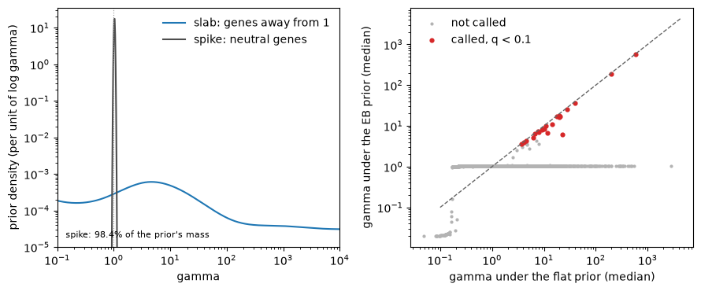
    


**Reading the figure.** Left: the prior puts almost all its mass in
a narrow spike at gamma close to 1, the neutral genes, and spreads
the rest thinly as a slab over values far from 1, mostly above. Its
shape is learned from all the cohort's genes at once. Right: one
point per gene; the dashed line is "the two estimates agree". Genes
with many carriers (the called ones, red) stay on it: their data
outweigh the prior. Genes with few carriers, whose flat estimate can
be anything from 0.1 to tens of thousands, form the horizontal band
at 1: the prior pulls them back, because the data cannot tell them
from the spike. That is what makes the EB estimates comparable
across genes, and why a large flat estimate on its own means little.

## 9. Project (a): frequency is not selection

Suppose a published paper ranked the mutations of head and neck
cancer by how often they occur, and called the most frequent the
most important. PIK3CA has three classic hotspots: E545K and E542K
in the helical domain, H1047R in the kinase domain. Which is the
most frequent, which mutates fastest, and which is the most strongly
selected?


```python
pik3ca = ["PIK3CA p.E545K", "PIK3CA p.E542K", "PIK3CA p.H1047R"]
project_a = rates.loc[
    pik3ca, ["observed carriers", "expected carriers"]
]
project_a = project_a.join(
    variant_gammas.loc[pik3ca, ["mean", "lower", "upper"]]
)
project_a.columns = [
    "carriers",
    "expected (neutral)",
    "gamma",
    "gamma lower",
    "gamma upper",
]
project_a.style.format("{:.3g}")
```


<style type="text/css">
</style>
<table id="T_d8508">
  <thead>
    <tr>
      <th class="blank level0" >&nbsp;</th>
      <th id="T_d8508_level0_col0" class="col_heading level0 col0" >carriers</th>
      <th id="T_d8508_level0_col1" class="col_heading level0 col1" >expected (neutral)</th>
      <th id="T_d8508_level0_col2" class="col_heading level0 col2" >gamma</th>
      <th id="T_d8508_level0_col3" class="col_heading level0 col3" >gamma lower</th>
      <th id="T_d8508_level0_col4" class="col_heading level0 col4" >gamma upper</th>
    </tr>
  </thead>
  <tbody>
    <tr>
      <th id="T_d8508_level0_row0" class="row_heading level0 row0" >PIK3CA p.E545K</th>
      <td id="T_d8508_row0_col0" class="data row0 col0" >12</td>
      <td id="T_d8508_row0_col1" class="data row0 col1" >0.00278</td>
      <td id="T_d8508_row0_col2" class="data row0 col2" >6.59e+03</td>
      <td id="T_d8508_row0_col3" class="data row0 col3" >2.92e+03</td>
      <td id="T_d8508_row0_col4" class="data row0 col4" >1.21e+04</td>
    </tr>
    <tr>
      <th id="T_d8508_level0_row1" class="row_heading level0 row1" >PIK3CA p.E542K</th>
      <td id="T_d8508_row1_col0" class="data row1 col0" >13</td>
      <td id="T_d8508_row1_col1" class="data row1 col1" >0.00288</td>
      <td id="T_d8508_row1_col2" class="data row1 col2" >7.24e+03</td>
      <td id="T_d8508_row1_col3" class="data row1 col3" >3.22e+03</td>
      <td id="T_d8508_row1_col4" class="data row1 col4" >1.36e+04</td>
    </tr>
    <tr>
      <th id="T_d8508_level0_row2" class="row_heading level0 row2" >PIK3CA p.H1047R</th>
      <td id="T_d8508_row2_col0" class="data row2 col0" >6</td>
      <td id="T_d8508_row2_col1" class="data row2 col1" >0.000666</td>
      <td id="T_d8508_row2_col2" class="data row2 col2" >1.41e+04</td>
      <td id="T_d8508_row2_col3" class="data row2 col3" >5.28e+03</td>
      <td id="T_d8508_row2_col4" class="data row2 col4" >2.8e+04</td>
    </tr>
  </tbody>
</table>


```python
fig, axes = plt.subplots(1, 3, figsize=(9, 2.8), sharey=True)
y = np.arange(len(pik3ca))[::-1]
labels = [v.split()[1] for v in pik3ca]
axes[0].barh(y, project_a["carriers"])
axes[0].set_xlabel("carrier tumors")
axes[1].barh(y, project_a["expected (neutral)"])
axes[1].set_xlabel("expected by mutation alone")
axes[2].errorbar(
    project_a["gamma"],
    y,
    xerr=[
        project_a["gamma"] - project_a["gamma lower"],
        project_a["gamma upper"] - project_a["gamma"],
    ],
    fmt="o",
    capsize=2,
)
axes[2].set_xlabel("gamma (89% interval)")
axes[0].set_yticks(y, labels)
fig.tight_layout()
plt.show()
```


    
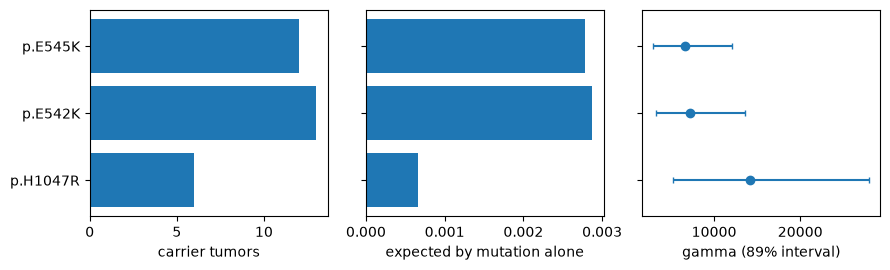
    


**Reading the figure.** The two helical-domain hotspots are the
frequent ones (12 and 13 carriers), and the kinase-domain H1047R has
half as many (6). But E545K and E542K mutate about three and a half
times faster: they are C>T changes in APOBEC's TCA context, and APOBEC
is active in many of these tumors (section 4). Once each is divided by
its own neutral rate, H1047R comes out the *most* strongly selected,
about twice the helical ones. Its interval overlaps theirs, so how
sure is that? From the posterior draws:


```python
draws = {
    v: np.asarray(model.gammas[v].posterior["gamma"]).ravel()
    for v in pik3ca
}
rng = np.random.default_rng(0)
for other in ("PIK3CA p.E545K", "PIK3CA p.E542K"):
    ratio = draws["PIK3CA p.H1047R"] / rng.permutation(draws[other])
    lo, hi = np.percentile(ratio, [5.5, 94.5])
    print(
        f"H1047R / {other.split()[1]}: {np.median(ratio):.2f} "
        f"[{lo:.2f}, {hi:.2f}], P(H1047R stronger) = "
        f"{(ratio > 1).mean():.2f}"
    )
```

    H1047R / p.E545K: 2.10 [0.67, 6.06], P(H1047R stronger) = 0.85
    H1047R / p.E542K: 1.91 [0.62, 5.60], P(H1047R stronger) = 0.82


The posterior favours stronger selection on H1047R, but with six
carriers it does not settle it: a frequency ranking puts the three
in the opposite order to the selection ranking, and the honest
statement is "H1047R is at least as strongly selected as the
helical hotspots despite being half as frequent". (The draws of two
gammas are paired at random: they share the rate model's
uncertainty, which this ignores, so the interval is if anything too
wide.) That frequency and strength of selection part ways in head
and neck cancer, and that APOBEC deaminates the E545K and E542K
sites, was shown with cancereffectsizeR's method by Cannataro et al.
(2019, *Oncogene* 38:3475-3487, doi:10.1038/s41388-018-0657-6): read
it beside this project.

**How to turn this into a letter.** State the claim you test (the
paper's ranking by frequency), show frequency, neutral expectation
and gamma side by side as here, for the paper's own variants, and
report gamma with its interval. Check that your conclusion does not
depend on one setting: refit with fewer covariate components, and
with `gene_tumor_dispersion=None`; a robust difference survives
both. And say what gamma is not: it is selection relative to the
variant's own neutral rate, under this rate model; a variant gamma
is conditional on the site-level rate model (sites recur somewhat
more often than it predicts), so read a difference of less than
about a factor of two between two variants with care.

## 10. Project (b): selection in two groups of tumors

Does selection on a gene differ between tumors with and without human
papillomavirus (HPV)? In HPV-positive tumors the virus's E6 protein
degrades p53, and its E7 protein inactivates RB, the pathway CDKN2A
guards: the virus does the work that TP53 and CDKN2A mutations do in
HPV-negative tumors, so selection on those genes should be weaker
there. HPV infection also switches on APOBEC, whose favourite context
holds the helical PIK3CA hotspots (E545K, E542K), so one might expect
those hotspots to be more frequent in HPV-positive tumors because they
mutate faster there. Whether they do is a question for the rates, not
for intuition. A comparison of mutation frequencies cannot separate
rate from selection; gamma can, because each tumor's rate includes its
own burden and spectrum.

**Step 1: the groups**, from the HPV calls of TCGA's PanCanAtlas
subtype table (from viral transcripts in each tumor's RNA), read from
the cBioPortal (public, no account).


```python
import requests

response = requests.get(
    "https://www.cbioportal.org/api/studies/"
    "hnsc_tcga_pan_can_atlas_2018/clinical-data",
    params={
        "clinicalDataType": "PATIENT",
        "attributeId": "SUBTYPE",  # HNSC_HPV+ or HNSC_HPV-
        "projection": "SUMMARY",
    },
    timeout=60,
)
subtype = {row["patientId"]: row["value"] for row in response.json()}
patient = pd.Series(kept, index=kept).str.slice(0, 12)
hpv = patient.map(subtype)
groups = {
    "HPV+": set(hpv.index[hpv == "HNSC_HPV+"]),
    "HPV-": set(hpv.index[hpv == "HNSC_HPV-"]),
}
print(
    {name: len(tumors) for name, tumors in groups.items()},
    "| no HPV call:",
    int(hpv.isna().sum()),
)
```

    {'HPV+': 57, 'HPV-': 262} | no HPV call: 13


**Step 2: one rate model, two gammas.** The rate model above was
fitted on all tumors; it already gives every tumor its own rates.
A group's gamma is estimated on that group's tumors alone, by
excluding everyone else. **Do not fit a separate rate model per
group**: the covariate effects and `r_g` are properties of genes,
best estimated on all tumors, and a small group's own fit would
make its rates noisier, not more specific.


```python
def group_gamma(item, level, group, **kwargs):
    """Gamma of ``item`` on one group's tumors: its posterior draws."""
    others = set(kept) - groups[group]
    settings = {
        **GAMMA_SETTINGS,
        "excluded_samples": EXCLUDED | others,
    }
    result = model.estimate_gamma(
        item, level=level, store=False, **settings, **kwargs
    )
    return np.asarray(result.posterior["gamma"]).ravel(), result


rows = []
# The numbers behind the table, kept for the figure.
summaries, ratios = {}, {}
for item, level in [
    ("TP53", "gene"),
    ("CDKN2A", "gene"),
    ("PIK3CA", "gene"),
    ("NOTCH1", "gene"),
    ("PIK3CA p.E545K", "variant"),
]:
    draws, row = {}, {"item": item}
    for group in groups:
        draws[group], result = group_gamma(item, level, group)
        s = summarize_gamma(result)
        summaries[item, group] = s
        row[f"{group} gamma"] = s["mean"]
        row[f"{group} 89%"] = f"[{s['lower']:.1f}, {s['upper']:.1f}]"
        row[f"{group} carriers"] = result.posterior.attrs[
            "n_tumors_with"
        ]
    # The ratio of the two gammas, from independent draws of each;
    # none when a group has no carrier (its gamma is only a bound).
    if any(summaries[item, g]["upper_bound_only"] for g in groups):
        ratios[item] = (np.nan, np.nan, np.nan)
        row["HPV+ / HPV-"] = np.nan
        row["ratio 89%"] = "no carrier in a group"
        row["P(HPV+ > HPV-)"] = np.nan
    else:
        log_ratio = np.log(draws["HPV+"]) - np.log(
            np.random.default_rng(0).permutation(draws["HPV-"])
        )
        lo, hi = np.exp(np.percentile(log_ratio, [5.5, 94.5]))
        ratios[item] = (float(np.exp(np.median(log_ratio))), lo, hi)
        row["HPV+ / HPV-"] = ratios[item][0]
        row["ratio 89%"] = f"[{lo:.2f}, {hi:.2f}]"
        row["P(HPV+ > HPV-)"] = float((log_ratio > 0).mean())
    rows.append(row)
group_table = pd.DataFrame(rows).set_index("item")
group_table
```

    Gamma posterior summary:
           mean  sd eti89_lb eti89_ub  ess_bulk  ess_tail r_hat mcse_mean mcse_sd
    gamma  47.7  29       16       98      4165      3938  1.00      0.43     0.6


    Gamma posterior summary:
            mean     sd eti89_lb eti89_ub  ess_bulk  ess_tail r_hat mcse_mean mcse_sd
    gamma  1e+03  4e+02      550     1700      4165      3938  1.00       5.7     6.5


    Gamma posterior summary:
           mean  sd eti89_lb eti89_ub  ess_bulk  ess_tail r_hat mcse_mean mcse_sd
    gamma  23.5  29        1       73      4165      3938  1.00      0.44    0.92


    Gamma posterior summary:
          mean   sd eti89_lb eti89_ub  ess_bulk  ess_tail r_hat mcse_mean mcse_sd
    gamma  299  152      130      580      4165      3938  1.00       2.3       3


    Gamma posterior summary:
           mean    sd eti89_lb eti89_ub  ess_bulk  ess_tail r_hat mcse_mean mcse_sd
    gamma  40.4  18.9       18       74      4165      3938  1.00      0.28    0.35


    Gamma posterior summary:
           mean   sd eti89_lb eti89_ub  ess_bulk  ess_tail r_hat mcse_mean mcse_sd
    gamma  15.7  6.6      8.1       27      4165      3938  1.00       0.1    0.15


    Gamma posterior summary:
           mean   sd eti89_lb eti89_ub  ess_bulk  ess_tail r_hat mcse_mean mcse_sd
    gamma  5.19  3.2      1.5       11      4165      3938  1.00     0.048   0.064


    Gamma posterior summary:
           mean   sd eti89_lb eti89_ub  ess_bulk  ess_tail r_hat mcse_mean mcse_sd
    gamma  7.59  2.8      4.2       12      4165      3938  1.00     0.042   0.051


    Gamma posterior summary:
            mean     sd eti89_lb eti89_ub  ess_bulk  ess_tail r_hat mcse_mean mcse_sd
    gamma  1e+04  8e+03     4200    28000      4165      3938  1.00       120     160


    Gamma posterior summary:
            mean     sd eti89_lb eti89_ub  ess_bulk  ess_tail r_hat mcse_mean mcse_sd
    gamma  6e+03  3e+03     2400    11000      4165      3938  1.00        47      65


<div>
<table border="1" class="dataframe">
  <thead>
    <tr style="text-align: right;">
      <th></th>
      <th>HPV+ gamma</th>
      <th>HPV+ 89%</th>
      <th>HPV+ carriers</th>
      <th>HPV- gamma</th>
      <th>HPV- 89%</th>
      <th>HPV- carriers</th>
      <th>HPV+ / HPV-</th>
      <th>ratio 89%</th>
      <th>P(HPV+ &gt; HPV-)</th>
    </tr>
    <tr>
      <th>item</th>
      <th></th>
      <th></th>
      <th></th>
      <th></th>
      <th></th>
      <th></th>
      <th></th>
      <th></th>
      <th></th>
    </tr>
  </thead>
  <tbody>
    <tr>
      <th>TP53</th>
      <td>47.654619</td>
      <td>[15.7, 98.1]</td>
      <td>4</td>
      <td>1010.193330</td>
      <td>[552.0, 1679.8]</td>
      <td>176</td>
      <td>0.043598</td>
      <td>[0.01, 0.12]</td>
      <td>0.00000</td>
    </tr>
    <tr>
      <th>CDKN2A</th>
      <td>NaN</td>
      <td>[nan, 73.0]</td>
      <td>0</td>
      <td>299.164397</td>
      <td>[130.1, 576.7]</td>
      <td>52</td>
      <td>NaN</td>
      <td>no carrier in a group</td>
      <td>NaN</td>
    </tr>
    <tr>
      <th>PIK3CA</th>
      <td>40.374263</td>
      <td>[18.2, 74.1]</td>
      <td>12</td>
      <td>15.693101</td>
      <td>[8.1, 27.2]</td>
      <td>35</td>
      <td>2.546037</td>
      <td>[0.97, 6.19]</td>
      <td>0.93825</td>
    </tr>
    <tr>
      <th>NOTCH1</th>
      <td>5.185211</td>
      <td>[1.5, 10.9]</td>
      <td>3</td>
      <td>7.588859</td>
      <td>[4.2, 12.4]</td>
      <td>38</td>
      <td>0.625570</td>
      <td>[0.19, 1.74]</td>
      <td>0.24050</td>
    </tr>
    <tr>
      <th>PIK3CA p.E545K</th>
      <td>13224.358991</td>
      <td>[4214.4, 27613.1]</td>
      <td>4</td>
      <td>5988.333890</td>
      <td>[2441.1, 11444.8]</td>
      <td>8</td>
      <td>2.149205</td>
      <td>[0.60, 6.78]</td>
      <td>0.83500</td>
    </tr>
  </tbody>
</table>
</div>


```python
from matplotlib import ticker  # axis tick placement and labels

items = list(group_table.index)
y = np.arange(len(items))[::-1]
fig, axes = plt.subplots(
    1,
    2,
    figsize=(9, 0.45 * len(items) + 1),
    sharey=True,
    width_ratios=[3, 2],
)
ax = axes[0]
x_min = (
    0.1  # the left edge: where an upper bound's dotted line starts
)
for group, offset, color in [
    ("HPV+", 0.15, "C1"),
    ("HPV-", -0.15, "C0"),
]:
    for yi, item in zip(y, items):
        s = summaries[item, group]
        if s["upper_bound_only"]:
            # No carrier in this group: only an upper bound, dotted.
            ax.plot(
                [x_min, s["upper"]],
                [yi + offset] * 2,
                ls=":",
                color=color,
            )
            ax.plot(
                s["upper"], yi + offset, marker="|", ms=8, color=color
            )
        else:
            ax.errorbar(
                s["mean"],
                yi + offset,
                xerr=[
                    [s["mean"] - s["lower"]],
                    [s["upper"] - s["mean"]],
                ],
                fmt="o",
                ms=4,
                capsize=2,
                color=color,
            )
    ax.plot(
        [], [], "o", ms=4, color=color, label=group
    )  # legend entry
ax.axvline(1, color="0.6", lw=1, ls="--")
ax.set_xscale("log")
if any(
    summaries[i, g]["upper_bound_only"] for i in items for g in groups
):
    ax.set_xlim(left=x_min)  # room for the dotted bounds
ax.set_yticks(y, items)
ax.set_xlabel("gamma (posterior mean, 89% interval)")
# A framed legend above the axes, so its markers are not read as data.
ax.legend(
    frameon=True, loc="lower left", bbox_to_anchor=(0, 1.02), ncol=2
)

ax = axes[1]
median, lower, upper = (
    np.array(v) for v in zip(*(ratios[i] for i in items))
)
ax.errorbar(
    median,
    y,
    xerr=[median - lower, upper - median],
    fmt="o",
    ms=4,
    capsize=2,
    color="0.2",
)
for yi, item in zip(y, items):
    if np.isnan(ratios[item][0]):
        ax.text(
            1,
            yi,
            "no carrier in a group",
            ha="center",
            va="center",
            fontsize=7,
            color="0.4",
            bbox={"facecolor": "white", "edgecolor": "none"},
        )
ax.axvline(1, color="0.6", lw=1, ls="--")
ax.set_xscale("log")
# Ticks at powers of 2 (1/4, 1/2, 1, 2, 4), fractions below 1.
ax.xaxis.set_major_locator(ticker.LogLocator(base=2))
ax.xaxis.set_major_formatter(
    ticker.FuncFormatter(
        lambda v, _: f"{v:g}" if v >= 1 else f"1/{1 / v:g}"
    )
)
ax.xaxis.set_minor_formatter(ticker.NullFormatter())
ax.set_xlabel("HPV+ / HPV- gamma (89%)")
fig.tight_layout()
plt.show()
```


    
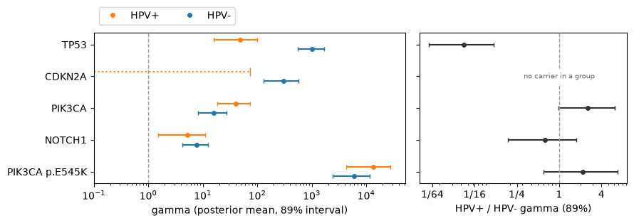
    


**Reading the figure.** Left: each gene's (and E545K's) gamma in the
two groups, HPV-positive orange, HPV-negative blue; right: the ratio
of the two, with the dashed line at "no difference". TP53 is selected
about twenty times more weakly in HPV-positive tumors (the ratio's
interval lies far below 1), and CDKN2A has no carrier among them at
all, only an upper bound (dotted): the virus inactivates both
pathways, so mutations in these genes bring little. PIK3CA leans the
other way, about two and a half times more strongly selected in
HPV-positive tumors, but the lower end of its interval sits at about
1: suggestive, not resolved. For NOTCH1 and E545K the cohort cannot
tell. The HPV-positive group is a fifth the size of the other, hence
its wider intervals; the width of a ratio's interval is the answer to
"how large a difference could this cohort have missed".

**Reading the table.** For TP53 the frequencies point the same way as
the gammas: 4 of the 57 HPV-positive tumors carry a mutation (7%),
against 176 of the 262 HPV-negative ones (67%). For E545K intuition
would mislead. It is in 7% of the HPV-positive tumors and 3% of the
HPV-negative ones, and APOBEC has a larger share of the HPV-positive
tumors' mutations (median 24% against 14%); but those tumors carry
fewer mutations (a median of 64 calls against 112), so E545K's rate
per tumor is in fact about half as high in them (`model.mu_ms`, the
median over each group). Its higher frequency there is not rate.
Whether it is selection the cohort cannot say: on 4 and 8 carriers the
ratio's interval runs from 0.6 to 6.8. That is a result worth
reporting as it is ("no evidence of a difference, and anything from
somewhat weaker to nearly seven times stronger cannot be excluded").

**How the uncertainty is computed, and what it leaves out.** The
ratio's interval comes from pairing independent draws of the two
groups' posteriors. Both gammas share the same rate model, and its
uncertainty (the covariate effects, `r_g`) moves both the same way;
pairing independent draws ignores that shared part, which makes
the ratio's interval somewhat *wider* than it should be. So a ratio
whose interval excludes 1 here is a conservative finding. A
`P(HPV+ > HPV-)` near 0.5 means no evidence of a difference,
not evidence of no difference: check the interval's width before
writing "the same".

**Common mistakes in group comparisons.**

- Comparing frequencies (or the fraction of tumors mutated) between
  groups whose burdens differ.
- Comparing two groups' gammas from two separately fitted rate
  models: their difference then mixes selection with the two fits'
  differences.
- Forgetting confounders. HPV-positive tumors are mostly in the
  oropharynx, and their patients smoke less: a difference between
  the groups may be one of anatomical site or of tobacco. Compare
  within one site (the oropharynx has both kinds) before attributing
  it to the virus.
- Testing many genes and reporting the few with intervals excluding
  1: correct for the number of genes compared, or decide the genes
  before looking.

## 11. The figures sigmutsel draws

The package has its own plotting functions (in `sigmutsel.figures`,
two of them also as methods of `Model`). Each returns its figure and
saves it when given a path (`save=`, or `save_path=` for the
correlations).

| function | what it draws | here |
|---|---|---|
| `figures.plot_sig_decomposition_with_burden` | each tumor's signature shares, tumors sorted by burden | section 4 |
| `figures.plot_signature_profile` | a 96-type profile: a signature, or a tumor's own spectrum | below |
| `Model.plot_gamma_results` | gammas and their intervals against the carriers | below |
| `figures.comparison_with_observed` | observed against expected counts per gene, with R² | below |
| `Model.plot_signature_correlations` | how each signature's mutations follow gene covariates | below |

**Signature profiles.** A signature is a probability over the 96
mutation types (six substitutions, each in 16 contexts of the bases
on either side). Two of HNSC's, and one tumor's own calls:


```python
from sigmutsel.figures import plot_signature_profile

signatures = dataset.signature_matrix
tumor = burden.idxmax()  # the tumor with the most calls
spectrum = (
    calls.loc[calls["Tumor_Sample_Barcode"] == tumor, "type"]
    .value_counts(normalize=True)
    .reindex(signatures.index, fill_value=0.0)
)
fig, axes = plt.subplots(3, 1, figsize=(9, 6.5))
for ax, profile, label in (
    (axes[0], signatures["SBS4"], "SBS4\n(tobacco)"),
    (axes[1], signatures["SBS2"], "SBS2\n(APOBEC)"),
    (axes[2], spectrum, f"one tumor\n({burden.max()} calls)"),
):
    plot_signature_profile(
        profile, ax=ax, ylabel=label, context_labels=False
    )
fig.tight_layout()
plt.show()
```


    
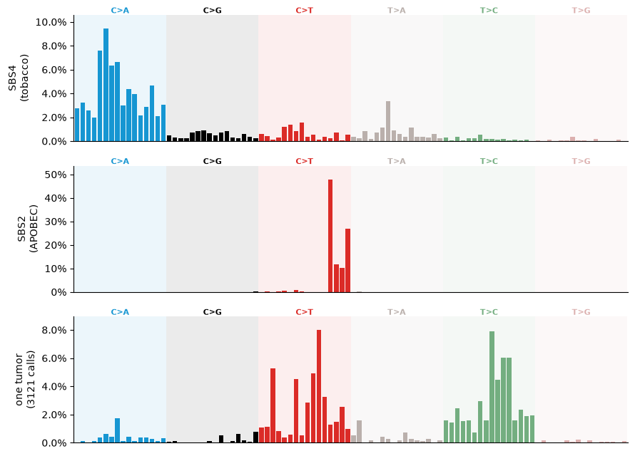
    


**Reading the figure.** Tobacco's SBS4 is mostly C>A (blue); APOBEC's
SBS2 is C>T (red), highest where a T precedes the C (its TCW context).
The tumor's own profile is the mixture its decomposition found, with
the noise of a finite number of calls.

**Gammas against carriers.** The gene gammas of section 7, with 89%
intervals, against the number of tumors carrying a non-silent
mutation in the gene. Passenger genes are open circles and Census
oncogenes diamonds:


```python
gene_keys = [
    k for k in model.gammas if k.startswith("ENSG") and "__" not in k
]
# The package draws at the size of a slide; a higher resolution
# makes it readable here.
with plt.rc_context({"figure.dpi": 200}):
    fig = model.plot_gamma_results(
        keys=gene_keys, level="gene", prob=0.89, show=True
    )
```


    
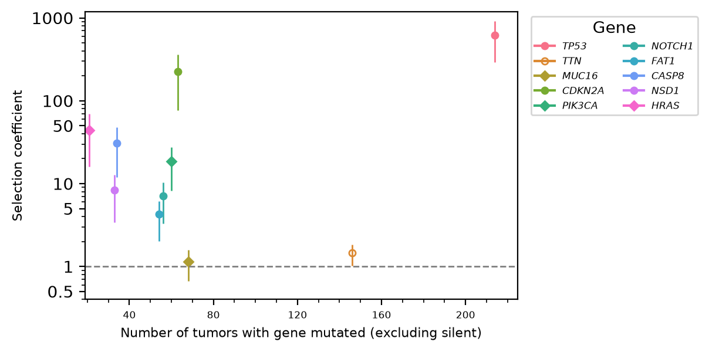
    


**Reading the figure.** Frequency and selection are different axes:
a gene can be mutated in many tumors and sit at 1 (TTN, MUC16: long
genes) or in fewer and sit far above it.

**Observed against expected, on linear axes.** The pairs of section
5's fit check, drawn by the package, with R² and the mean percentage
error written on the figure:


```python
from sigmutsel.figures import comparison_with_observed

# The package draws at the size of a slide; a higher resolution
# makes it readable here.
with plt.rc_context({"figure.dpi": 200}):
    fig = comparison_with_observed(
        per_gene["expected"], per_gene["observed"], show=True
    )
```


    
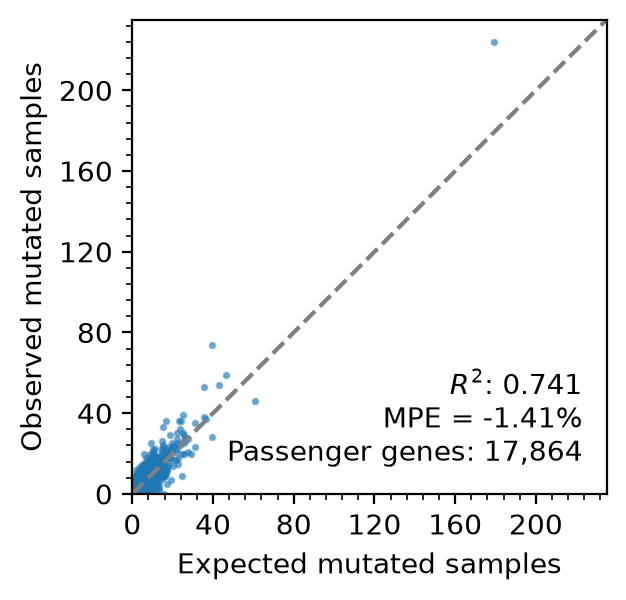
    


**Reading the figure.** On linear axes the few genes with the most
mutations stretch the scale and decide most of R², while the
thousands of genes with a handful of mutations pile up near the
origin; section 5's logarithmic version shows them. Read both.

**Signatures against covariates.** Each gene's calls are attributed to
the signatures (by each tumor's exposures and each signature's
probability of the call's type), and each signature's per-gene totals
are correlated with a few raw covariates, read by name from the
Zenodo record (only those columns are downloaded): mean replication
time, expression in the tumors, and two histone marks from the
Roadmap epigenome of esophagus (E079).


```python
RAW_COLUMNS = {
    "mrt": "replication time (late = 1)",
    "tpm_unstranded": "expression in the tumors",  # already in log
    "e079_h3k36me3_fc_signal_cds_span_logmean": "H3K36me3 (transcribed)",
    "e079_h3k9me3_fc_signal_cds_span_logmean": "H3K9me3 (heterochromatin)",
}
raw = sigmutselcovs.fetch_covariate_matrix(
    PROJECT, "full", columns=list(RAW_COLUMNS)
).rename(columns=RAW_COLUMNS)
# The package draws at the size of a slide; a higher resolution
# makes it readable here.
with plt.rc_context({"figure.dpi": 200}):
    fig, _, _ = model.plot_signature_correlations(
        covariates=raw, top_n=8, show=True
    )
```


    
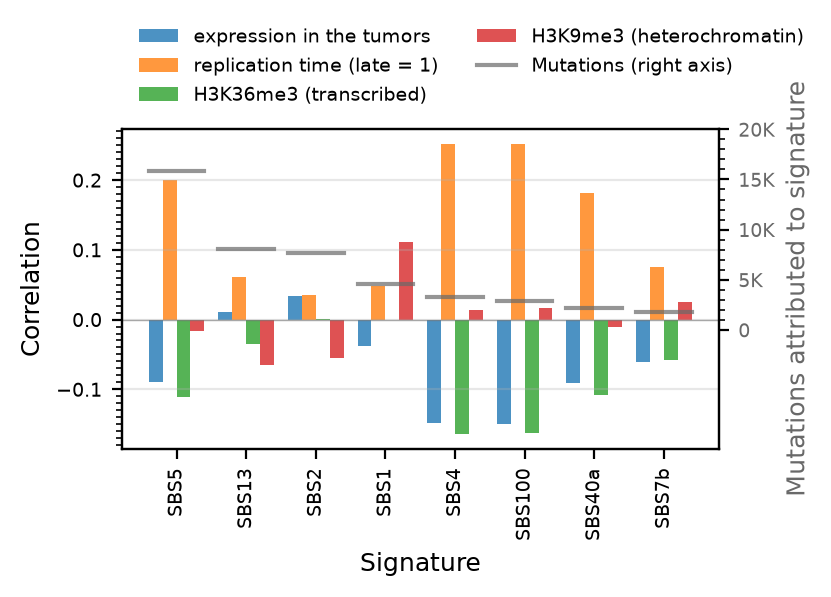
    


**Reading the figure.** For each of the eight signatures with the most
calls, one bar per covariate: the correlation, across genes, between
the signature's calls in the gene and the covariate; the grey line is
the number of calls attributed to the signature (right axis).
Replication time correlates positively with all eight, most for
tobacco's SBS4, SBS100 and the clock-like SBS5, and least for APOBEC's
SBS2 and SBS13, which follow replication timing little. Expression and
H3K36me3, the marks of transcribed genes, correlate negatively with
most (transcribed genes are repaired more); H3K9me3 is mixed. These
raw correlations also carry gene length (longer genes collect more
calls of every signature) and each other, so read them as a first
look; the model uses all covariates together, through their
components.

## 12. Reading the output correctly: a checklist

- **Gamma is the strength of selection**: how many times more
  often a mutation is found in tumors than its neutral rate
  predicts. It is not a probability of being a driver, not the
  mutation's fitness effect in absolute units, and not its
  "impact" on the patient.
- **Frequency is rate times selection.** A frequent mutation can be
  a fast-mutating site under modest selection; a rare one can be a
  slow site under strong selection. Always show the rate.
- **Compare genes with the EB estimates** (`eb_*`), not the flat
  ones; decide "selected or not" with `called` (`q`), not with an
  interval.
- **Gene gamma vs variant gamma.** For oncogenes, read variant (or
  missense-channel) gammas; for tumor suppressors, the `plof`
  channel.
- **A variant seen in one tumor** has a gamma set almost entirely
  by its rate (about 1/rate): ranking singletons by gamma ranks
  them by how slowly they mutate.
- **Near-neutral variant gammas are biased upward** by the
  same-gene hold-out (tumors with another hit in the gene, mostly
  high-burden ones, leave the variant's absent set): read a
  variant gamma of a few as possibly neutral.
- **mu_gs does not include r_g**; multiply by
  `compute_r_g_for_evaluation()` yourself.
- **QC consistency**: pass the same `excluded_samples` everywhere.

## 13. What next: project ideas

Each project below is a summer's work with this tutorial's tools.

1. **A letter on a frequency-based claim.** Find a published paper
   that ranks or compares mutations by frequency (or calls the most
   frequent mutation the main driver) and redo its comparison with
   rates and gammas, as in project (a).
2. **Selection by group.** Smokers and never-smokers in head and neck
   or lung cancer (`exposures.tobacco_smoking_status`, from the GDC's
   `cases` endpoint; `LUAD` is a larger cohort: run it on a server),
   young and old patients (`diagnoses.age_at_diagnosis`), sexes,
   molecular subtypes. Which genes' gammas differ, and which
   differences survive a confounder?
3. **APOBEC hotspots across cancers.** PIK3CA E545K/E542K in
   bladder (`BLCA`), cervical (`CESC`), breast (`BRCA`) and head and
   neck cancer: does the helical/kinase difference hold everywhere?
4. **The synonymous control.** Estimate the `syn` channel gamma for
   the 50 most mutated genes of a cohort. Which are above 1, and
   why (splicing, mapping, a rate error)?
5. **A cohort outside TCGA.** Any GRCh38 MAF works; skip the
   TCGA-specific sample QC, and give covariates with sigmutselcovs
   (`project_genes` places your genes in a TCGA cohort's
   components).

## Troubleshooting

- `RuntimeWarning: No installed GRCh38 genome`: run
  `sigmutsel-setup` (or `python -c "from sigmutsel.setup import
  install_reference_genome; install_reference_genome()"`), then
  rebuild the dataset: one built without the genome has other
  opportunities.
- `FileNotFoundError: ... not found ... python -m sigmutsel setup`:
  reference data missing; `sigmutsel-check-data` lists what is.
- The fit warns "There are not enough devices to run parallel
  chains" (and section 5 printed `JAX devices: 1`): `XLA_FLAGS`
  was set after JAX was imported, which happens when cells run out
  of order. Restart the kernel and run the first cell first; or
  leave it, since the chains then run one after another with the
  same result, only slower.
- Killed / out of memory during the dataset build: the build peaks
  at about 12 GB for this cohort; use a smaller cohort, or a
  machine with more memory.
- A gamma raises `ValueError`: the item is not in the dataset (check
  the spelling, `"GENE p.X123Y"`, and that it has a call in a kept
  tumor) or the gene has no rate.
- `estimate_gamma` returns quickly with a huge gamma and
  `likelihood_saturated` in its attributes: the data cannot bound
  it from above (all carriers, almost no rate); report it as a lower
  bound.
